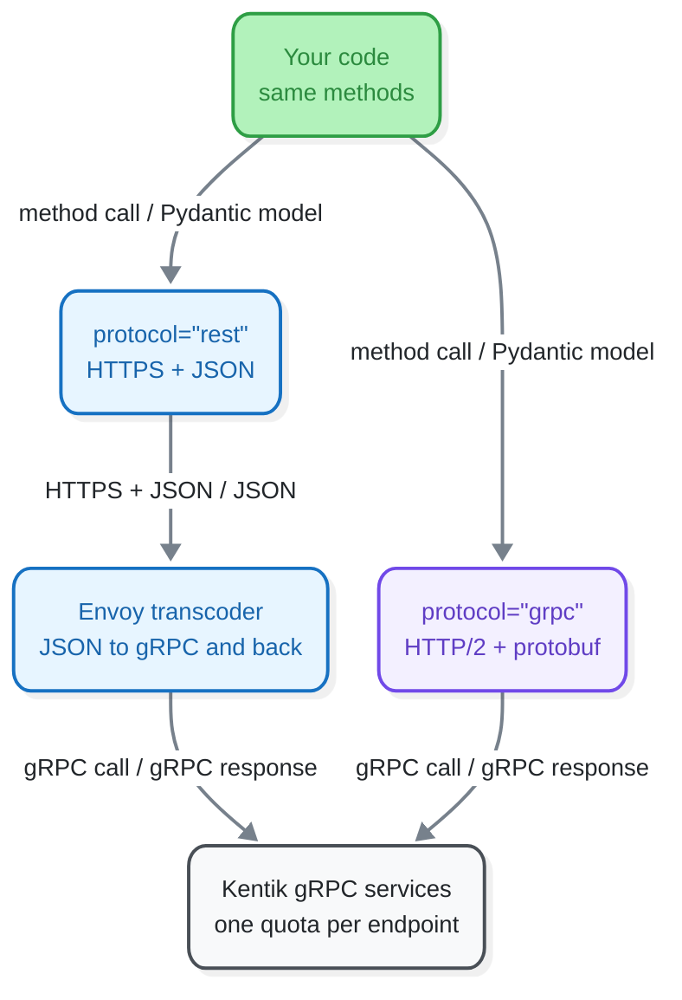

<!-- HAND-WRITTEN prose, except the `kentik-gen` marker blocks, which [`uv run poe generate`](../../../pyproject.toml) rewrites. Fix those in scripts/generation/docs_rendering.py. -->

# REST vs gRPC

`KentikAPI(protocol="rest")` and `KentikAPI(protocol="grpc")` give the same
service methods, and both return the same Pydantic models. This guide explains
where the two transports differ and how to choose one.

## Choosing a transport

Use REST unless you have a reason to use gRPC. The two transports behave the
same in most ways that matter, and REST covers every operation.

| Workload | Use | Why |
| --- | --- | --- |
| One-off script | REST | Every operation works. |
| CI or automation job | REST | A new operation in the job never raises `NotImplementedError`. |
| Sustained polling | Either | The per-endpoint quota is the limit, and both transports share it. |
| Long-running service | Either | Both transports cover every operation. Pick by the other rows in this guide. |
| Debugging an API problem | REST | You can read the body and reproduce the call with curl. |

This guide does not cover payload size, general speed, or behavior behind a
proxy. The project did not measure these three, so no advice here depends on
them.

## What is the same on both transports

| Behavior | Detail |
| --- | --- |
| Return type | The same Pydantic model, with equal contents. |
| Errors | The same exception class for the same failure. See the [error handling guide](error_handling.md). |
| Connection | One client keeps one connection (REST) or one channel (gRPC) and reuses it. |
| Timeout | Every call has one: 60 seconds by default, set with `timeout`. |
| Quota | One budget per endpoint, shared by both transports. |

Reuse one client for many calls, on both transports. The first call on a new
client pays for the TCP connection and the TLS handshake. In a measured run of
five `device.list` calls, the first call took 1.5 s on REST and 1.2 s on gRPC.
Later calls took 0.86 s and 0.76 s on average. Five calls are too few to rank
the transports. The run shows that a new client for each call adds hundreds of
milliseconds.

## How each transport works

| | REST | gRPC |
| --- | --- | --- |
| Protocol | HTTP/1.1 | HTTP/2 |
| Body | JSON (`application/json`) | Protobuf (`application/grpc`) |
| Readable without tools | Yes | No. Field numbers replace field names. |
| Reproduce with curl | Yes | No. `grpcurl` can, with the `.proto` files. |
| Runtime entry point | [`request_json()`](https://github.com/kentik/community_sdk_python/blob/main/src/kentik_api/core/rest_runtime.py) | [`call_grpc()`](https://github.com/kentik/community_sdk_python/blob/main/src/kentik_api/core/grpc_runtime.py) |

Each service method checks the transport once. On gRPC, the method converts
the request to a protobuf message and calls the stub through `call_grpc()`.
It then converts the response into the same Pydantic model that REST returns.

### Deadlines

A gRPC channel stays open while the client lives. By default, gRPC waits
forever for an answer.
[`GrpcTransport`](https://github.com/kentik/community_sdk_python/blob/main/src/kentik_api/transports/grpc_client.py)
adds the deadline of the client to every gRPC call that has none. A call to a
server that accepts the connection and never answers raises `TransportError`
at the deadline. To give one slow call more time, on either transport, use
`with_timeout()`:

```python
result = client.device.list(
    api_config_override=client.api_config.with_timeout(300),
)
```

Keep the 60-second default or raise it. An unthrottled `device.list` call
returns in about 0.6 s. Past Kentik's soft limit, the API delays each response
by up to 1.5 s and does not return an error. A short timeout therefore turns
throttling into a `TransportError`.

### Transport errors

`TransportError.may_have_reached_server` reports whether the request may have
reached Kentik. It is false for REST connection and pool failures that happen
before send. It is true for other REST failures and all gRPC transport errors.
True does not confirm that Kentik processed the request. Check the result before
you retry a write. See the [error handling guide](error_handling.md) for an
example.

### Errors that only gRPC has

`except KentikError:` catches every API, authentication, configuration, and
transport failure on both transports. It does not catch `NotImplementedError`,
which only gRPC raises (see below). Several gRPC codes share one HTTP status,
so an `HTTPException` from gRPC also keeps the original code in
`grpc_status_code`. For example, `ABORTED` and `ALREADY_EXISTS` both give
status 409.

## Both transports reach the same services

Kentik's REST API is a transcoding layer in front of the gRPC services: a
layer that converts each REST call into a gRPC call. An Envoy proxy receives
each REST request and converts it to a gRPC call. It then converts the gRPC
response back to JSON. Three headers on every REST response show this:

| Response header | What it shows |
| --- | --- |
| `server: envoy` | An Envoy proxy answered the request. |
| `grpc-status` | The status code of the gRPC call behind the REST call. |
| `grpc-message` | The error text of that gRPC call, when it failed. |

<!-- kentik-gen:transport-paths-explorer -->
<!-- github-only -->



<!-- /github-only -->
<!-- markdownlint-disable MD013 -->
<!-- sphinx-only
```{raw} html
<div class="kx">
<div class="chips" role="group" aria-label="Show one path" data-paths-for="transports-svg"></div>
<figure>
<div class="diagram explorer"><svg id="transports-svg" viewBox="0 0 1100 560" role="img" aria-label="Both clients reach the same Kentik gRPC services: REST through the Envoy transcoder, gRPC directly." xmlns="http://www.w3.org/2000/svg"><defs><marker id="tp-ah" viewBox="0 0 10 10" refX="8.5" refY="5" markerWidth="7" markerHeight="7" orient="auto-start-reverse"><path d="M0,0 L10,5 L0,10 z" class="ah"/></marker><marker id="tp-ah-hi" viewBox="0 0 10 10" refX="8.5" refY="5" markerWidth="7" markerHeight="7" orient="auto-start-reverse"><path d="M0,0 L10,5 L0,10 z" class="ah-hi"/></marker></defs><g class="edge call" data-seg="code_rest" data-links="code>restc"><path d="M450,56 L240,56 Q230,56 230,66 L230,170" data-route="M450,56 H230 V170" class="wire arrow" marker-end="url(#tp-ah)"/><text x="340" y="48" class="elabel" text-anchor="middle">method call</text></g><g class="edge data" data-seg="rest_code" data-links="restc>code"><path d="M290,170 L290,96 Q290,86 300,86 L450,86" data-route="M290,170 V86 H450" class="wire arrow" marker-end="url(#tp-ah)"/><text x="298" y="130" class="elabel" text-anchor="start">Pydantic model</text></g><g class="edge call" data-seg="code_grpc" data-links="code>grpcc"><path d="M650,56 L860,56 Q870,56 870,66 L870,170" data-route="M650,56 H870 V170" class="wire arrow" marker-end="url(#tp-ah)"/><text x="760" y="48" class="elabel" text-anchor="middle">method call</text></g><g class="edge data" data-seg="grpc_code" data-links="grpcc>code"><path d="M810,170 L810,96 Q810,86 800,86 L650,86" data-route="M810,170 V86 H650" class="wire arrow" marker-end="url(#tp-ah)"/><text x="802" y="130" class="elabel" text-anchor="end">Pydantic model</text></g><g class="edge call" data-seg="rest_envoy" data-links="restc>envoy"><path d="M230,242 V310" data-route="M230,242 V310" class="wire arrow" marker-end="url(#tp-ah)"/><text x="222" y="280" class="elabel" text-anchor="end">HTTPS + JSON</text></g><g class="edge data" data-seg="envoy_rest" data-links="envoy>restc"><path d="M290,310 V242" data-route="M290,310 V242" class="wire arrow" marker-end="url(#tp-ah)"/><text x="298" y="280" class="elabel" text-anchor="start">JSON</text></g><g class="edge call" data-seg="envoy_svc" data-links="envoy>svc"><path d="M290,382 L290,466 Q290,476 300,476 L450,476" data-route="M290,382 V476 H450" class="wire arrow" marker-end="url(#tp-ah)"/><text x="361" y="468" class="elabel" text-anchor="middle">gRPC call</text></g><g class="edge data" data-seg="svc_envoy" data-links="svc>envoy"><path d="M450,506 L240,506 Q230,506 230,496 L230,382" data-route="M450,506 H230 V382" class="wire arrow" marker-end="url(#tp-ah)"/><text x="340" y="524" class="elabel" text-anchor="middle">gRPC response</text></g><g class="edge call" data-seg="grpc_svc" data-links="grpcc>svc"><path d="M810,242 L810,466 Q810,476 800,476 L650,476" data-route="M810,242 V476 H650" class="wire arrow" marker-end="url(#tp-ah)"/><text x="802" y="420" class="elabel" text-anchor="end">gRPC call</text></g><g class="edge data" data-seg="svc_grpc" data-links="svc>grpcc"><path d="M650,506 L860,506 Q870,506 870,496 L870,242" data-route="M650,506 H870 V242" class="wire arrow" marker-end="url(#tp-ah)"/><text x="878" y="420" class="elabel" text-anchor="start">gRPC response</text></g><g class="node fam-green src " data-id="code" tabindex="0" role="button" aria-label="Select Your code"><rect x="450" y="30" width="200" height="72" rx="14"/><text x="550.0" y="62.5" class="nm">Your code</text><text x="550.0" y="79.5" class="ft">same methods</text></g><g class="node fam-blue proc " data-id="restc" tabindex="0" role="button" aria-label="Select KentikAPI(protocol=&quot;rest&quot;)"><rect x="160" y="170" width="200" height="72" rx="14"/><text x="260.0" y="202.5" class="nm">protocol=&quot;rest&quot;</text><text x="260.0" y="219.5" class="ft">HTTPS + JSON</text></g><g class="node fam-violet proc " data-id="grpcc" tabindex="0" role="button" aria-label="Select KentikAPI(protocol=&quot;grpc&quot;)"><rect x="740" y="170" width="200" height="72" rx="14"/><text x="840.0" y="202.5" class="nm">protocol=&quot;grpc&quot;</text><text x="840.0" y="219.5" class="ft">HTTP/2 + protobuf</text></g><g class="node fam-blue proc " data-id="envoy" tabindex="0" role="button" aria-label="Select Envoy transcoder"><rect x="160" y="310" width="200" height="72" rx="14"/><text x="260.0" y="342.5" class="nm">Envoy transcoder</text><text x="260.0" y="359.5" class="ft">JSON to gRPC and back</text></g><g class="node fam-neutral hub " data-id="svc" tabindex="0" role="button" aria-label="Select Kentik gRPC services"><rect x="450" y="450" width="200" height="72" rx="14"/><text x="550.0" y="482.5" class="nm">Kentik gRPC services</text><text x="550.0" y="499.5" class="ft">one quota per endpoint</text></g></svg></div>
<figcaption>Select a part. Each hop is a call going down and its answer coming back up. Both paths end at the same services, so both take from the same quota.</figcaption>
</figure>
<div class="legend" aria-hidden="true"><span><svg viewBox="0 0 34 10"><line x1="2" y1="5" x2="32" y2="5" stroke="var(--wire-hi)" stroke-linecap="round" stroke-width="3"/></svg>what the selected part needs</span><span><svg viewBox="0 0 34 10"><line x1="2" y1="5" x2="32" y2="5" stroke="var(--wire-hi)" stroke-linecap="round" stroke-width="3" stroke-dasharray="9 7"/></svg>where its data goes</span></div>
<div class="detail" data-detail-for="transports-svg" aria-live="polite"></div>
<script type="application/json" id="diagram-data">{"transports-svg": {"select": "svc", "parts": {"code": {"title": "Your code", "role": "Calls the same service methods on either client.", "facts": ["Both clients return the same Pydantic models"], "stops": "Nothing is sent."}, "restc": {"title": "KentikAPI(protocol=\"rest\")", "role": "Sends each call as an HTTPS request with a JSON body.", "facts": ["HTTP/1.1", "Every operation, V5 included"], "stops": "Expected: REST calls stop. A gRPC client keeps working."}, "grpcc": {"title": "KentikAPI(protocol=\"grpc\")", "role": "Sends each call as a gRPC call with a protobuf body.", "facts": ["HTTP/2", "Every V6 operation. V5 calls go over REST"], "stops": "Expected: gRPC calls stop. A REST client keeps working."}, "envoy": {"title": "Envoy transcoder", "role": "Converts each REST request into a gRPC call, and the answer back into JSON.", "facts": ["Answers with the header server: envoy", "Copies the gRPC status into grpc-status"], "stops": "Expected: REST calls fail. gRPC calls keep working."}, "svc": {"title": "Kentik gRPC services", "role": "The services behind both transports.", "facts": ["60 requests per 60 seconds for each endpoint", "REST and gRPC take from the same quota"], "stops": "Expected: both transports fail."}}, "paths": {"rest": {"label": "REST", "family": "blue", "title": "A REST call", "text": "Envoy converts the request into a gRPC call and the answer back into JSON.", "links": ["code>restc", "restc>envoy", "envoy>svc", "svc>envoy", "envoy>restc", "restc>code"]}, "grpc": {"label": "gRPC", "family": "violet", "title": "A gRPC call", "text": "The gRPC client calls the services directly.", "links": ["code>grpcc", "grpcc>svc", "svc>grpcc", "grpcc>code"]}}}}</script>
</div>
```
-->
<!-- markdownlint-enable MD013 -->
<!-- /kentik-gen:transport-paths-explorer -->

The two transports therefore share one quota. Kentik allows 60 requests per
60 seconds for each endpoint. A REST call and a gRPC call to the same endpoint
take from the same 60. In a measured run that alternated between the
transports, the remaining quota fell by one on each call: 59, 58, 57, 56, 55,
54. A change of transport does not give you more requests. See the
[rate limiting guide](rate_limiting.md) for the quota headers and the limits
that no header shows.

## What gRPC covers

REST covers every operation the SDK has. gRPC covers every V6 operation:

| Measure | Count |
| --- | --- |
| Services with a wrapper on the client | 37 |
| Services with no wrapper | 6 |
| Wrapper operations | 240 |
| Operations with a gRPC translation | 234 |
| V5 operations (`client.v5`), REST only | 6 |

The generator gives an operation a gRPC translation when an RPC declares the
same HTTP rule as the REST operation: the same proto service, HTTP verb, and
path. Every V6 operation in the current schema has such an RPC. The V5
endpoints exist only on REST, so `client.v5` sends its calls over REST on a
`protocol="grpc"` client too. See [V5 query and batch calls](v5.md).

The six services with no wrapper are `core`, `deviceconf`, `diagnostic`,
`kptr`, `monitoring`, and `net`. The SDK has models and proto stubs for them,
but no methods on the client, on either transport. The OpenAPI schema declares
no REST paths for them, and the SDK generates its wrappers from those paths.

### When gRPC raises `NotImplementedError`

On `protocol="grpc"`, a service method raises `NotImplementedError` in two
cases. The two have different causes and different fixes:

| Message | Cause | What to do |
| --- | --- | --- |
| `gRPC translation for <Operation> is not yet implemented.` | No RPC declares the operation's HTTP rule. No operation in the current schema is in this state. | Call it through a `protocol="rest"` client. |
| `gRPC proto modules for <service> service failed to import: <cause>` | The service's compiled proto modules failed to import when the client started. The cause names the import error, or a descriptor-pool conflict. | Repair the installation. Every other method of that service raises the same error. |

The first case is fixed and predictable: a schema change adds or removes it,
not the run. The second case depends on the environment.

A program that needs both transports can hold two clients:

```python
from kentik_api.client import KentikAPI

with (
    KentikAPI(protocol="grpc") as grpc_client,
    KentikAPI(protocol="rest") as rest_client,
):
    groups = grpc_client.as_group.list()
    packages = rest_client.mkp.package_list()
```
