<!-- AUTO-GENERATED: scripts/generation/endpoint_docs.py, render_endpoint_docs() -->
<!-- Rebuilt on every `uv run poe generate`. Do not edit by hand. -->

# Alerting Service

## Overview

<!-- github-only -->

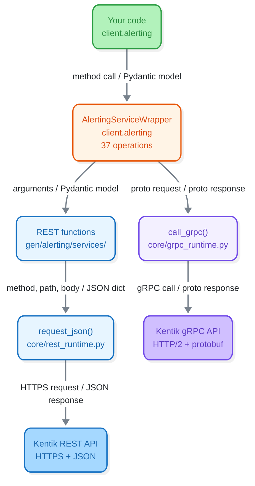

<!-- /github-only -->
<!-- markdownlint-disable MD013 -->
<!-- sphinx-only
```{raw} html
<div class="kx">
<div class="chips" role="group" aria-label="Show one path" data-paths-for="overview-svg"></div>
<figure>
<div class="diagram explorer"><svg id="overview-svg" viewBox="0 0 1100 680" role="img" aria-label="Call path of client.alerting: your code calls the wrapper, which sends the call over REST or gRPC." xmlns="http://www.w3.org/2000/svg"><defs><marker id="ov-ah" viewBox="0 0 10 10" refX="8.5" refY="5" markerWidth="7" markerHeight="7" orient="auto-start-reverse"><path d="M0,0 L10,5 L0,10 z" class="ah"/></marker><marker id="ov-ah-hi" viewBox="0 0 10 10" refX="8.5" refY="5" markerWidth="7" markerHeight="7" orient="auto-start-reverse"><path d="M0,0 L10,5 L0,10 z" class="ah-hi"/></marker></defs><g class="edge call" data-seg="code_call" data-links="code>wrap"><path d="M520,102 V170" data-route="M520,102 V170" class="wire arrow" marker-end="url(#ov-ah)"/><text x="512" y="140" class="elabel" text-anchor="end">method call</text></g><g class="edge data" data-seg="wrap_answer" data-links="wrap>code"><path d="M580,170 V102" data-route="M580,170 V102" class="wire arrow" marker-end="url(#ov-ah)"/><text x="588" y="140" class="elabel" text-anchor="start">Pydantic model</text></g><g class="edge call" data-seg="rest_call" data-links="wrap>rest"><path d="M450,196 L240,196 Q230,196 230,206 L230,310" data-route="M450,196 H230 V310" class="wire arrow" marker-end="url(#ov-ah)"/><text x="340" y="188" class="elabel" text-anchor="middle">arguments</text></g><g class="edge data" data-seg="rest_answer" data-links="rest>wrap"><path d="M290,310 L290,236 Q290,226 300,226 L450,226" data-route="M290,310 V226 H450" class="wire arrow" marker-end="url(#ov-ah)"/><text x="298" y="275" class="elabel" text-anchor="start">Pydantic model</text></g><g class="edge call" data-seg="rj_call" data-links="rest>rj"><path d="M230,382 V450" data-route="M230,382 V450" class="wire arrow" marker-end="url(#ov-ah)"/><text x="222" y="420" class="elabel" text-anchor="end">method, path, body</text></g><g class="edge data" data-seg="rj_answer" data-links="rj>rest"><path d="M290,450 V382" data-route="M290,450 V382" class="wire arrow" marker-end="url(#ov-ah)"/><text x="298" y="420" class="elabel" text-anchor="start">JSON dict</text></g><g class="edge call" data-seg="api_call" data-links="rj>restapi"><path d="M230,522 V590" data-route="M230,522 V590" class="wire arrow" marker-end="url(#ov-ah)"/><text x="222" y="560" class="elabel" text-anchor="end">HTTPS request</text></g><g class="edge data" data-seg="api_answer" data-links="restapi>rj"><path d="M290,590 V522" data-route="M290,590 V522" class="wire arrow" marker-end="url(#ov-ah)"/><text x="298" y="560" class="elabel" text-anchor="start">JSON response</text></g><g class="edge call" data-seg="cg_call" data-links="wrap>cg"><path d="M650,196 L860,196 Q870,196 870,206 L870,310" data-route="M650,196 H870 V310" class="wire arrow" marker-end="url(#ov-ah)"/><text x="760" y="188" class="elabel" text-anchor="middle">proto request</text></g><g class="edge data" data-seg="cg_answer" data-links="cg>wrap"><path d="M810,310 L810,236 Q810,226 800,226 L650,226" data-route="M810,310 V226 H650" class="wire arrow" marker-end="url(#ov-ah)"/><text x="802" y="275" class="elabel" text-anchor="end">proto response</text></g><g class="edge call" data-seg="grpc_call" data-links="cg>grpcapi"><path d="M810,382 V590" data-route="M810,382 V590" class="wire arrow" marker-end="url(#ov-ah)"/><text x="802" y="490" class="elabel" text-anchor="end">gRPC call</text></g><g class="edge data" data-seg="grpc_answer" data-links="grpcapi>cg"><path d="M870,590 V382" data-route="M870,590 V382" class="wire arrow" marker-end="url(#ov-ah)"/><text x="878" y="490" class="elabel" text-anchor="start">proto response</text></g><g class="node fam-green src " data-id="code" tabindex="0" role="button" aria-label="Select Your code"><rect x="450" y="30" width="200" height="72" rx="14"/><text x="550.0" y="62.5" class="nm">Your code</text><text x="550.0" y="79.5" class="ft">client.alerting</text></g><g class="node fam-orange proc " data-id="wrap" tabindex="0" role="button" aria-label="Select AlertingServiceWrapper"><rect x="450" y="170" width="200" height="72" rx="14"/><text x="550.0" y="194.0" class="nm">AlertingServiceWrapper</text><text x="550.0" y="211.0" class="ft">client.alerting</text><text x="550.0" y="228.0" class="ft">37 operations</text></g><g class="node fam-blue proc " data-id="rest" tabindex="0" role="button" aria-label="Select REST functions"><rect x="160" y="310" width="200" height="72" rx="14"/><text x="260.0" y="342.5" class="nm">REST functions</text><text x="260.0" y="359.5" class="ft">gen/alerting/services/</text></g><g class="node fam-blue proc " data-id="rj" tabindex="0" role="button" aria-label="Select request_json()"><rect x="160" y="450" width="200" height="72" rx="14"/><text x="260.0" y="482.5" class="nm">request_json()</text><text x="260.0" y="499.5" class="ft">core/rest_runtime.py</text></g><g class="node fam-blue src " data-id="restapi" tabindex="0" role="button" aria-label="Select Kentik REST API"><rect x="160" y="590" width="200" height="72" rx="14"/><text x="260.0" y="622.5" class="nm">Kentik REST API</text><text x="260.0" y="639.5" class="ft">HTTPS + JSON</text></g><g class="node fam-violet proc " data-id="cg" tabindex="0" role="button" aria-label="Select call_grpc()"><rect x="740" y="310" width="200" height="72" rx="14"/><text x="840.0" y="342.5" class="nm">call_grpc()</text><text x="840.0" y="359.5" class="ft">core/grpc_runtime.py</text></g><g class="node fam-violet src " data-id="grpcapi" tabindex="0" role="button" aria-label="Select Kentik gRPC API"><rect x="740" y="590" width="200" height="72" rx="14"/><text x="840.0" y="622.5" class="nm">Kentik gRPC API</text><text x="840.0" y="639.5" class="ft">HTTP/2 + protobuf</text></g></svg></div>
<figcaption>Select a part. Each hop is a call going down and its answer coming back up.</figcaption>
</figure>
<div class="legend" aria-hidden="true"><span><svg viewBox="0 0 34 10"><line x1="2" y1="5" x2="32" y2="5" stroke="var(--wire-hi)" stroke-linecap="round" stroke-width="3"/></svg>what the selected part needs</span><span><svg viewBox="0 0 34 10"><line x1="2" y1="5" x2="32" y2="5" stroke="var(--wire-hi)" stroke-linecap="round" stroke-width="3" stroke-dasharray="9 7"/></svg>where its data goes</span></div>
<div class="detail" data-detail-for="overview-svg" aria-live="polite"></div>
<script type="application/json" id="diagram-data">{"overview-svg": {"select": "wrap", "parts": {"code": {"title": "Your code", "role": "Calls a method on the service wrapper.", "facts": ["client.alerting.<method>(...)"], "stops": "Nothing in the SDK runs."}, "wrap": {"title": "AlertingServiceWrapper", "role": "Sends each call to the REST function or to call_grpc(), for the transport that the client uses.", "facts": ["Source: gen/alerting/services/alerting.py", "Returns models from gen/alerting/models/"], "stops": "Expected: no operation of this service can be called."}, "rest": {"title": "REST functions", "role": "One function per operation. Each one calls request_json() with its own error class.", "facts": ["Error classes: gen/alerting/error/"], "stops": "Expected: calls on a REST transport fail. A gRPC client keeps working."}, "rj": {"title": "request_json()", "role": "The one function that sends REST traffic: auth headers, quota, and errors.", "facts": ["Raises AuthenticationError on 401", "Raises the operation's error class on other errors"], "stops": "Expected: every REST call of every service fails."}, "restapi": {"title": "Kentik REST API", "role": "The REST endpoints of the service.", "facts": ["Reports the quota in response headers"], "stops": "Expected: REST calls raise TransportError. A gRPC client keeps working."}, "cg": {"title": "call_grpc()", "role": "The one function that sends gRPC traffic: deadline, quota, and errors.", "facts": ["Parses each answer into the same models as REST"], "stops": "Expected: every gRPC call fails. A REST client keeps working."}, "grpcapi": {"title": "Kentik gRPC API", "role": "The gRPC methods of the service.", "facts": ["Reports the quota in response metadata"], "stops": "Expected: gRPC calls raise TransportError. A REST client keeps working."}}, "paths": {"rest": {"label": "REST call", "family": "blue", "title": "A call on a REST transport", "text": "The wrapper calls the REST function, which sends the request with request_json().", "links": ["code>wrap", "wrap>rest", "rest>rj", "rj>restapi", "restapi>rj", "rj>rest", "rest>wrap", "wrap>code"]}, "grpc": {"label": "gRPC call", "family": "violet", "title": "A call on a gRPC transport", "text": "The wrapper builds the proto request and sends it with call_grpc().", "links": ["code>wrap", "wrap>cg", "cg>grpcapi", "grpcapi>cg", "cg>wrap", "wrap>code"]}}}}</script>
</div>
```
-->
<!-- markdownlint-enable MD013 -->

On an error status or a failed call, the SDK raises an error class from `gen/alerting/error/`, or a shared type from `kentik_api.errors`.

## Endpoints

### AlertService

#### `POST` `/v202505/alerts`

List Alerts

Returns an array of alert objects that contain information about individual alerts.

##### REST call flow

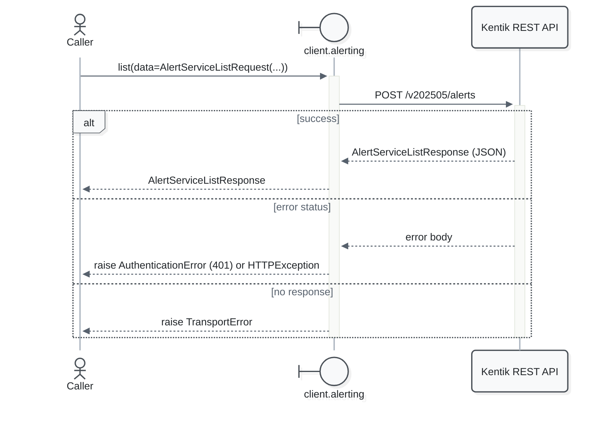

##### gRPC call flow

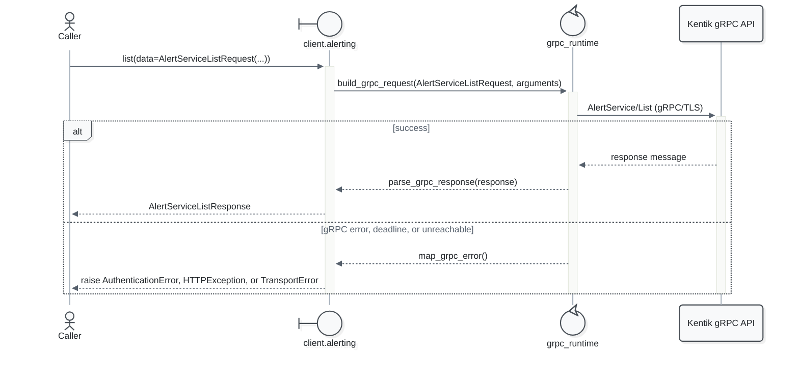

##### Parameters

| Name | In | Type | Required |
| --- | --- | --- | --- |
| `data` | body | `AlertServiceListRequest` | Yes |

##### Responses

| Status | Description | Model |
| --- | --- | --- |
| 200 | A successful response. | `AlertServiceListResponse` |
| default | An unexpected error response. | `rpcStatus` |

##### Example

```python
from kentik_api.client import KentikAPI
from kentik_api.gen.alerting.models import AlertServiceListRequest

# Both transports work: protocol="rest" (default) or protocol="grpc".
client = KentikAPI(protocol="rest")  # loads KENTIK_EMAIL/KENTIK_API_TOKEN from .env
response = client.alerting.list(
    data=AlertServiceListRequest(...),
)
```

---

#### `POST` `/v202505/alerts/clear`

Clear Alerts

Clears alerts.

##### REST call flow


##### gRPC call flow


##### Parameters

| Name | In | Type | Required |
| --- | --- | --- | --- |
| `data` | body | `AlertServiceClearRequest` | Yes |

##### Responses

| Status | Description | Model |
| --- | --- | --- |
| 200 | A successful response. | `AlertServiceClearResponse` |
| default | An unexpected error response. | `rpcStatus` |

##### Example

```python
from kentik_api.client import KentikAPI
from kentik_api.gen.alerting.models import AlertServiceClearRequest

# Both transports work: protocol="rest" (default) or protocol="grpc".
client = KentikAPI(protocol="rest")  # loads KENTIK_EMAIL/KENTIK_API_TOKEN from .env
response = client.alerting.clear(
    data=AlertServiceClearRequest(...),
)
```

---

#### `GET` `/v202505/alerts/{alertId}/comments`

List Alert Comments

Returns all comments for an alert.

##### REST call flow

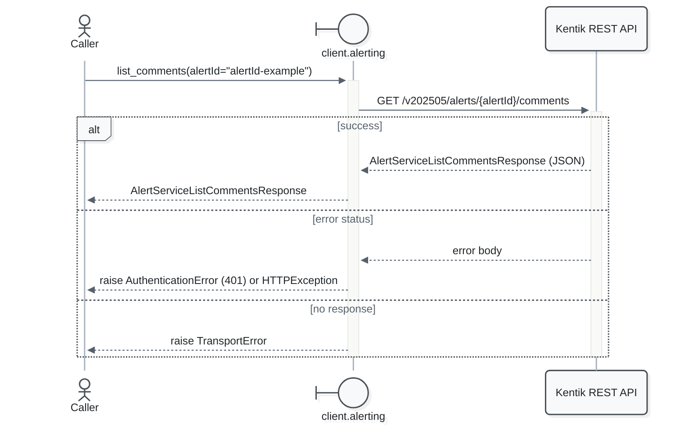

##### gRPC call flow

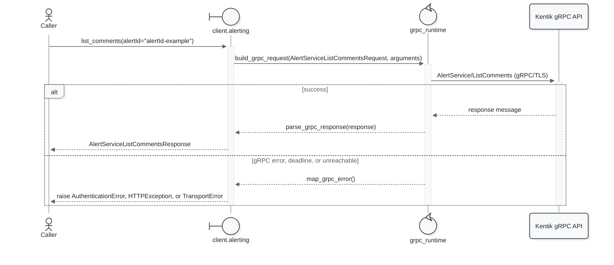

##### Parameters

| Name | In | Type | Required |
| --- | --- | --- | --- |
| `alertId` | path | `string` | Yes |

##### Responses

| Status | Description | Model |
| --- | --- | --- |
| 200 | A successful response. | `AlertServiceListCommentsResponse` |
| default | An unexpected error response. | `rpcStatus` |

##### Example

```python
from kentik_api.client import KentikAPI

# Both transports work: protocol="rest" (default) or protocol="grpc".
client = KentikAPI(protocol="rest")  # loads KENTIK_EMAIL/KENTIK_API_TOKEN from .env
response = client.alerting.list_comments(
    alertId="alertId-example",
)
```

---

#### `POST` `/v202505/alerts/{alertId}/comments`

Add Alert Comment

Adds a comment to an alert.

##### REST call flow

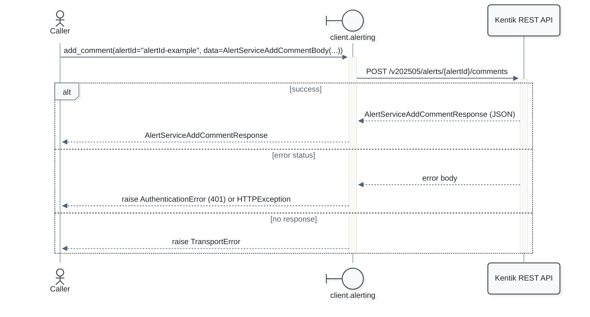

##### gRPC call flow

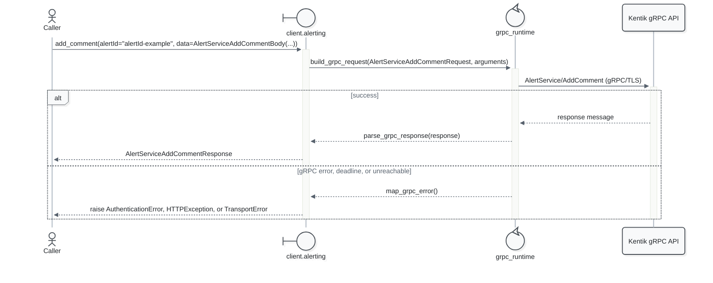

##### Parameters

| Name | In | Type | Required |
| --- | --- | --- | --- |
| `alertId` | path | `string` | Yes |
| `data` | body | `AlertServiceAddCommentBody` | Yes |

##### Responses

| Status | Description | Model |
| --- | --- | --- |
| 200 | A successful response. | `AlertServiceAddCommentResponse` |
| default | An unexpected error response. | `rpcStatus` |

##### Example

```python
from kentik_api.client import KentikAPI
from kentik_api.gen.alerting.models import AlertServiceAddCommentBody

# Both transports work: protocol="rest" (default) or protocol="grpc".
client = KentikAPI(protocol="rest")  # loads KENTIK_EMAIL/KENTIK_API_TOKEN from .env
response = client.alerting.add_comment(
    alertId="alertId-example",
    data=AlertServiceAddCommentBody(...),
)
```

---

#### `PUT` `/v202505/alerts/{alertId}/external-context`

Set External Context for Alert

Add or replace external context

##### REST call flow

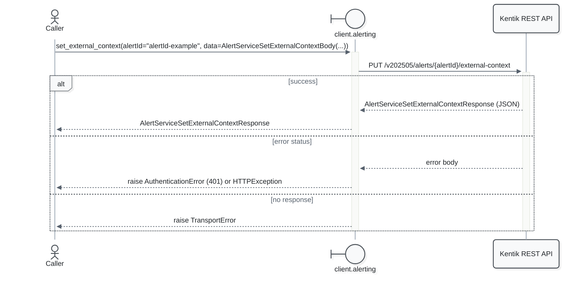

##### gRPC call flow

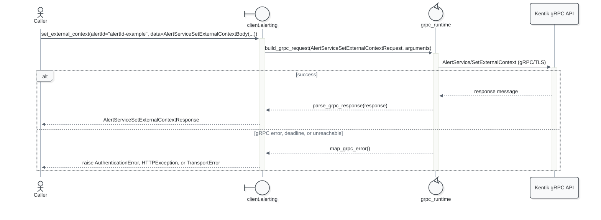

##### Parameters

| Name | In | Type | Required |
| --- | --- | --- | --- |
| `alertId` | path | `string` | Yes |
| `data` | body | `AlertServiceSetExternalContextBody` | Yes |

##### Responses

| Status | Description | Model |
| --- | --- | --- |
| 200 | A successful response. | `AlertServiceSetExternalContextResponse` |
| default | An unexpected error response. | `rpcStatus` |

##### Example

```python
from kentik_api.client import KentikAPI
from kentik_api.gen.alerting.models import AlertServiceSetExternalContextBody

# Both transports work: protocol="rest" (default) or protocol="grpc".
client = KentikAPI(protocol="rest")  # loads KENTIK_EMAIL/KENTIK_API_TOKEN from .env
response = client.alerting.set_external_context(
    alertId="alertId-example",
    data=AlertServiceSetExternalContextBody(...),
)
```

---

#### `GET` `/v202505/alerts/{id}`

Get Alert

Returns an alert object that contains information about an individual alert.

##### REST call flow

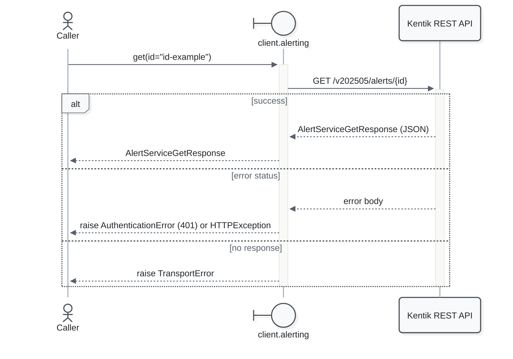

##### gRPC call flow

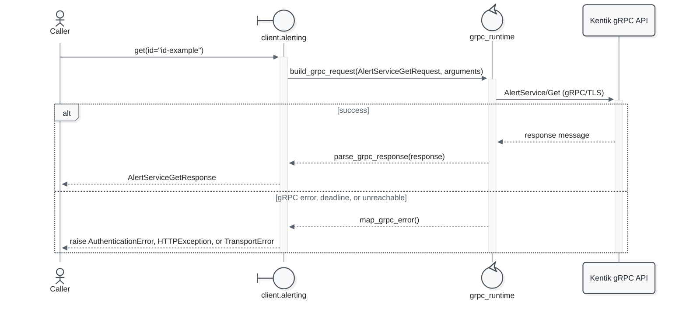

##### Parameters

| Name | In | Type | Required |
| --- | --- | --- | --- |
| `id` | path | `string` | Yes |

##### Responses

| Status | Description | Model |
| --- | --- | --- |
| 200 | A successful response. | `AlertServiceGetResponse` |
| default | An unexpected error response. | `rpcStatus` |

##### Example

```python
from kentik_api.client import KentikAPI

# Both transports work: protocol="rest" (default) or protocol="grpc".
client = KentikAPI(protocol="rest")  # loads KENTIK_EMAIL/KENTIK_API_TOKEN from .env
response = client.alerting.get(
    id="id-example",
)
```

---

#### `POST` `/v202505/alerts/{id}/ack`

Ack Alert

Acknowledges an alert.

##### REST call flow

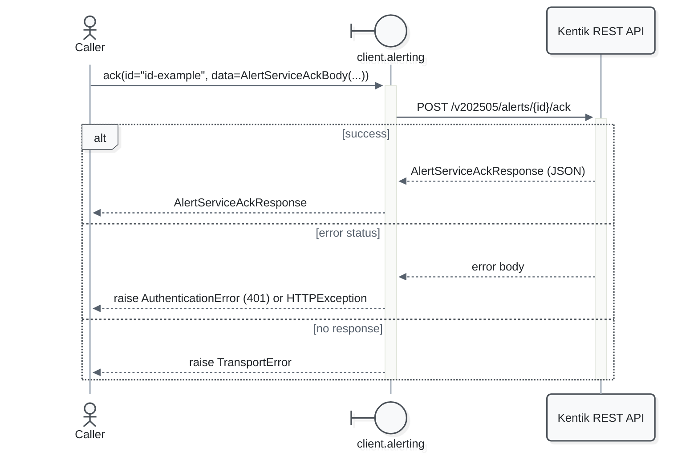

##### gRPC call flow


##### Parameters

| Name | In | Type | Required |
| --- | --- | --- | --- |
| `id` | path | `string` | Yes |
| `data` | body | `AlertServiceAckBody` | Yes |

##### Responses

| Status | Description | Model |
| --- | --- | --- |
| 200 | A successful response. | `AlertServiceAckResponse` |
| default | An unexpected error response. | `rpcStatus` |

##### Example

```python
from kentik_api.client import KentikAPI
from kentik_api.gen.alerting.models import AlertServiceAckBody

# Both transports work: protocol="rest" (default) or protocol="grpc".
client = KentikAPI(protocol="rest")  # loads KENTIK_EMAIL/KENTIK_API_TOKEN from .env
response = client.alerting.ack(
    id="id-example",
    data=AlertServiceAckBody(...),
)
```

---

#### `POST` `/v202505/alerts/{id}/unack`

UnAck Alert

Unacknowledges an alert (removes the acknowledgement).

##### REST call flow

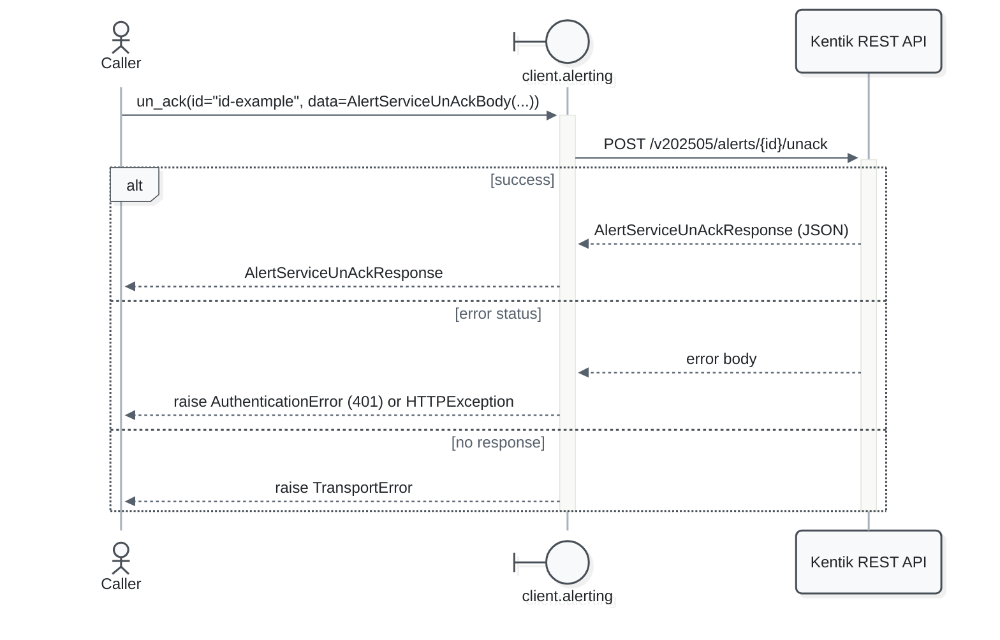

##### gRPC call flow

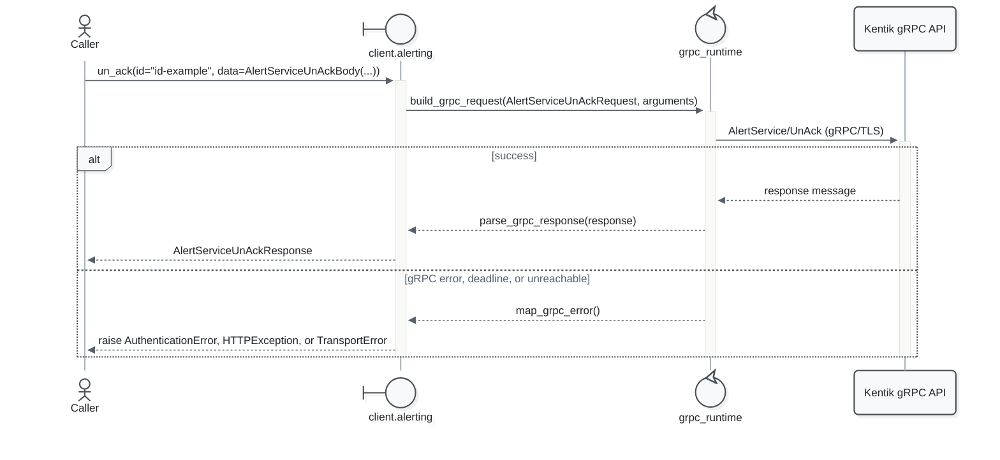

##### Parameters

| Name | In | Type | Required |
| --- | --- | --- | --- |
| `id` | path | `string` | Yes |
| `data` | body | `AlertServiceUnAckBody` | Yes |

##### Responses

| Status | Description | Model |
| --- | --- | --- |
| 200 | A successful response. | `AlertServiceUnAckResponse` |
| default | An unexpected error response. | `rpcStatus` |

##### Example

```python
from kentik_api.client import KentikAPI
from kentik_api.gen.alerting.models import AlertServiceUnAckBody

# Both transports work: protocol="rest" (default) or protocol="grpc".
client = KentikAPI(protocol="rest")  # loads KENTIK_EMAIL/KENTIK_API_TOKEN from .env
response = client.alerting.un_ack(
    id="id-example",
    data=AlertServiceUnAckBody(...),
)
```

### AlertAutoAckService

#### `POST` `/v202505/alerts/ack/auto`

Create Auto-Ack

Creates a new auto-ack configuration.

##### REST call flow

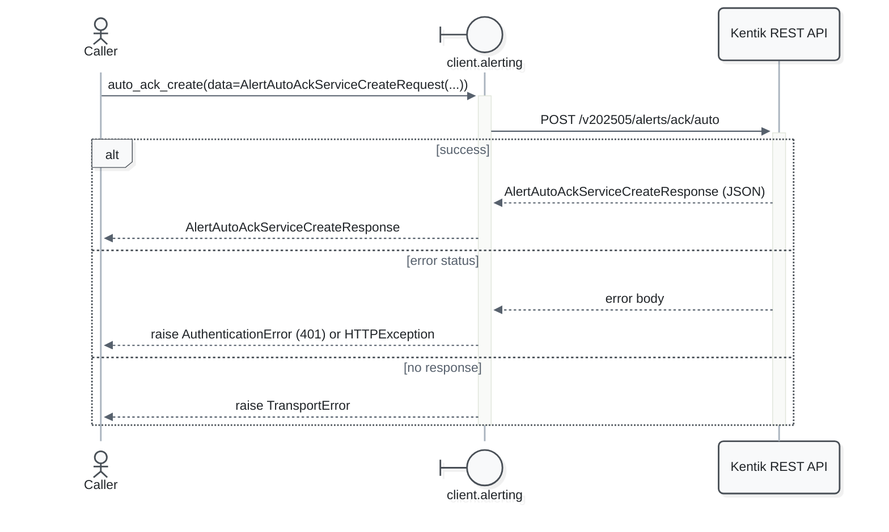

##### gRPC call flow

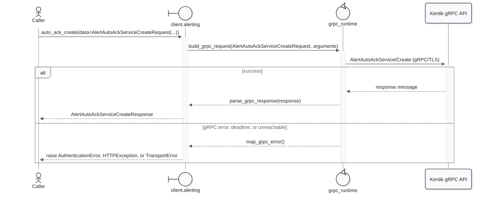

##### Parameters

| Name | In | Type | Required |
| --- | --- | --- | --- |
| `data` | body | `AlertAutoAckServiceCreateRequest` | Yes |

##### Responses

| Status | Description | Model |
| --- | --- | --- |
| 200 | A successful response. | `AlertAutoAckServiceCreateResponse` |
| default | An unexpected error response. | `rpcStatus` |

##### Example

```python
from kentik_api.client import KentikAPI
from kentik_api.gen.alerting.models import AlertAutoAckServiceCreateRequest

# Both transports work: protocol="rest" (default) or protocol="grpc".
client = KentikAPI(protocol="rest")  # loads KENTIK_EMAIL/KENTIK_API_TOKEN from .env
response = client.alerting.auto_ack_create(
    data=AlertAutoAckServiceCreateRequest(...),
)
```

---

#### `POST` `/v202505/alerts/ack/auto/list`

List Auto-Acks

Returns a list of auto-ack configurations.

##### REST call flow

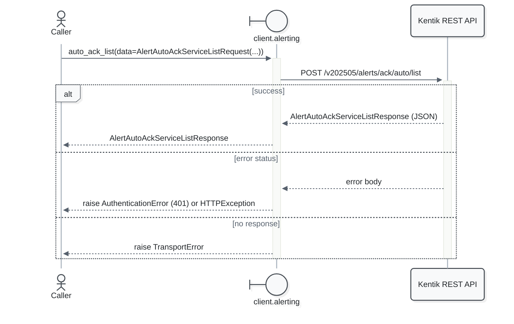

##### gRPC call flow

```mermaid
%%{init: {"theme": "redux", "look": "neo", "layout": "elk", "fontFamily": "ui-monospace, SFMono-Regular, Menlo, monospace", "themeVariables": {"fontFamily": "ui-monospace, SFMono-Regular, Menlo, monospace", "primaryColor": "#f8f9fa", "primaryBorderColor": "#495057", "primaryTextColor": "#212529", "textColor": "#212529", "lineColor": "#77818c", "edgeLabelBackground": "#ffffff", "actorBkg": "#f8f9fa", "actorBorder": "#495057", "actorTextColor": "#212529", "actorLineColor": "#a9b3be", "signalColor": "#57616d", "signalTextColor": "#212529", "labelBoxBkgColor": "#f8f9fa", "labelBoxBorderColor": "#495057", "labelTextColor": "#212529", "loopTextColor": "#57616d", "noteBkgColor": "#fff9db", "noteBorderColor": "#f08c00", "noteTextColor": "#a35a00"}, "sequence": {"activationWidth": 16}, "flowchart": {"curve": "basis", "nodeSpacing": 30, "rankSpacing": 70, "wrappingWidth": 400}}}%%
sequenceDiagram
    actor C as Caller
    participant W@{ "type": "boundary" } as client.alerting
    participant R@{ "type": "control" } as grpc_runtime
    participant API as Kentik gRPC API

    C->>+W: auto_ack_list(data=AlertAutoAckServiceListRequest(...))
    W->>+R: build_grpc_request(AlertAutoAckServiceListRequest, arguments)
    R->>+API: AlertAutoAckService/List (gRPC/TLS)
    alt success
        API-->>R: response message
        R-->>W: parse_grpc_response(response)
        W-->>C: AlertAutoAckServiceListResponse
    else gRPC error, deadline, or unreachable
        R-->>W: map_grpc_error()
        W-->>C: raise AuthenticationError, HTTPException, or TransportError
    end
    deactivate API
    deactivate R
    deactivate W
```

##### Parameters

| Name | In | Type | Required |
| --- | --- | --- | --- |
| `data` | body | `AlertAutoAckServiceListRequest` | Yes |

##### Responses

| Status | Description | Model |
| --- | --- | --- |
| 200 | A successful response. | `AlertAutoAckServiceListResponse` |
| default | An unexpected error response. | `rpcStatus` |

##### Example

```python
from kentik_api.client import KentikAPI
from kentik_api.gen.alerting.models import AlertAutoAckServiceListRequest

# Both transports work: protocol="rest" (default) or protocol="grpc".
client = KentikAPI(protocol="rest")  # loads KENTIK_EMAIL/KENTIK_API_TOKEN from .env
response = client.alerting.auto_ack_list(
    data=AlertAutoAckServiceListRequest(...),
)
```

---

#### `GET` `/v202505/alerts/ack/auto/{autoAck.id}`

Get Auto-Ack

Returns an auto-ack configuration.

##### REST call flow

```mermaid
%%{init: {"theme": "redux", "look": "neo", "layout": "elk", "fontFamily": "ui-monospace, SFMono-Regular, Menlo, monospace", "themeVariables": {"fontFamily": "ui-monospace, SFMono-Regular, Menlo, monospace", "primaryColor": "#f8f9fa", "primaryBorderColor": "#495057", "primaryTextColor": "#212529", "textColor": "#212529", "lineColor": "#77818c", "edgeLabelBackground": "#ffffff", "actorBkg": "#f8f9fa", "actorBorder": "#495057", "actorTextColor": "#212529", "actorLineColor": "#a9b3be", "signalColor": "#57616d", "signalTextColor": "#212529", "labelBoxBkgColor": "#f8f9fa", "labelBoxBorderColor": "#495057", "labelTextColor": "#212529", "loopTextColor": "#57616d", "noteBkgColor": "#fff9db", "noteBorderColor": "#f08c00", "noteTextColor": "#a35a00"}, "sequence": {"activationWidth": 16}, "flowchart": {"curve": "basis", "nodeSpacing": 30, "rankSpacing": 70, "wrappingWidth": 400}}}%%
sequenceDiagram
    actor C as Caller
    participant W@{ "type": "boundary" } as client.alerting
    participant API as Kentik REST API

    C->>+W: auto_ack_get(autoAckid="autoAckid-example")
    W->>+API: GET /v202505/alerts/ack/auto/{autoAck.id}
    alt success
        API-->>W: AlertAutoAckServiceGetResponse (JSON)
        W-->>C: AlertAutoAckServiceGetResponse
    else error status
        API-->>W: error body
        W-->>C: raise AuthenticationError (401) or HTTPException
    else no response
        W-->>C: raise TransportError
    end
    deactivate API
    deactivate W
```

##### gRPC call flow

```mermaid
%%{init: {"theme": "redux", "look": "neo", "layout": "elk", "fontFamily": "ui-monospace, SFMono-Regular, Menlo, monospace", "themeVariables": {"fontFamily": "ui-monospace, SFMono-Regular, Menlo, monospace", "primaryColor": "#f8f9fa", "primaryBorderColor": "#495057", "primaryTextColor": "#212529", "textColor": "#212529", "lineColor": "#77818c", "edgeLabelBackground": "#ffffff", "actorBkg": "#f8f9fa", "actorBorder": "#495057", "actorTextColor": "#212529", "actorLineColor": "#a9b3be", "signalColor": "#57616d", "signalTextColor": "#212529", "labelBoxBkgColor": "#f8f9fa", "labelBoxBorderColor": "#495057", "labelTextColor": "#212529", "loopTextColor": "#57616d", "noteBkgColor": "#fff9db", "noteBorderColor": "#f08c00", "noteTextColor": "#a35a00"}, "sequence": {"activationWidth": 16}, "flowchart": {"curve": "basis", "nodeSpacing": 30, "rankSpacing": 70, "wrappingWidth": 400}}}%%
sequenceDiagram
    actor C as Caller
    participant W@{ "type": "boundary" } as client.alerting
    participant R@{ "type": "control" } as grpc_runtime
    participant API as Kentik gRPC API

    C->>+W: auto_ack_get(autoAckid="autoAckid-example")
    W->>+R: build_grpc_request(AlertAutoAckServiceGetRequest, arguments)
    R->>+API: AlertAutoAckService/Get (gRPC/TLS)
    alt success
        API-->>R: response message
        R-->>W: parse_grpc_response(response)
        W-->>C: AlertAutoAckServiceGetResponse
    else gRPC error, deadline, or unreachable
        R-->>W: map_grpc_error()
        W-->>C: raise AuthenticationError, HTTPException, or TransportError
    end
    deactivate API
    deactivate R
    deactivate W
```

##### Parameters

| Name | In | Type | Required |
| --- | --- | --- | --- |
| `autoAckid` | path | `string` | Yes |

##### Responses

| Status | Description | Model |
| --- | --- | --- |
| 200 | A successful response. | `AlertAutoAckServiceGetResponse` |
| default | An unexpected error response. | `rpcStatus` |

##### Example

```python
from kentik_api.client import KentikAPI

# Both transports work: protocol="rest" (default) or protocol="grpc".
client = KentikAPI(protocol="rest")  # loads KENTIK_EMAIL/KENTIK_API_TOKEN from .env
response = client.alerting.auto_ack_get(
    autoAckid="autoAckid-example",
)
```

---

#### `PATCH` `/v202505/alerts/ack/auto/{autoAck.id}`

Replace Auto-Ack

Replaces an auto-ack configuration.

##### REST call flow

```mermaid
%%{init: {"theme": "redux", "look": "neo", "layout": "elk", "fontFamily": "ui-monospace, SFMono-Regular, Menlo, monospace", "themeVariables": {"fontFamily": "ui-monospace, SFMono-Regular, Menlo, monospace", "primaryColor": "#f8f9fa", "primaryBorderColor": "#495057", "primaryTextColor": "#212529", "textColor": "#212529", "lineColor": "#77818c", "edgeLabelBackground": "#ffffff", "actorBkg": "#f8f9fa", "actorBorder": "#495057", "actorTextColor": "#212529", "actorLineColor": "#a9b3be", "signalColor": "#57616d", "signalTextColor": "#212529", "labelBoxBkgColor": "#f8f9fa", "labelBoxBorderColor": "#495057", "labelTextColor": "#212529", "loopTextColor": "#57616d", "noteBkgColor": "#fff9db", "noteBorderColor": "#f08c00", "noteTextColor": "#a35a00"}, "sequence": {"activationWidth": 16}, "flowchart": {"curve": "basis", "nodeSpacing": 30, "rankSpacing": 70, "wrappingWidth": 400}}}%%
sequenceDiagram
    actor C as Caller
    participant W@{ "type": "boundary" } as client.alerting
    participant API as Kentik REST API

    C->>+W: auto_ack_replace(autoAckid="autoAckid-example", data=AlertAutoAckServiceReplaceBody(...))
    W->>+API: PATCH /v202505/alerts/ack/auto/{autoAck.id}
    alt success
        API-->>W: AlertAutoAckServiceReplaceResponse (JSON)
        W-->>C: AlertAutoAckServiceReplaceResponse
    else error status
        API-->>W: error body
        W-->>C: raise AuthenticationError (401) or HTTPException
    else no response
        W-->>C: raise TransportError
    end
    deactivate API
    deactivate W
```

##### gRPC call flow

```mermaid
%%{init: {"theme": "redux", "look": "neo", "layout": "elk", "fontFamily": "ui-monospace, SFMono-Regular, Menlo, monospace", "themeVariables": {"fontFamily": "ui-monospace, SFMono-Regular, Menlo, monospace", "primaryColor": "#f8f9fa", "primaryBorderColor": "#495057", "primaryTextColor": "#212529", "textColor": "#212529", "lineColor": "#77818c", "edgeLabelBackground": "#ffffff", "actorBkg": "#f8f9fa", "actorBorder": "#495057", "actorTextColor": "#212529", "actorLineColor": "#a9b3be", "signalColor": "#57616d", "signalTextColor": "#212529", "labelBoxBkgColor": "#f8f9fa", "labelBoxBorderColor": "#495057", "labelTextColor": "#212529", "loopTextColor": "#57616d", "noteBkgColor": "#fff9db", "noteBorderColor": "#f08c00", "noteTextColor": "#a35a00"}, "sequence": {"activationWidth": 16}, "flowchart": {"curve": "basis", "nodeSpacing": 30, "rankSpacing": 70, "wrappingWidth": 400}}}%%
sequenceDiagram
    actor C as Caller
    participant W@{ "type": "boundary" } as client.alerting
    participant R@{ "type": "control" } as grpc_runtime
    participant API as Kentik gRPC API

    C->>+W: auto_ack_replace(autoAckid="autoAckid-example", data=AlertAutoAckServiceReplaceBody(...))
    W->>+R: build_grpc_request(AlertAutoAckServiceReplaceRequest, arguments)
    R->>+API: AlertAutoAckService/Replace (gRPC/TLS)
    alt success
        API-->>R: response message
        R-->>W: parse_grpc_response(response)
        W-->>C: AlertAutoAckServiceReplaceResponse
    else gRPC error, deadline, or unreachable
        R-->>W: map_grpc_error()
        W-->>C: raise AuthenticationError, HTTPException, or TransportError
    end
    deactivate API
    deactivate R
    deactivate W
```

##### Parameters

| Name | In | Type | Required |
| --- | --- | --- | --- |
| `autoAckid` | path | `string` | Yes |
| `data` | body | `AlertAutoAckServiceReplaceBody` | Yes |

##### Responses

| Status | Description | Model |
| --- | --- | --- |
| 200 | A successful response. | `AlertAutoAckServiceReplaceResponse` |
| default | An unexpected error response. | `rpcStatus` |

##### Example

```python
from kentik_api.client import KentikAPI
from kentik_api.gen.alerting.models import AlertAutoAckServiceReplaceBody

# Both transports work: protocol="rest" (default) or protocol="grpc".
client = KentikAPI(protocol="rest")  # loads KENTIK_EMAIL/KENTIK_API_TOKEN from .env
response = client.alerting.auto_ack_replace(
    autoAckid="autoAckid-example",
    data=AlertAutoAckServiceReplaceBody(...),
)
```

---

#### `DELETE` `/v202505/alerts/ack/auto/{autoAck.id}`

Delete Auto-Ack

Deletes an auto-ack configuration.

##### REST call flow

```mermaid
%%{init: {"theme": "redux", "look": "neo", "layout": "elk", "fontFamily": "ui-monospace, SFMono-Regular, Menlo, monospace", "themeVariables": {"fontFamily": "ui-monospace, SFMono-Regular, Menlo, monospace", "primaryColor": "#f8f9fa", "primaryBorderColor": "#495057", "primaryTextColor": "#212529", "textColor": "#212529", "lineColor": "#77818c", "edgeLabelBackground": "#ffffff", "actorBkg": "#f8f9fa", "actorBorder": "#495057", "actorTextColor": "#212529", "actorLineColor": "#a9b3be", "signalColor": "#57616d", "signalTextColor": "#212529", "labelBoxBkgColor": "#f8f9fa", "labelBoxBorderColor": "#495057", "labelTextColor": "#212529", "loopTextColor": "#57616d", "noteBkgColor": "#fff9db", "noteBorderColor": "#f08c00", "noteTextColor": "#a35a00"}, "sequence": {"activationWidth": 16}, "flowchart": {"curve": "basis", "nodeSpacing": 30, "rankSpacing": 70, "wrappingWidth": 400}}}%%
sequenceDiagram
    actor C as Caller
    participant W@{ "type": "boundary" } as client.alerting
    participant API as Kentik REST API

    C->>+W: auto_ack_delete(autoAckid="autoAckid-example")
    W->>+API: DELETE /v202505/alerts/ack/auto/{autoAck.id}
    alt success
        API-->>W: AlertAutoAckServiceDeleteResponse (JSON)
        W-->>C: AlertAutoAckServiceDeleteResponse
    else error status
        API-->>W: error body
        W-->>C: raise AuthenticationError (401) or HTTPException
    else no response
        W-->>C: raise TransportError
    end
    deactivate API
    deactivate W
```

##### gRPC call flow

```mermaid
%%{init: {"theme": "redux", "look": "neo", "layout": "elk", "fontFamily": "ui-monospace, SFMono-Regular, Menlo, monospace", "themeVariables": {"fontFamily": "ui-monospace, SFMono-Regular, Menlo, monospace", "primaryColor": "#f8f9fa", "primaryBorderColor": "#495057", "primaryTextColor": "#212529", "textColor": "#212529", "lineColor": "#77818c", "edgeLabelBackground": "#ffffff", "actorBkg": "#f8f9fa", "actorBorder": "#495057", "actorTextColor": "#212529", "actorLineColor": "#a9b3be", "signalColor": "#57616d", "signalTextColor": "#212529", "labelBoxBkgColor": "#f8f9fa", "labelBoxBorderColor": "#495057", "labelTextColor": "#212529", "loopTextColor": "#57616d", "noteBkgColor": "#fff9db", "noteBorderColor": "#f08c00", "noteTextColor": "#a35a00"}, "sequence": {"activationWidth": 16}, "flowchart": {"curve": "basis", "nodeSpacing": 30, "rankSpacing": 70, "wrappingWidth": 400}}}%%
sequenceDiagram
    actor C as Caller
    participant W@{ "type": "boundary" } as client.alerting
    participant R@{ "type": "control" } as grpc_runtime
    participant API as Kentik gRPC API

    C->>+W: auto_ack_delete(autoAckid="autoAckid-example")
    W->>+R: build_grpc_request(AlertAutoAckServiceDeleteRequest, arguments)
    R->>+API: AlertAutoAckService/Delete (gRPC/TLS)
    alt success
        API-->>R: response message
        R-->>W: parse_grpc_response(response)
        W-->>C: AlertAutoAckServiceDeleteResponse
    else gRPC error, deadline, or unreachable
        R-->>W: map_grpc_error()
        W-->>C: raise AuthenticationError, HTTPException, or TransportError
    end
    deactivate API
    deactivate R
    deactivate W
```

##### Parameters

| Name | In | Type | Required |
| --- | --- | --- | --- |
| `autoAckid` | path | `string` | Yes |

##### Responses

| Status | Description | Model |
| --- | --- | --- |
| 200 | A successful response. | `AlertAutoAckServiceDeleteResponse` |
| default | An unexpected error response. | `rpcStatus` |

##### Example

```python
from kentik_api.client import KentikAPI

# Both transports work: protocol="rest" (default) or protocol="grpc".
client = KentikAPI(protocol="rest")  # loads KENTIK_EMAIL/KENTIK_API_TOKEN from .env
response = client.alerting.auto_ack_delete(
    autoAckid="autoAckid-example",
)
```

### MitigationsService

#### `GET` `/v202505/mitigations`

List Mitigations

Returns a list of mitigations.

##### REST call flow

```mermaid
%%{init: {"theme": "redux", "look": "neo", "layout": "elk", "fontFamily": "ui-monospace, SFMono-Regular, Menlo, monospace", "themeVariables": {"fontFamily": "ui-monospace, SFMono-Regular, Menlo, monospace", "primaryColor": "#f8f9fa", "primaryBorderColor": "#495057", "primaryTextColor": "#212529", "textColor": "#212529", "lineColor": "#77818c", "edgeLabelBackground": "#ffffff", "actorBkg": "#f8f9fa", "actorBorder": "#495057", "actorTextColor": "#212529", "actorLineColor": "#a9b3be", "signalColor": "#57616d", "signalTextColor": "#212529", "labelBoxBkgColor": "#f8f9fa", "labelBoxBorderColor": "#495057", "labelTextColor": "#212529", "loopTextColor": "#57616d", "noteBkgColor": "#fff9db", "noteBorderColor": "#f08c00", "noteTextColor": "#a35a00"}, "sequence": {"activationWidth": 16}, "flowchart": {"curve": "basis", "nodeSpacing": 30, "rankSpacing": 70, "wrappingWidth": 400}}}%%
sequenceDiagram
    actor C as Caller
    participant W@{ "type": "boundary" } as client.alerting
    participant API as Kentik REST API

    C->>+W: mitigations_list()
    W->>+API: GET /v202505/mitigations
    alt success
        API-->>W: MitigationsServiceListResponse (JSON)
        W-->>C: MitigationsServiceListResponse
    else error status
        API-->>W: error body
        W-->>C: raise AuthenticationError (401) or HTTPException
    else no response
        W-->>C: raise TransportError
    end
    deactivate API
    deactivate W
```

##### gRPC call flow

```mermaid
%%{init: {"theme": "redux", "look": "neo", "layout": "elk", "fontFamily": "ui-monospace, SFMono-Regular, Menlo, monospace", "themeVariables": {"fontFamily": "ui-monospace, SFMono-Regular, Menlo, monospace", "primaryColor": "#f8f9fa", "primaryBorderColor": "#495057", "primaryTextColor": "#212529", "textColor": "#212529", "lineColor": "#77818c", "edgeLabelBackground": "#ffffff", "actorBkg": "#f8f9fa", "actorBorder": "#495057", "actorTextColor": "#212529", "actorLineColor": "#a9b3be", "signalColor": "#57616d", "signalTextColor": "#212529", "labelBoxBkgColor": "#f8f9fa", "labelBoxBorderColor": "#495057", "labelTextColor": "#212529", "loopTextColor": "#57616d", "noteBkgColor": "#fff9db", "noteBorderColor": "#f08c00", "noteTextColor": "#a35a00"}, "sequence": {"activationWidth": 16}, "flowchart": {"curve": "basis", "nodeSpacing": 30, "rankSpacing": 70, "wrappingWidth": 400}}}%%
sequenceDiagram
    actor C as Caller
    participant W@{ "type": "boundary" } as client.alerting
    participant R@{ "type": "control" } as grpc_runtime
    participant API as Kentik gRPC API

    C->>+W: mitigations_list()
    W->>+R: build_grpc_request(MitigationsServiceListRequest, arguments)
    R->>+API: MitigationsService/List (gRPC/TLS)
    alt success
        API-->>R: response message
        R-->>W: parse_grpc_response(response)
        W-->>C: MitigationsServiceListResponse
    else gRPC error, deadline, or unreachable
        R-->>W: map_grpc_error()
        W-->>C: raise AuthenticationError, HTTPException, or TransportError
    end
    deactivate API
    deactivate R
    deactivate W
```

##### Parameters

| Name | In | Type | Required |
| --- | --- | --- | --- |
| `paginationlimit` | query | `string (uint64)` | No |
| `paginationoffset` | query | `string (uint64)` | No |
| `paginationincludeTotalCount` | query | `boolean` | No |
| `filterscreatedAtstart` | query | `string (date-time)` | No |
| `filterscreatedAtend` | query | `string (date-time)` | No |
| `filtersmitigationIds` | query | `string[]` | No |
| `filtersalarmIds` | query | `string[]` | No |
| `filtersstates` | query | `string[]` | No |
| `filtersplatformIds` | query | `string[]` | No |
| `filtersmethodIds` | query | `string[]` | No |
| `filtersipCidrs` | query | `string[]` | No |
| `filtersipCidrPattern` | query | `string` | No |
| `filterstypes` | query | `string[]` | No |

##### Responses

| Status | Description | Model |
| --- | --- | --- |
| 200 | A successful response. | `MitigationsServiceListResponse` |
| default | An unexpected error response. | `rpcStatus` |

##### Example

```python
from kentik_api.client import KentikAPI

# Both transports work: protocol="rest" (default) or protocol="grpc".
client = KentikAPI(protocol="rest")  # loads KENTIK_EMAIL/KENTIK_API_TOKEN from .env
response = client.alerting.mitigations_list()
```

---

#### `POST` `/v202505/mitigations`

Create Mitigation

Creates a new manual mitigation.

##### REST call flow

```mermaid
%%{init: {"theme": "redux", "look": "neo", "layout": "elk", "fontFamily": "ui-monospace, SFMono-Regular, Menlo, monospace", "themeVariables": {"fontFamily": "ui-monospace, SFMono-Regular, Menlo, monospace", "primaryColor": "#f8f9fa", "primaryBorderColor": "#495057", "primaryTextColor": "#212529", "textColor": "#212529", "lineColor": "#77818c", "edgeLabelBackground": "#ffffff", "actorBkg": "#f8f9fa", "actorBorder": "#495057", "actorTextColor": "#212529", "actorLineColor": "#a9b3be", "signalColor": "#57616d", "signalTextColor": "#212529", "labelBoxBkgColor": "#f8f9fa", "labelBoxBorderColor": "#495057", "labelTextColor": "#212529", "loopTextColor": "#57616d", "noteBkgColor": "#fff9db", "noteBorderColor": "#f08c00", "noteTextColor": "#a35a00"}, "sequence": {"activationWidth": 16}, "flowchart": {"curve": "basis", "nodeSpacing": 30, "rankSpacing": 70, "wrappingWidth": 400}}}%%
sequenceDiagram
    actor C as Caller
    participant W@{ "type": "boundary" } as client.alerting
    participant API as Kentik REST API

    C->>+W: mitigations_create(data=MitigationsServiceCreateRequest(...))
    W->>+API: POST /v202505/mitigations
    alt success
        API-->>W: MitigationsServiceCreateResponse (JSON)
        W-->>C: MitigationsServiceCreateResponse
    else error status
        API-->>W: error body
        W-->>C: raise AuthenticationError (401) or HTTPException
    else no response
        W-->>C: raise TransportError
    end
    deactivate API
    deactivate W
```

##### gRPC call flow

```mermaid
%%{init: {"theme": "redux", "look": "neo", "layout": "elk", "fontFamily": "ui-monospace, SFMono-Regular, Menlo, monospace", "themeVariables": {"fontFamily": "ui-monospace, SFMono-Regular, Menlo, monospace", "primaryColor": "#f8f9fa", "primaryBorderColor": "#495057", "primaryTextColor": "#212529", "textColor": "#212529", "lineColor": "#77818c", "edgeLabelBackground": "#ffffff", "actorBkg": "#f8f9fa", "actorBorder": "#495057", "actorTextColor": "#212529", "actorLineColor": "#a9b3be", "signalColor": "#57616d", "signalTextColor": "#212529", "labelBoxBkgColor": "#f8f9fa", "labelBoxBorderColor": "#495057", "labelTextColor": "#212529", "loopTextColor": "#57616d", "noteBkgColor": "#fff9db", "noteBorderColor": "#f08c00", "noteTextColor": "#a35a00"}, "sequence": {"activationWidth": 16}, "flowchart": {"curve": "basis", "nodeSpacing": 30, "rankSpacing": 70, "wrappingWidth": 400}}}%%
sequenceDiagram
    actor C as Caller
    participant W@{ "type": "boundary" } as client.alerting
    participant R@{ "type": "control" } as grpc_runtime
    participant API as Kentik gRPC API

    C->>+W: mitigations_create(data=MitigationsServiceCreateRequest(...))
    W->>+R: build_grpc_request(MitigationsServiceCreateRequest, arguments)
    R->>+API: MitigationsService/Create (gRPC/TLS)
    alt success
        API-->>R: response message
        R-->>W: parse_grpc_response(response)
        W-->>C: MitigationsServiceCreateResponse
    else gRPC error, deadline, or unreachable
        R-->>W: map_grpc_error()
        W-->>C: raise AuthenticationError, HTTPException, or TransportError
    end
    deactivate API
    deactivate R
    deactivate W
```

##### Parameters

| Name | In | Type | Required |
| --- | --- | --- | --- |
| `data` | body | `MitigationsServiceCreateRequest` | Yes |

##### Responses

| Status | Description | Model |
| --- | --- | --- |
| 200 | A successful response. | `MitigationsServiceCreateResponse` |
| default | An unexpected error response. | `rpcStatus` |

##### Example

```python
from kentik_api.client import KentikAPI
from kentik_api.gen.alerting.models import MitigationsServiceCreateRequest

# Both transports work: protocol="rest" (default) or protocol="grpc".
client = KentikAPI(protocol="rest")  # loads KENTIK_EMAIL/KENTIK_API_TOKEN from .env
response = client.alerting.mitigations_create(
    data=MitigationsServiceCreateRequest(...),
)
```

---

#### `GET` `/v202505/mitigations/actions`

Get Available Actions

Returns available actions for mitigations.

##### REST call flow

```mermaid
%%{init: {"theme": "redux", "look": "neo", "layout": "elk", "fontFamily": "ui-monospace, SFMono-Regular, Menlo, monospace", "themeVariables": {"fontFamily": "ui-monospace, SFMono-Regular, Menlo, monospace", "primaryColor": "#f8f9fa", "primaryBorderColor": "#495057", "primaryTextColor": "#212529", "textColor": "#212529", "lineColor": "#77818c", "edgeLabelBackground": "#ffffff", "actorBkg": "#f8f9fa", "actorBorder": "#495057", "actorTextColor": "#212529", "actorLineColor": "#a9b3be", "signalColor": "#57616d", "signalTextColor": "#212529", "labelBoxBkgColor": "#f8f9fa", "labelBoxBorderColor": "#495057", "labelTextColor": "#212529", "loopTextColor": "#57616d", "noteBkgColor": "#fff9db", "noteBorderColor": "#f08c00", "noteTextColor": "#a35a00"}, "sequence": {"activationWidth": 16}, "flowchart": {"curve": "basis", "nodeSpacing": 30, "rankSpacing": 70, "wrappingWidth": 400}}}%%
sequenceDiagram
    actor C as Caller
    participant W@{ "type": "boundary" } as client.alerting
    participant API as Kentik REST API

    C->>+W: available_actions()
    W->>+API: GET /v202505/mitigations/actions
    alt success
        API-->>W: MitigationsServiceAvailableActionsResponse (JSON)
        W-->>C: MitigationsServiceAvailableActionsResponse
    else error status
        API-->>W: error body
        W-->>C: raise AuthenticationError (401) or HTTPException
    else no response
        W-->>C: raise TransportError
    end
    deactivate API
    deactivate W
```

##### gRPC call flow

```mermaid
%%{init: {"theme": "redux", "look": "neo", "layout": "elk", "fontFamily": "ui-monospace, SFMono-Regular, Menlo, monospace", "themeVariables": {"fontFamily": "ui-monospace, SFMono-Regular, Menlo, monospace", "primaryColor": "#f8f9fa", "primaryBorderColor": "#495057", "primaryTextColor": "#212529", "textColor": "#212529", "lineColor": "#77818c", "edgeLabelBackground": "#ffffff", "actorBkg": "#f8f9fa", "actorBorder": "#495057", "actorTextColor": "#212529", "actorLineColor": "#a9b3be", "signalColor": "#57616d", "signalTextColor": "#212529", "labelBoxBkgColor": "#f8f9fa", "labelBoxBorderColor": "#495057", "labelTextColor": "#212529", "loopTextColor": "#57616d", "noteBkgColor": "#fff9db", "noteBorderColor": "#f08c00", "noteTextColor": "#a35a00"}, "sequence": {"activationWidth": 16}, "flowchart": {"curve": "basis", "nodeSpacing": 30, "rankSpacing": 70, "wrappingWidth": 400}}}%%
sequenceDiagram
    actor C as Caller
    participant W@{ "type": "boundary" } as client.alerting
    participant R@{ "type": "control" } as grpc_runtime
    participant API as Kentik gRPC API

    C->>+W: available_actions()
    W->>+R: build_grpc_request(MitigationsServiceAvailableActionsRequest, arguments)
    R->>+API: MitigationsService/AvailableActions (gRPC/TLS)
    alt success
        API-->>R: response message
        R-->>W: parse_grpc_response(response)
        W-->>C: MitigationsServiceAvailableActionsResponse
    else gRPC error, deadline, or unreachable
        R-->>W: map_grpc_error()
        W-->>C: raise AuthenticationError, HTTPException, or TransportError
    end
    deactivate API
    deactivate R
    deactivate W
```

##### Responses

| Status | Description | Model |
| --- | --- | --- |
| 200 | A successful response. | `MitigationsServiceAvailableActionsResponse` |
| default | An unexpected error response. | `rpcStatus` |

##### Example

```python
from kentik_api.client import KentikAPI

# Both transports work: protocol="rest" (default) or protocol="grpc".
client = KentikAPI(protocol="rest")  # loads KENTIK_EMAIL/KENTIK_API_TOKEN from .env
response = client.alerting.available_actions()
```

---

#### `GET` `/v202505/mitigations/{action}`

Get Mitigation

Returns a mitigation.

##### REST call flow

```mermaid
%%{init: {"theme": "redux", "look": "neo", "layout": "elk", "fontFamily": "ui-monospace, SFMono-Regular, Menlo, monospace", "themeVariables": {"fontFamily": "ui-monospace, SFMono-Regular, Menlo, monospace", "primaryColor": "#f8f9fa", "primaryBorderColor": "#495057", "primaryTextColor": "#212529", "textColor": "#212529", "lineColor": "#77818c", "edgeLabelBackground": "#ffffff", "actorBkg": "#f8f9fa", "actorBorder": "#495057", "actorTextColor": "#212529", "actorLineColor": "#a9b3be", "signalColor": "#57616d", "signalTextColor": "#212529", "labelBoxBkgColor": "#f8f9fa", "labelBoxBorderColor": "#495057", "labelTextColor": "#212529", "loopTextColor": "#57616d", "noteBkgColor": "#fff9db", "noteBorderColor": "#f08c00", "noteTextColor": "#a35a00"}, "sequence": {"activationWidth": 16}, "flowchart": {"curve": "basis", "nodeSpacing": 30, "rankSpacing": 70, "wrappingWidth": 400}}}%%
sequenceDiagram
    actor C as Caller
    participant W@{ "type": "boundary" } as client.alerting
    participant API as Kentik REST API

    C->>+W: mitigations_get(action="action-example")
    W->>+API: GET /v202505/mitigations/{action}
    alt success
        API-->>W: MitigationsServiceGetResponse (JSON)
        W-->>C: MitigationsServiceGetResponse
    else error status
        API-->>W: error body
        W-->>C: raise AuthenticationError (401) or HTTPException
    else no response
        W-->>C: raise TransportError
    end
    deactivate API
    deactivate W
```

##### gRPC call flow

```mermaid
%%{init: {"theme": "redux", "look": "neo", "layout": "elk", "fontFamily": "ui-monospace, SFMono-Regular, Menlo, monospace", "themeVariables": {"fontFamily": "ui-monospace, SFMono-Regular, Menlo, monospace", "primaryColor": "#f8f9fa", "primaryBorderColor": "#495057", "primaryTextColor": "#212529", "textColor": "#212529", "lineColor": "#77818c", "edgeLabelBackground": "#ffffff", "actorBkg": "#f8f9fa", "actorBorder": "#495057", "actorTextColor": "#212529", "actorLineColor": "#a9b3be", "signalColor": "#57616d", "signalTextColor": "#212529", "labelBoxBkgColor": "#f8f9fa", "labelBoxBorderColor": "#495057", "labelTextColor": "#212529", "loopTextColor": "#57616d", "noteBkgColor": "#fff9db", "noteBorderColor": "#f08c00", "noteTextColor": "#a35a00"}, "sequence": {"activationWidth": 16}, "flowchart": {"curve": "basis", "nodeSpacing": 30, "rankSpacing": 70, "wrappingWidth": 400}}}%%
sequenceDiagram
    actor C as Caller
    participant W@{ "type": "boundary" } as client.alerting
    participant R@{ "type": "control" } as grpc_runtime
    participant API as Kentik gRPC API

    C->>+W: mitigations_get(action="action-example")
    W->>+R: build_grpc_request(MitigationsServiceGetRequest, arguments)
    R->>+API: MitigationsService/Get (gRPC/TLS)
    alt success
        API-->>R: response message
        R-->>W: parse_grpc_response(response)
        W-->>C: MitigationsServiceGetResponse
    else gRPC error, deadline, or unreachable
        R-->>W: map_grpc_error()
        W-->>C: raise AuthenticationError, HTTPException, or TransportError
    end
    deactivate API
    deactivate R
    deactivate W
```

##### Parameters

| Name | In | Type | Required |
| --- | --- | --- | --- |
| `action` | path | `string` | Yes |

##### Responses

| Status | Description | Model |
| --- | --- | --- |
| 200 | A successful response. | `MitigationsServiceGetResponse` |
| default | An unexpected error response. | `rpcStatus` |

##### Example

```python
from kentik_api.client import KentikAPI

# Both transports work: protocol="rest" (default) or protocol="grpc".
client = KentikAPI(protocol="rest")  # loads KENTIK_EMAIL/KENTIK_API_TOKEN from .env
response = client.alerting.mitigations_get(
    action="action-example",
)
```

---

#### `POST` `/v202505/mitigations/{action}`

Act on Mitigation

Performs an action on one or more mitigations.

##### REST call flow

```mermaid
%%{init: {"theme": "redux", "look": "neo", "layout": "elk", "fontFamily": "ui-monospace, SFMono-Regular, Menlo, monospace", "themeVariables": {"fontFamily": "ui-monospace, SFMono-Regular, Menlo, monospace", "primaryColor": "#f8f9fa", "primaryBorderColor": "#495057", "primaryTextColor": "#212529", "textColor": "#212529", "lineColor": "#77818c", "edgeLabelBackground": "#ffffff", "actorBkg": "#f8f9fa", "actorBorder": "#495057", "actorTextColor": "#212529", "actorLineColor": "#a9b3be", "signalColor": "#57616d", "signalTextColor": "#212529", "labelBoxBkgColor": "#f8f9fa", "labelBoxBorderColor": "#495057", "labelTextColor": "#212529", "loopTextColor": "#57616d", "noteBkgColor": "#fff9db", "noteBorderColor": "#f08c00", "noteTextColor": "#a35a00"}, "sequence": {"activationWidth": 16}, "flowchart": {"curve": "basis", "nodeSpacing": 30, "rankSpacing": 70, "wrappingWidth": 400}}}%%
sequenceDiagram
    actor C as Caller
    participant W@{ "type": "boundary" } as client.alerting
    participant API as Kentik REST API

    C->>+W: act(action="action-example", data=MitigationsServiceActBody(...))
    W->>+API: POST /v202505/mitigations/{action}
    alt success
        API-->>W: MitigationsServiceActResponse (JSON)
        W-->>C: MitigationsServiceActResponse
    else error status
        API-->>W: error body
        W-->>C: raise AuthenticationError (401) or HTTPException
    else no response
        W-->>C: raise TransportError
    end
    deactivate API
    deactivate W
```

##### gRPC call flow

```mermaid
%%{init: {"theme": "redux", "look": "neo", "layout": "elk", "fontFamily": "ui-monospace, SFMono-Regular, Menlo, monospace", "themeVariables": {"fontFamily": "ui-monospace, SFMono-Regular, Menlo, monospace", "primaryColor": "#f8f9fa", "primaryBorderColor": "#495057", "primaryTextColor": "#212529", "textColor": "#212529", "lineColor": "#77818c", "edgeLabelBackground": "#ffffff", "actorBkg": "#f8f9fa", "actorBorder": "#495057", "actorTextColor": "#212529", "actorLineColor": "#a9b3be", "signalColor": "#57616d", "signalTextColor": "#212529", "labelBoxBkgColor": "#f8f9fa", "labelBoxBorderColor": "#495057", "labelTextColor": "#212529", "loopTextColor": "#57616d", "noteBkgColor": "#fff9db", "noteBorderColor": "#f08c00", "noteTextColor": "#a35a00"}, "sequence": {"activationWidth": 16}, "flowchart": {"curve": "basis", "nodeSpacing": 30, "rankSpacing": 70, "wrappingWidth": 400}}}%%
sequenceDiagram
    actor C as Caller
    participant W@{ "type": "boundary" } as client.alerting
    participant R@{ "type": "control" } as grpc_runtime
    participant API as Kentik gRPC API

    C->>+W: act(action="action-example", data=MitigationsServiceActBody(...))
    W->>+R: build_grpc_request(MitigationsServiceActRequest, arguments)
    R->>+API: MitigationsService/Act (gRPC/TLS)
    alt success
        API-->>R: response message
        R-->>W: parse_grpc_response(response)
        W-->>C: MitigationsServiceActResponse
    else gRPC error, deadline, or unreachable
        R-->>W: map_grpc_error()
        W-->>C: raise AuthenticationError, HTTPException, or TransportError
    end
    deactivate API
    deactivate R
    deactivate W
```

##### Parameters

| Name | In | Type | Required |
| --- | --- | --- | --- |
| `action` | path | `string` | Yes |
| `data` | body | `MitigationsServiceActBody` | Yes |

##### Responses

| Status | Description | Model |
| --- | --- | --- |
| 200 | A successful response. | `MitigationsServiceActResponse` |
| default | An unexpected error response. | `rpcStatus` |

##### Example

```python
from kentik_api.client import KentikAPI
from kentik_api.gen.alerting.models import MitigationsServiceActBody

# Both transports work: protocol="rest" (default) or protocol="grpc".
client = KentikAPI(protocol="rest")  # loads KENTIK_EMAIL/KENTIK_API_TOKEN from .env
response = client.alerting.act(
    action="action-example",
    data=MitigationsServiceActBody(...),
)
```

---

#### `GET` `/v202505/mitigations/{id}/actions`

Get Available Actions for Mitigation

Returns available actions for a specific mitigation.

##### REST call flow

```mermaid
%%{init: {"theme": "redux", "look": "neo", "layout": "elk", "fontFamily": "ui-monospace, SFMono-Regular, Menlo, monospace", "themeVariables": {"fontFamily": "ui-monospace, SFMono-Regular, Menlo, monospace", "primaryColor": "#f8f9fa", "primaryBorderColor": "#495057", "primaryTextColor": "#212529", "textColor": "#212529", "lineColor": "#77818c", "edgeLabelBackground": "#ffffff", "actorBkg": "#f8f9fa", "actorBorder": "#495057", "actorTextColor": "#212529", "actorLineColor": "#a9b3be", "signalColor": "#57616d", "signalTextColor": "#212529", "labelBoxBkgColor": "#f8f9fa", "labelBoxBorderColor": "#495057", "labelTextColor": "#212529", "loopTextColor": "#57616d", "noteBkgColor": "#fff9db", "noteBorderColor": "#f08c00", "noteTextColor": "#a35a00"}, "sequence": {"activationWidth": 16}, "flowchart": {"curve": "basis", "nodeSpacing": 30, "rankSpacing": 70, "wrappingWidth": 400}}}%%
sequenceDiagram
    actor C as Caller
    participant W@{ "type": "boundary" } as client.alerting
    participant API as Kentik REST API

    C->>+W: available_actions_for_mitigation(id="id-example")
    W->>+API: GET /v202505/mitigations/{id}/actions
    alt success
        API-->>W: MitigationsServiceAvailableActionsForMitigationResponse (JSON)
        W-->>C: MitigationsServiceAvailableActionsForMitigationResponse
    else error status
        API-->>W: error body
        W-->>C: raise AuthenticationError (401) or HTTPException
    else no response
        W-->>C: raise TransportError
    end
    deactivate API
    deactivate W
```

##### gRPC call flow

```mermaid
%%{init: {"theme": "redux", "look": "neo", "layout": "elk", "fontFamily": "ui-monospace, SFMono-Regular, Menlo, monospace", "themeVariables": {"fontFamily": "ui-monospace, SFMono-Regular, Menlo, monospace", "primaryColor": "#f8f9fa", "primaryBorderColor": "#495057", "primaryTextColor": "#212529", "textColor": "#212529", "lineColor": "#77818c", "edgeLabelBackground": "#ffffff", "actorBkg": "#f8f9fa", "actorBorder": "#495057", "actorTextColor": "#212529", "actorLineColor": "#a9b3be", "signalColor": "#57616d", "signalTextColor": "#212529", "labelBoxBkgColor": "#f8f9fa", "labelBoxBorderColor": "#495057", "labelTextColor": "#212529", "loopTextColor": "#57616d", "noteBkgColor": "#fff9db", "noteBorderColor": "#f08c00", "noteTextColor": "#a35a00"}, "sequence": {"activationWidth": 16}, "flowchart": {"curve": "basis", "nodeSpacing": 30, "rankSpacing": 70, "wrappingWidth": 400}}}%%
sequenceDiagram
    actor C as Caller
    participant W@{ "type": "boundary" } as client.alerting
    participant R@{ "type": "control" } as grpc_runtime
    participant API as Kentik gRPC API

    C->>+W: available_actions_for_mitigation(id="id-example")
    W->>+R: build_grpc_request(MitigationsServiceAvailableActionsForMitigationRequest, arguments)
    R->>+API: MitigationsService/AvailableActionsForMitigation (gRPC/TLS)
    alt success
        API-->>R: response message
        R-->>W: parse_grpc_response(response)
        W-->>C: MitigationsServiceAvailableActionsForMitigationResponse
    else gRPC error, deadline, or unreachable
        R-->>W: map_grpc_error()
        W-->>C: raise AuthenticationError, HTTPException, or TransportError
    end
    deactivate API
    deactivate R
    deactivate W
```

##### Parameters

| Name | In | Type | Required |
| --- | --- | --- | --- |
| `id` | path | `string (int64)` | Yes |

##### Responses

| Status | Description | Model |
| --- | --- | --- |
| 200 | A successful response. | `MitigationsServiceAvailableActionsForMitigationResponse` |
| default | An unexpected error response. | `rpcStatus` |

##### Example

```python
from kentik_api.client import KentikAPI

# Both transports work: protocol="rest" (default) or protocol="grpc".
client = KentikAPI(protocol="rest")  # loads KENTIK_EMAIL/KENTIK_API_TOKEN from .env
response = client.alerting.available_actions_for_mitigation(
    id="id-example",
)
```

### MitigationMethodsService

#### `GET` `/v202505/mitigations/methods`

List Mitigation Methods

Returns a list of mitigation methods.

##### REST call flow

```mermaid
%%{init: {"theme": "redux", "look": "neo", "layout": "elk", "fontFamily": "ui-monospace, SFMono-Regular, Menlo, monospace", "themeVariables": {"fontFamily": "ui-monospace, SFMono-Regular, Menlo, monospace", "primaryColor": "#f8f9fa", "primaryBorderColor": "#495057", "primaryTextColor": "#212529", "textColor": "#212529", "lineColor": "#77818c", "edgeLabelBackground": "#ffffff", "actorBkg": "#f8f9fa", "actorBorder": "#495057", "actorTextColor": "#212529", "actorLineColor": "#a9b3be", "signalColor": "#57616d", "signalTextColor": "#212529", "labelBoxBkgColor": "#f8f9fa", "labelBoxBorderColor": "#495057", "labelTextColor": "#212529", "loopTextColor": "#57616d", "noteBkgColor": "#fff9db", "noteBorderColor": "#f08c00", "noteTextColor": "#a35a00"}, "sequence": {"activationWidth": 16}, "flowchart": {"curve": "basis", "nodeSpacing": 30, "rankSpacing": 70, "wrappingWidth": 400}}}%%
sequenceDiagram
    actor C as Caller
    participant W@{ "type": "boundary" } as client.alerting
    participant API as Kentik REST API

    C->>+W: mitigation_methods_list()
    W->>+API: GET /v202505/mitigations/methods
    alt success
        API-->>W: MitigationMethodsServiceListResponse (JSON)
        W-->>C: MitigationMethodsServiceListResponse
    else error status
        API-->>W: error body
        W-->>C: raise AuthenticationError (401) or HTTPException
    else no response
        W-->>C: raise TransportError
    end
    deactivate API
    deactivate W
```

##### gRPC call flow

```mermaid
%%{init: {"theme": "redux", "look": "neo", "layout": "elk", "fontFamily": "ui-monospace, SFMono-Regular, Menlo, monospace", "themeVariables": {"fontFamily": "ui-monospace, SFMono-Regular, Menlo, monospace", "primaryColor": "#f8f9fa", "primaryBorderColor": "#495057", "primaryTextColor": "#212529", "textColor": "#212529", "lineColor": "#77818c", "edgeLabelBackground": "#ffffff", "actorBkg": "#f8f9fa", "actorBorder": "#495057", "actorTextColor": "#212529", "actorLineColor": "#a9b3be", "signalColor": "#57616d", "signalTextColor": "#212529", "labelBoxBkgColor": "#f8f9fa", "labelBoxBorderColor": "#495057", "labelTextColor": "#212529", "loopTextColor": "#57616d", "noteBkgColor": "#fff9db", "noteBorderColor": "#f08c00", "noteTextColor": "#a35a00"}, "sequence": {"activationWidth": 16}, "flowchart": {"curve": "basis", "nodeSpacing": 30, "rankSpacing": 70, "wrappingWidth": 400}}}%%
sequenceDiagram
    actor C as Caller
    participant W@{ "type": "boundary" } as client.alerting
    participant R@{ "type": "control" } as grpc_runtime
    participant API as Kentik gRPC API

    C->>+W: mitigation_methods_list()
    W->>+R: build_grpc_request(MitigationMethodsServiceListRequest, arguments)
    R->>+API: MitigationMethodsService/List (gRPC/TLS)
    alt success
        API-->>R: response message
        R-->>W: parse_grpc_response(response)
        W-->>C: MitigationMethodsServiceListResponse
    else gRPC error, deadline, or unreachable
        R-->>W: map_grpc_error()
        W-->>C: raise AuthenticationError, HTTPException, or TransportError
    end
    deactivate API
    deactivate R
    deactivate W
```

##### Parameters

| Name | In | Type | Required |
| --- | --- | --- | --- |
| `paginationlimit` | query | `string (uint64)` | No |
| `paginationoffset` | query | `string (uint64)` | No |
| `paginationincludeTotalCount` | query | `boolean` | No |
| `filtersmethodIds` | query | `string[]` | No |
| `filtersplatformTypes` | query | `string[]` | No |
| `filterscreatedAtstart` | query | `string (date-time)` | No |
| `filterscreatedAtend` | query | `string (date-time)` | No |
| `filtersmodifiedAtstart` | query | `string (date-time)` | No |
| `filtersmodifiedAtend` | query | `string (date-time)` | No |

##### Responses

| Status | Description | Model |
| --- | --- | --- |
| 200 | A successful response. | `MitigationMethodsServiceListResponse` |
| default | An unexpected error response. | `rpcStatus` |

##### Example

```python
from kentik_api.client import KentikAPI

# Both transports work: protocol="rest" (default) or protocol="grpc".
client = KentikAPI(protocol="rest")  # loads KENTIK_EMAIL/KENTIK_API_TOKEN from .env
response = client.alerting.mitigation_methods_list()
```

---

#### `GET` `/v202505/mitigations/methods/{id}`

Get Mitigation Method

Returns a mitigation method.

##### REST call flow

```mermaid
%%{init: {"theme": "redux", "look": "neo", "layout": "elk", "fontFamily": "ui-monospace, SFMono-Regular, Menlo, monospace", "themeVariables": {"fontFamily": "ui-monospace, SFMono-Regular, Menlo, monospace", "primaryColor": "#f8f9fa", "primaryBorderColor": "#495057", "primaryTextColor": "#212529", "textColor": "#212529", "lineColor": "#77818c", "edgeLabelBackground": "#ffffff", "actorBkg": "#f8f9fa", "actorBorder": "#495057", "actorTextColor": "#212529", "actorLineColor": "#a9b3be", "signalColor": "#57616d", "signalTextColor": "#212529", "labelBoxBkgColor": "#f8f9fa", "labelBoxBorderColor": "#495057", "labelTextColor": "#212529", "loopTextColor": "#57616d", "noteBkgColor": "#fff9db", "noteBorderColor": "#f08c00", "noteTextColor": "#a35a00"}, "sequence": {"activationWidth": 16}, "flowchart": {"curve": "basis", "nodeSpacing": 30, "rankSpacing": 70, "wrappingWidth": 400}}}%%
sequenceDiagram
    actor C as Caller
    participant W@{ "type": "boundary" } as client.alerting
    participant API as Kentik REST API

    C->>+W: mitigation_methods_get(id="id-example")
    W->>+API: GET /v202505/mitigations/methods/{id}
    alt success
        API-->>W: MitigationMethodsServiceGetResponse (JSON)
        W-->>C: MitigationMethodsServiceGetResponse
    else error status
        API-->>W: error body
        W-->>C: raise AuthenticationError (401) or HTTPException
    else no response
        W-->>C: raise TransportError
    end
    deactivate API
    deactivate W
```

##### gRPC call flow

```mermaid
%%{init: {"theme": "redux", "look": "neo", "layout": "elk", "fontFamily": "ui-monospace, SFMono-Regular, Menlo, monospace", "themeVariables": {"fontFamily": "ui-monospace, SFMono-Regular, Menlo, monospace", "primaryColor": "#f8f9fa", "primaryBorderColor": "#495057", "primaryTextColor": "#212529", "textColor": "#212529", "lineColor": "#77818c", "edgeLabelBackground": "#ffffff", "actorBkg": "#f8f9fa", "actorBorder": "#495057", "actorTextColor": "#212529", "actorLineColor": "#a9b3be", "signalColor": "#57616d", "signalTextColor": "#212529", "labelBoxBkgColor": "#f8f9fa", "labelBoxBorderColor": "#495057", "labelTextColor": "#212529", "loopTextColor": "#57616d", "noteBkgColor": "#fff9db", "noteBorderColor": "#f08c00", "noteTextColor": "#a35a00"}, "sequence": {"activationWidth": 16}, "flowchart": {"curve": "basis", "nodeSpacing": 30, "rankSpacing": 70, "wrappingWidth": 400}}}%%
sequenceDiagram
    actor C as Caller
    participant W@{ "type": "boundary" } as client.alerting
    participant R@{ "type": "control" } as grpc_runtime
    participant API as Kentik gRPC API

    C->>+W: mitigation_methods_get(id="id-example")
    W->>+R: build_grpc_request(MitigationMethodsServiceGetRequest, arguments)
    R->>+API: MitigationMethodsService/Get (gRPC/TLS)
    alt success
        API-->>R: response message
        R-->>W: parse_grpc_response(response)
        W-->>C: MitigationMethodsServiceGetResponse
    else gRPC error, deadline, or unreachable
        R-->>W: map_grpc_error()
        W-->>C: raise AuthenticationError, HTTPException, or TransportError
    end
    deactivate API
    deactivate R
    deactivate W
```

##### Parameters

| Name | In | Type | Required |
| --- | --- | --- | --- |
| `id` | path | `string` | Yes |

##### Responses

| Status | Description | Model |
| --- | --- | --- |
| 200 | A successful response. | `MitigationMethodsServiceGetResponse` |
| default | An unexpected error response. | `rpcStatus` |

##### Example

```python
from kentik_api.client import KentikAPI

# Both transports work: protocol="rest" (default) or protocol="grpc".
client = KentikAPI(protocol="rest")  # loads KENTIK_EMAIL/KENTIK_API_TOKEN from .env
response = client.alerting.mitigation_methods_get(
    id="id-example",
)
```

### MitigationPlatformsService

#### `GET` `/v202505/mitigations/platforms`

List Mitigation Platforms

Returns a list of mitigation platforms.

##### REST call flow

```mermaid
%%{init: {"theme": "redux", "look": "neo", "layout": "elk", "fontFamily": "ui-monospace, SFMono-Regular, Menlo, monospace", "themeVariables": {"fontFamily": "ui-monospace, SFMono-Regular, Menlo, monospace", "primaryColor": "#f8f9fa", "primaryBorderColor": "#495057", "primaryTextColor": "#212529", "textColor": "#212529", "lineColor": "#77818c", "edgeLabelBackground": "#ffffff", "actorBkg": "#f8f9fa", "actorBorder": "#495057", "actorTextColor": "#212529", "actorLineColor": "#a9b3be", "signalColor": "#57616d", "signalTextColor": "#212529", "labelBoxBkgColor": "#f8f9fa", "labelBoxBorderColor": "#495057", "labelTextColor": "#212529", "loopTextColor": "#57616d", "noteBkgColor": "#fff9db", "noteBorderColor": "#f08c00", "noteTextColor": "#a35a00"}, "sequence": {"activationWidth": 16}, "flowchart": {"curve": "basis", "nodeSpacing": 30, "rankSpacing": 70, "wrappingWidth": 400}}}%%
sequenceDiagram
    actor C as Caller
    participant W@{ "type": "boundary" } as client.alerting
    participant API as Kentik REST API

    C->>+W: mitigation_platforms_list()
    W->>+API: GET /v202505/mitigations/platforms
    alt success
        API-->>W: MitigationPlatformsServiceListResponse (JSON)
        W-->>C: MitigationPlatformsServiceListResponse
    else error status
        API-->>W: error body
        W-->>C: raise AuthenticationError (401) or HTTPException
    else no response
        W-->>C: raise TransportError
    end
    deactivate API
    deactivate W
```

##### gRPC call flow

```mermaid
%%{init: {"theme": "redux", "look": "neo", "layout": "elk", "fontFamily": "ui-monospace, SFMono-Regular, Menlo, monospace", "themeVariables": {"fontFamily": "ui-monospace, SFMono-Regular, Menlo, monospace", "primaryColor": "#f8f9fa", "primaryBorderColor": "#495057", "primaryTextColor": "#212529", "textColor": "#212529", "lineColor": "#77818c", "edgeLabelBackground": "#ffffff", "actorBkg": "#f8f9fa", "actorBorder": "#495057", "actorTextColor": "#212529", "actorLineColor": "#a9b3be", "signalColor": "#57616d", "signalTextColor": "#212529", "labelBoxBkgColor": "#f8f9fa", "labelBoxBorderColor": "#495057", "labelTextColor": "#212529", "loopTextColor": "#57616d", "noteBkgColor": "#fff9db", "noteBorderColor": "#f08c00", "noteTextColor": "#a35a00"}, "sequence": {"activationWidth": 16}, "flowchart": {"curve": "basis", "nodeSpacing": 30, "rankSpacing": 70, "wrappingWidth": 400}}}%%
sequenceDiagram
    actor C as Caller
    participant W@{ "type": "boundary" } as client.alerting
    participant R@{ "type": "control" } as grpc_runtime
    participant API as Kentik gRPC API

    C->>+W: mitigation_platforms_list()
    W->>+R: build_grpc_request(MitigationPlatformsServiceListRequest, arguments)
    R->>+API: MitigationPlatformsService/List (gRPC/TLS)
    alt success
        API-->>R: response message
        R-->>W: parse_grpc_response(response)
        W-->>C: MitigationPlatformsServiceListResponse
    else gRPC error, deadline, or unreachable
        R-->>W: map_grpc_error()
        W-->>C: raise AuthenticationError, HTTPException, or TransportError
    end
    deactivate API
    deactivate R
    deactivate W
```

##### Parameters

| Name | In | Type | Required |
| --- | --- | --- | --- |
| `paginationlimit` | query | `string (uint64)` | No |
| `paginationoffset` | query | `string (uint64)` | No |
| `paginationincludeTotalCount` | query | `boolean` | No |
| `filtersplatformIds` | query | `string[]` | No |
| `filtersplatformTypes` | query | `string[]` | No |
| `filterscreatedAtstart` | query | `string (date-time)` | No |
| `filterscreatedAtend` | query | `string (date-time)` | No |
| `filtersmodifiedAtstart` | query | `string (date-time)` | No |
| `filtersmodifiedAtend` | query | `string (date-time)` | No |

##### Responses

| Status | Description | Model |
| --- | --- | --- |
| 200 | A successful response. | `MitigationPlatformsServiceListResponse` |
| default | An unexpected error response. | `rpcStatus` |

##### Example

```python
from kentik_api.client import KentikAPI

# Both transports work: protocol="rest" (default) or protocol="grpc".
client = KentikAPI(protocol="rest")  # loads KENTIK_EMAIL/KENTIK_API_TOKEN from .env
response = client.alerting.mitigation_platforms_list()
```

---

#### `GET` `/v202505/mitigations/platforms/{id}`

Get Mitigation Platform

Returns a mitigation platform.

##### REST call flow

```mermaid
%%{init: {"theme": "redux", "look": "neo", "layout": "elk", "fontFamily": "ui-monospace, SFMono-Regular, Menlo, monospace", "themeVariables": {"fontFamily": "ui-monospace, SFMono-Regular, Menlo, monospace", "primaryColor": "#f8f9fa", "primaryBorderColor": "#495057", "primaryTextColor": "#212529", "textColor": "#212529", "lineColor": "#77818c", "edgeLabelBackground": "#ffffff", "actorBkg": "#f8f9fa", "actorBorder": "#495057", "actorTextColor": "#212529", "actorLineColor": "#a9b3be", "signalColor": "#57616d", "signalTextColor": "#212529", "labelBoxBkgColor": "#f8f9fa", "labelBoxBorderColor": "#495057", "labelTextColor": "#212529", "loopTextColor": "#57616d", "noteBkgColor": "#fff9db", "noteBorderColor": "#f08c00", "noteTextColor": "#a35a00"}, "sequence": {"activationWidth": 16}, "flowchart": {"curve": "basis", "nodeSpacing": 30, "rankSpacing": 70, "wrappingWidth": 400}}}%%
sequenceDiagram
    actor C as Caller
    participant W@{ "type": "boundary" } as client.alerting
    participant API as Kentik REST API

    C->>+W: mitigation_platforms_get(id="id-example")
    W->>+API: GET /v202505/mitigations/platforms/{id}
    alt success
        API-->>W: MitigationPlatformsServiceGetResponse (JSON)
        W-->>C: MitigationPlatformsServiceGetResponse
    else error status
        API-->>W: error body
        W-->>C: raise AuthenticationError (401) or HTTPException
    else no response
        W-->>C: raise TransportError
    end
    deactivate API
    deactivate W
```

##### gRPC call flow

```mermaid
%%{init: {"theme": "redux", "look": "neo", "layout": "elk", "fontFamily": "ui-monospace, SFMono-Regular, Menlo, monospace", "themeVariables": {"fontFamily": "ui-monospace, SFMono-Regular, Menlo, monospace", "primaryColor": "#f8f9fa", "primaryBorderColor": "#495057", "primaryTextColor": "#212529", "textColor": "#212529", "lineColor": "#77818c", "edgeLabelBackground": "#ffffff", "actorBkg": "#f8f9fa", "actorBorder": "#495057", "actorTextColor": "#212529", "actorLineColor": "#a9b3be", "signalColor": "#57616d", "signalTextColor": "#212529", "labelBoxBkgColor": "#f8f9fa", "labelBoxBorderColor": "#495057", "labelTextColor": "#212529", "loopTextColor": "#57616d", "noteBkgColor": "#fff9db", "noteBorderColor": "#f08c00", "noteTextColor": "#a35a00"}, "sequence": {"activationWidth": 16}, "flowchart": {"curve": "basis", "nodeSpacing": 30, "rankSpacing": 70, "wrappingWidth": 400}}}%%
sequenceDiagram
    actor C as Caller
    participant W@{ "type": "boundary" } as client.alerting
    participant R@{ "type": "control" } as grpc_runtime
    participant API as Kentik gRPC API

    C->>+W: mitigation_platforms_get(id="id-example")
    W->>+R: build_grpc_request(MitigationPlatformsServiceGetRequest, arguments)
    R->>+API: MitigationPlatformsService/Get (gRPC/TLS)
    alt success
        API-->>R: response message
        R-->>W: parse_grpc_response(response)
        W-->>C: MitigationPlatformsServiceGetResponse
    else gRPC error, deadline, or unreachable
        R-->>W: map_grpc_error()
        W-->>C: raise AuthenticationError, HTTPException, or TransportError
    end
    deactivate API
    deactivate R
    deactivate W
```

##### Parameters

| Name | In | Type | Required |
| --- | --- | --- | --- |
| `id` | path | `string` | Yes |

##### Responses

| Status | Description | Model |
| --- | --- | --- |
| 200 | A successful response. | `MitigationPlatformsServiceGetResponse` |
| default | An unexpected error response. | `rpcStatus` |

##### Example

```python
from kentik_api.client import KentikAPI

# Both transports work: protocol="rest" (default) or protocol="grpc".
client = KentikAPI(protocol="rest")  # loads KENTIK_EMAIL/KENTIK_API_TOKEN from .env
response = client.alerting.mitigation_platforms_get(
    id="id-example",
)
```

### PolicyService

#### `POST` `/v202505/policies/list`

List Policies

Returns a list of alerting policies.

##### REST call flow

```mermaid
%%{init: {"theme": "redux", "look": "neo", "layout": "elk", "fontFamily": "ui-monospace, SFMono-Regular, Menlo, monospace", "themeVariables": {"fontFamily": "ui-monospace, SFMono-Regular, Menlo, monospace", "primaryColor": "#f8f9fa", "primaryBorderColor": "#495057", "primaryTextColor": "#212529", "textColor": "#212529", "lineColor": "#77818c", "edgeLabelBackground": "#ffffff", "actorBkg": "#f8f9fa", "actorBorder": "#495057", "actorTextColor": "#212529", "actorLineColor": "#a9b3be", "signalColor": "#57616d", "signalTextColor": "#212529", "labelBoxBkgColor": "#f8f9fa", "labelBoxBorderColor": "#495057", "labelTextColor": "#212529", "loopTextColor": "#57616d", "noteBkgColor": "#fff9db", "noteBorderColor": "#f08c00", "noteTextColor": "#a35a00"}, "sequence": {"activationWidth": 16}, "flowchart": {"curve": "basis", "nodeSpacing": 30, "rankSpacing": 70, "wrappingWidth": 400}}}%%
sequenceDiagram
    actor C as Caller
    participant W@{ "type": "boundary" } as client.alerting
    participant API as Kentik REST API

    C->>+W: policy_list(data=PolicyServiceListRequest(...))
    W->>+API: POST /v202505/policies/list
    alt success
        API-->>W: PolicyServiceListResponse (JSON)
        W-->>C: PolicyServiceListResponse
    else error status
        API-->>W: error body
        W-->>C: raise AuthenticationError (401) or HTTPException
    else no response
        W-->>C: raise TransportError
    end
    deactivate API
    deactivate W
```

##### gRPC call flow

```mermaid
%%{init: {"theme": "redux", "look": "neo", "layout": "elk", "fontFamily": "ui-monospace, SFMono-Regular, Menlo, monospace", "themeVariables": {"fontFamily": "ui-monospace, SFMono-Regular, Menlo, monospace", "primaryColor": "#f8f9fa", "primaryBorderColor": "#495057", "primaryTextColor": "#212529", "textColor": "#212529", "lineColor": "#77818c", "edgeLabelBackground": "#ffffff", "actorBkg": "#f8f9fa", "actorBorder": "#495057", "actorTextColor": "#212529", "actorLineColor": "#a9b3be", "signalColor": "#57616d", "signalTextColor": "#212529", "labelBoxBkgColor": "#f8f9fa", "labelBoxBorderColor": "#495057", "labelTextColor": "#212529", "loopTextColor": "#57616d", "noteBkgColor": "#fff9db", "noteBorderColor": "#f08c00", "noteTextColor": "#a35a00"}, "sequence": {"activationWidth": 16}, "flowchart": {"curve": "basis", "nodeSpacing": 30, "rankSpacing": 70, "wrappingWidth": 400}}}%%
sequenceDiagram
    actor C as Caller
    participant W@{ "type": "boundary" } as client.alerting
    participant R@{ "type": "control" } as grpc_runtime
    participant API as Kentik gRPC API

    C->>+W: policy_list(data=PolicyServiceListRequest(...))
    W->>+R: build_grpc_request(PolicyServiceListRequest, arguments)
    R->>+API: PolicyService/List (gRPC/TLS)
    alt success
        API-->>R: response message
        R-->>W: parse_grpc_response(response)
        W-->>C: PolicyServiceListResponse
    else gRPC error, deadline, or unreachable
        R-->>W: map_grpc_error()
        W-->>C: raise AuthenticationError, HTTPException, or TransportError
    end
    deactivate API
    deactivate R
    deactivate W
```

##### Parameters

| Name | In | Type | Required |
| --- | --- | --- | --- |
| `data` | body | `PolicyServiceListRequest` | Yes |

##### Responses

| Status | Description | Model |
| --- | --- | --- |
| 200 | A successful response. | `PolicyServiceListResponse` |
| default | An unexpected error response. | `rpcStatus` |

##### Example

```python
from kentik_api.client import KentikAPI
from kentik_api.gen.alerting.models import PolicyServiceListRequest

# Both transports work: protocol="rest" (default) or protocol="grpc".
client = KentikAPI(protocol="rest")  # loads KENTIK_EMAIL/KENTIK_API_TOKEN from .env
response = client.alerting.policy_list(
    data=PolicyServiceListRequest(...),
)
```

---

#### `GET` `/v202505/policies/{policyType}/{id}`

Get Policy

Returns an alerting policy.

##### REST call flow

```mermaid
%%{init: {"theme": "redux", "look": "neo", "layout": "elk", "fontFamily": "ui-monospace, SFMono-Regular, Menlo, monospace", "themeVariables": {"fontFamily": "ui-monospace, SFMono-Regular, Menlo, monospace", "primaryColor": "#f8f9fa", "primaryBorderColor": "#495057", "primaryTextColor": "#212529", "textColor": "#212529", "lineColor": "#77818c", "edgeLabelBackground": "#ffffff", "actorBkg": "#f8f9fa", "actorBorder": "#495057", "actorTextColor": "#212529", "actorLineColor": "#a9b3be", "signalColor": "#57616d", "signalTextColor": "#212529", "labelBoxBkgColor": "#f8f9fa", "labelBoxBorderColor": "#495057", "labelTextColor": "#212529", "loopTextColor": "#57616d", "noteBkgColor": "#fff9db", "noteBorderColor": "#f08c00", "noteTextColor": "#a35a00"}, "sequence": {"activationWidth": 16}, "flowchart": {"curve": "basis", "nodeSpacing": 30, "rankSpacing": 70, "wrappingWidth": 400}}}%%
sequenceDiagram
    actor C as Caller
    participant W@{ "type": "boundary" } as client.alerting
    participant API as Kentik REST API

    C->>+W: policy_get(policyType="policyType-example", id="id-example")
    W->>+API: GET /v202505/policies/{policyType}/{id}
    alt success
        API-->>W: PolicyServiceGetResponse (JSON)
        W-->>C: PolicyServiceGetResponse
    else error status
        API-->>W: error body
        W-->>C: raise AuthenticationError (401) or HTTPException
    else no response
        W-->>C: raise TransportError
    end
    deactivate API
    deactivate W
```

##### gRPC call flow

```mermaid
%%{init: {"theme": "redux", "look": "neo", "layout": "elk", "fontFamily": "ui-monospace, SFMono-Regular, Menlo, monospace", "themeVariables": {"fontFamily": "ui-monospace, SFMono-Regular, Menlo, monospace", "primaryColor": "#f8f9fa", "primaryBorderColor": "#495057", "primaryTextColor": "#212529", "textColor": "#212529", "lineColor": "#77818c", "edgeLabelBackground": "#ffffff", "actorBkg": "#f8f9fa", "actorBorder": "#495057", "actorTextColor": "#212529", "actorLineColor": "#a9b3be", "signalColor": "#57616d", "signalTextColor": "#212529", "labelBoxBkgColor": "#f8f9fa", "labelBoxBorderColor": "#495057", "labelTextColor": "#212529", "loopTextColor": "#57616d", "noteBkgColor": "#fff9db", "noteBorderColor": "#f08c00", "noteTextColor": "#a35a00"}, "sequence": {"activationWidth": 16}, "flowchart": {"curve": "basis", "nodeSpacing": 30, "rankSpacing": 70, "wrappingWidth": 400}}}%%
sequenceDiagram
    actor C as Caller
    participant W@{ "type": "boundary" } as client.alerting
    participant R@{ "type": "control" } as grpc_runtime
    participant API as Kentik gRPC API

    C->>+W: policy_get(policyType="policyType-example", id="id-example")
    W->>+R: build_grpc_request(PolicyServiceGetRequest, arguments)
    R->>+API: PolicyService/Get (gRPC/TLS)
    alt success
        API-->>R: response message
        R-->>W: parse_grpc_response(response)
        W-->>C: PolicyServiceGetResponse
    else gRPC error, deadline, or unreachable
        R-->>W: map_grpc_error()
        W-->>C: raise AuthenticationError, HTTPException, or TransportError
    end
    deactivate API
    deactivate R
    deactivate W
```

##### Parameters

| Name | In | Type | Required |
| --- | --- | --- | --- |
| `policyType` | path | `string` | Yes |
| `id` | path | `string` | Yes |

##### Responses

| Status | Description | Model |
| --- | --- | --- |
| 200 | A successful response. | `PolicyServiceGetResponse` |
| default | An unexpected error response. | `rpcStatus` |

##### Example

```python
from kentik_api.client import KentikAPI

# Both transports work: protocol="rest" (default) or protocol="grpc".
client = KentikAPI(protocol="rest")  # loads KENTIK_EMAIL/KENTIK_API_TOKEN from .env
response = client.alerting.policy_get(
    policyType="policyType-example",
    id="id-example",
)
```

---

#### `POST` `/v202505/policies/{policyType}/{id}/disable`

Disable Policy

Disables an alerting policy.

##### REST call flow

```mermaid
%%{init: {"theme": "redux", "look": "neo", "layout": "elk", "fontFamily": "ui-monospace, SFMono-Regular, Menlo, monospace", "themeVariables": {"fontFamily": "ui-monospace, SFMono-Regular, Menlo, monospace", "primaryColor": "#f8f9fa", "primaryBorderColor": "#495057", "primaryTextColor": "#212529", "textColor": "#212529", "lineColor": "#77818c", "edgeLabelBackground": "#ffffff", "actorBkg": "#f8f9fa", "actorBorder": "#495057", "actorTextColor": "#212529", "actorLineColor": "#a9b3be", "signalColor": "#57616d", "signalTextColor": "#212529", "labelBoxBkgColor": "#f8f9fa", "labelBoxBorderColor": "#495057", "labelTextColor": "#212529", "loopTextColor": "#57616d", "noteBkgColor": "#fff9db", "noteBorderColor": "#f08c00", "noteTextColor": "#a35a00"}, "sequence": {"activationWidth": 16}, "flowchart": {"curve": "basis", "nodeSpacing": 30, "rankSpacing": 70, "wrappingWidth": 400}}}%%
sequenceDiagram
    actor C as Caller
    participant W@{ "type": "boundary" } as client.alerting
    participant API as Kentik REST API

    C->>+W: disable(policyType="policyType-example", id="id-example", data=PolicyServiceDisableBody(...))
    W->>+API: POST /v202505/policies/{policyType}/{id}/disable
    alt success
        API-->>W: PolicyServiceDisableResponse (JSON)
        W-->>C: PolicyServiceDisableResponse
    else error status
        API-->>W: error body
        W-->>C: raise AuthenticationError (401) or HTTPException
    else no response
        W-->>C: raise TransportError
    end
    deactivate API
    deactivate W
```

##### gRPC call flow

```mermaid
%%{init: {"theme": "redux", "look": "neo", "layout": "elk", "fontFamily": "ui-monospace, SFMono-Regular, Menlo, monospace", "themeVariables": {"fontFamily": "ui-monospace, SFMono-Regular, Menlo, monospace", "primaryColor": "#f8f9fa", "primaryBorderColor": "#495057", "primaryTextColor": "#212529", "textColor": "#212529", "lineColor": "#77818c", "edgeLabelBackground": "#ffffff", "actorBkg": "#f8f9fa", "actorBorder": "#495057", "actorTextColor": "#212529", "actorLineColor": "#a9b3be", "signalColor": "#57616d", "signalTextColor": "#212529", "labelBoxBkgColor": "#f8f9fa", "labelBoxBorderColor": "#495057", "labelTextColor": "#212529", "loopTextColor": "#57616d", "noteBkgColor": "#fff9db", "noteBorderColor": "#f08c00", "noteTextColor": "#a35a00"}, "sequence": {"activationWidth": 16}, "flowchart": {"curve": "basis", "nodeSpacing": 30, "rankSpacing": 70, "wrappingWidth": 400}}}%%
sequenceDiagram
    actor C as Caller
    participant W@{ "type": "boundary" } as client.alerting
    participant R@{ "type": "control" } as grpc_runtime
    participant API as Kentik gRPC API

    C->>+W: disable(policyType="policyType-example", id="id-example", data=PolicyServiceDisableBody(...))
    W->>+R: build_grpc_request(PolicyServiceDisableRequest, arguments)
    R->>+API: PolicyService/Disable (gRPC/TLS)
    alt success
        API-->>R: response message
        R-->>W: parse_grpc_response(response)
        W-->>C: PolicyServiceDisableResponse
    else gRPC error, deadline, or unreachable
        R-->>W: map_grpc_error()
        W-->>C: raise AuthenticationError, HTTPException, or TransportError
    end
    deactivate API
    deactivate R
    deactivate W
```

##### Parameters

| Name | In | Type | Required |
| --- | --- | --- | --- |
| `policyType` | path | `string` | Yes |
| `id` | path | `string` | Yes |
| `data` | body | `PolicyServiceDisableBody` | Yes |

##### Responses

| Status | Description | Model |
| --- | --- | --- |
| 200 | A successful response. | `PolicyServiceDisableResponse` |
| default | An unexpected error response. | `rpcStatus` |

##### Example

```python
from kentik_api.client import KentikAPI
from kentik_api.gen.alerting.models import PolicyServiceDisableBody

# Both transports work: protocol="rest" (default) or protocol="grpc".
client = KentikAPI(protocol="rest")  # loads KENTIK_EMAIL/KENTIK_API_TOKEN from .env
response = client.alerting.disable(
    policyType="policyType-example",
    id="id-example",
    data=PolicyServiceDisableBody(...),
)
```

---

#### `POST` `/v202505/policies/{policyType}/{id}/enable`

Enable Policy

Enables an alerting policy.

##### REST call flow

```mermaid
%%{init: {"theme": "redux", "look": "neo", "layout": "elk", "fontFamily": "ui-monospace, SFMono-Regular, Menlo, monospace", "themeVariables": {"fontFamily": "ui-monospace, SFMono-Regular, Menlo, monospace", "primaryColor": "#f8f9fa", "primaryBorderColor": "#495057", "primaryTextColor": "#212529", "textColor": "#212529", "lineColor": "#77818c", "edgeLabelBackground": "#ffffff", "actorBkg": "#f8f9fa", "actorBorder": "#495057", "actorTextColor": "#212529", "actorLineColor": "#a9b3be", "signalColor": "#57616d", "signalTextColor": "#212529", "labelBoxBkgColor": "#f8f9fa", "labelBoxBorderColor": "#495057", "labelTextColor": "#212529", "loopTextColor": "#57616d", "noteBkgColor": "#fff9db", "noteBorderColor": "#f08c00", "noteTextColor": "#a35a00"}, "sequence": {"activationWidth": 16}, "flowchart": {"curve": "basis", "nodeSpacing": 30, "rankSpacing": 70, "wrappingWidth": 400}}}%%
sequenceDiagram
    actor C as Caller
    participant W@{ "type": "boundary" } as client.alerting
    participant API as Kentik REST API

    C->>+W: enable(policyType="policyType-example", id="id-example", data=PolicyServiceEnableBody(...))
    W->>+API: POST /v202505/policies/{policyType}/{id}/enable
    alt success
        API-->>W: PolicyServiceEnableResponse (JSON)
        W-->>C: PolicyServiceEnableResponse
    else error status
        API-->>W: error body
        W-->>C: raise AuthenticationError (401) or HTTPException
    else no response
        W-->>C: raise TransportError
    end
    deactivate API
    deactivate W
```

##### gRPC call flow

```mermaid
%%{init: {"theme": "redux", "look": "neo", "layout": "elk", "fontFamily": "ui-monospace, SFMono-Regular, Menlo, monospace", "themeVariables": {"fontFamily": "ui-monospace, SFMono-Regular, Menlo, monospace", "primaryColor": "#f8f9fa", "primaryBorderColor": "#495057", "primaryTextColor": "#212529", "textColor": "#212529", "lineColor": "#77818c", "edgeLabelBackground": "#ffffff", "actorBkg": "#f8f9fa", "actorBorder": "#495057", "actorTextColor": "#212529", "actorLineColor": "#a9b3be", "signalColor": "#57616d", "signalTextColor": "#212529", "labelBoxBkgColor": "#f8f9fa", "labelBoxBorderColor": "#495057", "labelTextColor": "#212529", "loopTextColor": "#57616d", "noteBkgColor": "#fff9db", "noteBorderColor": "#f08c00", "noteTextColor": "#a35a00"}, "sequence": {"activationWidth": 16}, "flowchart": {"curve": "basis", "nodeSpacing": 30, "rankSpacing": 70, "wrappingWidth": 400}}}%%
sequenceDiagram
    actor C as Caller
    participant W@{ "type": "boundary" } as client.alerting
    participant R@{ "type": "control" } as grpc_runtime
    participant API as Kentik gRPC API

    C->>+W: enable(policyType="policyType-example", id="id-example", data=PolicyServiceEnableBody(...))
    W->>+R: build_grpc_request(PolicyServiceEnableRequest, arguments)
    R->>+API: PolicyService/Enable (gRPC/TLS)
    alt success
        API-->>R: response message
        R-->>W: parse_grpc_response(response)
        W-->>C: PolicyServiceEnableResponse
    else gRPC error, deadline, or unreachable
        R-->>W: map_grpc_error()
        W-->>C: raise AuthenticationError, HTTPException, or TransportError
    end
    deactivate API
    deactivate R
    deactivate W
```

##### Parameters

| Name | In | Type | Required |
| --- | --- | --- | --- |
| `policyType` | path | `string` | Yes |
| `id` | path | `string` | Yes |
| `data` | body | `PolicyServiceEnableBody` | Yes |

##### Responses

| Status | Description | Model |
| --- | --- | --- |
| 200 | A successful response. | `PolicyServiceEnableResponse` |
| default | An unexpected error response. | `rpcStatus` |

##### Example

```python
from kentik_api.client import KentikAPI
from kentik_api.gen.alerting.models import PolicyServiceEnableBody

# Both transports work: protocol="rest" (default) or protocol="grpc".
client = KentikAPI(protocol="rest")  # loads KENTIK_EMAIL/KENTIK_API_TOKEN from .env
response = client.alerting.enable(
    policyType="policyType-example",
    id="id-example",
    data=PolicyServiceEnableBody(...),
)
```

### AlertSilenceNotificationsService

#### `POST` `/v202505/alerts/silence`

Create Alert Silence Notifications

Creates a new alert silence notifications configuration.

##### REST call flow

```mermaid
%%{init: {"theme": "redux", "look": "neo", "layout": "elk", "fontFamily": "ui-monospace, SFMono-Regular, Menlo, monospace", "themeVariables": {"fontFamily": "ui-monospace, SFMono-Regular, Menlo, monospace", "primaryColor": "#f8f9fa", "primaryBorderColor": "#495057", "primaryTextColor": "#212529", "textColor": "#212529", "lineColor": "#77818c", "edgeLabelBackground": "#ffffff", "actorBkg": "#f8f9fa", "actorBorder": "#495057", "actorTextColor": "#212529", "actorLineColor": "#a9b3be", "signalColor": "#57616d", "signalTextColor": "#212529", "labelBoxBkgColor": "#f8f9fa", "labelBoxBorderColor": "#495057", "labelTextColor": "#212529", "loopTextColor": "#57616d", "noteBkgColor": "#fff9db", "noteBorderColor": "#f08c00", "noteTextColor": "#a35a00"}, "sequence": {"activationWidth": 16}, "flowchart": {"curve": "basis", "nodeSpacing": 30, "rankSpacing": 70, "wrappingWidth": 400}}}%%
sequenceDiagram
    actor C as Caller
    participant W@{ "type": "boundary" } as client.alerting
    participant API as Kentik REST API

    C->>+W: silence_notifications_create(data=AlertSilenceNotificationsServiceCreateRequest(...))
    W->>+API: POST /v202505/alerts/silence
    alt success
        API-->>W: AlertSilenceNotificationsServiceCreateResponse (JSON)
        W-->>C: AlertSilenceNotificationsServiceCreateResponse
    else error status
        API-->>W: error body
        W-->>C: raise AuthenticationError (401) or HTTPException
    else no response
        W-->>C: raise TransportError
    end
    deactivate API
    deactivate W
```

##### gRPC call flow

```mermaid
%%{init: {"theme": "redux", "look": "neo", "layout": "elk", "fontFamily": "ui-monospace, SFMono-Regular, Menlo, monospace", "themeVariables": {"fontFamily": "ui-monospace, SFMono-Regular, Menlo, monospace", "primaryColor": "#f8f9fa", "primaryBorderColor": "#495057", "primaryTextColor": "#212529", "textColor": "#212529", "lineColor": "#77818c", "edgeLabelBackground": "#ffffff", "actorBkg": "#f8f9fa", "actorBorder": "#495057", "actorTextColor": "#212529", "actorLineColor": "#a9b3be", "signalColor": "#57616d", "signalTextColor": "#212529", "labelBoxBkgColor": "#f8f9fa", "labelBoxBorderColor": "#495057", "labelTextColor": "#212529", "loopTextColor": "#57616d", "noteBkgColor": "#fff9db", "noteBorderColor": "#f08c00", "noteTextColor": "#a35a00"}, "sequence": {"activationWidth": 16}, "flowchart": {"curve": "basis", "nodeSpacing": 30, "rankSpacing": 70, "wrappingWidth": 400}}}%%
sequenceDiagram
    actor C as Caller
    participant W@{ "type": "boundary" } as client.alerting
    participant R@{ "type": "control" } as grpc_runtime
    participant API as Kentik gRPC API

    C->>+W: silence_notifications_create(data=AlertSilenceNotificationsServiceCreateRequest(...))
    W->>+R: build_grpc_request(AlertSilenceNotificationsServiceCreateRequest, arguments)
    R->>+API: AlertSilenceNotificationsService/Create (gRPC/TLS)
    alt success
        API-->>R: response message
        R-->>W: parse_grpc_response(response)
        W-->>C: AlertSilenceNotificationsServiceCreateResponse
    else gRPC error, deadline, or unreachable
        R-->>W: map_grpc_error()
        W-->>C: raise AuthenticationError, HTTPException, or TransportError
    end
    deactivate API
    deactivate R
    deactivate W
```

##### Parameters

| Name | In | Type | Required |
| --- | --- | --- | --- |
| `data` | body | `AlertSilenceNotificationsServiceCreateRequest` | Yes |

##### Responses

| Status | Description | Model |
| --- | --- | --- |
| 200 | A successful response. | `AlertSilenceNotificationsServiceCreateResponse` |
| default | An unexpected error response. | `rpcStatus` |

##### Example

```python
from kentik_api.client import KentikAPI
from kentik_api.gen.alerting.models import AlertSilenceNotificationsServiceCreateRequest

# Both transports work: protocol="rest" (default) or protocol="grpc".
client = KentikAPI(protocol="rest")  # loads KENTIK_EMAIL/KENTIK_API_TOKEN from .env
response = client.alerting.silence_notifications_create(
    data=AlertSilenceNotificationsServiceCreateRequest(...),
)
```

---

#### `POST` `/v202505/alerts/silence/list`

List Alert Notification Silences

Returns a list of alert silence notifications configurations.

##### REST call flow

```mermaid
%%{init: {"theme": "redux", "look": "neo", "layout": "elk", "fontFamily": "ui-monospace, SFMono-Regular, Menlo, monospace", "themeVariables": {"fontFamily": "ui-monospace, SFMono-Regular, Menlo, monospace", "primaryColor": "#f8f9fa", "primaryBorderColor": "#495057", "primaryTextColor": "#212529", "textColor": "#212529", "lineColor": "#77818c", "edgeLabelBackground": "#ffffff", "actorBkg": "#f8f9fa", "actorBorder": "#495057", "actorTextColor": "#212529", "actorLineColor": "#a9b3be", "signalColor": "#57616d", "signalTextColor": "#212529", "labelBoxBkgColor": "#f8f9fa", "labelBoxBorderColor": "#495057", "labelTextColor": "#212529", "loopTextColor": "#57616d", "noteBkgColor": "#fff9db", "noteBorderColor": "#f08c00", "noteTextColor": "#a35a00"}, "sequence": {"activationWidth": 16}, "flowchart": {"curve": "basis", "nodeSpacing": 30, "rankSpacing": 70, "wrappingWidth": 400}}}%%
sequenceDiagram
    actor C as Caller
    participant W@{ "type": "boundary" } as client.alerting
    participant API as Kentik REST API

    C->>+W: silence_notifications_list(data=AlertSilenceNotificationsServiceListRequest(...))
    W->>+API: POST /v202505/alerts/silence/list
    alt success
        API-->>W: AlertSilenceNotificationsServiceListResponse (JSON)
        W-->>C: AlertSilenceNotificationsServiceListResponse
    else error status
        API-->>W: error body
        W-->>C: raise AuthenticationError (401) or HTTPException
    else no response
        W-->>C: raise TransportError
    end
    deactivate API
    deactivate W
```

##### gRPC call flow

```mermaid
%%{init: {"theme": "redux", "look": "neo", "layout": "elk", "fontFamily": "ui-monospace, SFMono-Regular, Menlo, monospace", "themeVariables": {"fontFamily": "ui-monospace, SFMono-Regular, Menlo, monospace", "primaryColor": "#f8f9fa", "primaryBorderColor": "#495057", "primaryTextColor": "#212529", "textColor": "#212529", "lineColor": "#77818c", "edgeLabelBackground": "#ffffff", "actorBkg": "#f8f9fa", "actorBorder": "#495057", "actorTextColor": "#212529", "actorLineColor": "#a9b3be", "signalColor": "#57616d", "signalTextColor": "#212529", "labelBoxBkgColor": "#f8f9fa", "labelBoxBorderColor": "#495057", "labelTextColor": "#212529", "loopTextColor": "#57616d", "noteBkgColor": "#fff9db", "noteBorderColor": "#f08c00", "noteTextColor": "#a35a00"}, "sequence": {"activationWidth": 16}, "flowchart": {"curve": "basis", "nodeSpacing": 30, "rankSpacing": 70, "wrappingWidth": 400}}}%%
sequenceDiagram
    actor C as Caller
    participant W@{ "type": "boundary" } as client.alerting
    participant R@{ "type": "control" } as grpc_runtime
    participant API as Kentik gRPC API

    C->>+W: silence_notifications_list(data=AlertSilenceNotificationsServiceListRequest(...))
    W->>+R: build_grpc_request(AlertSilenceNotificationsServiceListRequest, arguments)
    R->>+API: AlertSilenceNotificationsService/List (gRPC/TLS)
    alt success
        API-->>R: response message
        R-->>W: parse_grpc_response(response)
        W-->>C: AlertSilenceNotificationsServiceListResponse
    else gRPC error, deadline, or unreachable
        R-->>W: map_grpc_error()
        W-->>C: raise AuthenticationError, HTTPException, or TransportError
    end
    deactivate API
    deactivate R
    deactivate W
```

##### Parameters

| Name | In | Type | Required |
| --- | --- | --- | --- |
| `data` | body | `AlertSilenceNotificationsServiceListRequest` | Yes |

##### Responses

| Status | Description | Model |
| --- | --- | --- |
| 200 | A successful response. | `AlertSilenceNotificationsServiceListResponse` |
| default | An unexpected error response. | `rpcStatus` |

##### Example

```python
from kentik_api.client import KentikAPI
from kentik_api.gen.alerting.models import AlertSilenceNotificationsServiceListRequest

# Both transports work: protocol="rest" (default) or protocol="grpc".
client = KentikAPI(protocol="rest")  # loads KENTIK_EMAIL/KENTIK_API_TOKEN from .env
response = client.alerting.silence_notifications_list(
    data=AlertSilenceNotificationsServiceListRequest(...),
)
```

---

#### `GET` `/v202505/alerts/silence/{id}`

Get Alert Silence Notifications

Returns an alert silence notifications configuration.

##### REST call flow

```mermaid
%%{init: {"theme": "redux", "look": "neo", "layout": "elk", "fontFamily": "ui-monospace, SFMono-Regular, Menlo, monospace", "themeVariables": {"fontFamily": "ui-monospace, SFMono-Regular, Menlo, monospace", "primaryColor": "#f8f9fa", "primaryBorderColor": "#495057", "primaryTextColor": "#212529", "textColor": "#212529", "lineColor": "#77818c", "edgeLabelBackground": "#ffffff", "actorBkg": "#f8f9fa", "actorBorder": "#495057", "actorTextColor": "#212529", "actorLineColor": "#a9b3be", "signalColor": "#57616d", "signalTextColor": "#212529", "labelBoxBkgColor": "#f8f9fa", "labelBoxBorderColor": "#495057", "labelTextColor": "#212529", "loopTextColor": "#57616d", "noteBkgColor": "#fff9db", "noteBorderColor": "#f08c00", "noteTextColor": "#a35a00"}, "sequence": {"activationWidth": 16}, "flowchart": {"curve": "basis", "nodeSpacing": 30, "rankSpacing": 70, "wrappingWidth": 400}}}%%
sequenceDiagram
    actor C as Caller
    participant W@{ "type": "boundary" } as client.alerting
    participant API as Kentik REST API

    C->>+W: silence_notifications_get(id="id-example")
    W->>+API: GET /v202505/alerts/silence/{id}
    alt success
        API-->>W: AlertSilenceNotificationsServiceGetResponse (JSON)
        W-->>C: AlertSilenceNotificationsServiceGetResponse
    else error status
        API-->>W: error body
        W-->>C: raise AuthenticationError (401) or HTTPException
    else no response
        W-->>C: raise TransportError
    end
    deactivate API
    deactivate W
```

##### gRPC call flow

```mermaid
%%{init: {"theme": "redux", "look": "neo", "layout": "elk", "fontFamily": "ui-monospace, SFMono-Regular, Menlo, monospace", "themeVariables": {"fontFamily": "ui-monospace, SFMono-Regular, Menlo, monospace", "primaryColor": "#f8f9fa", "primaryBorderColor": "#495057", "primaryTextColor": "#212529", "textColor": "#212529", "lineColor": "#77818c", "edgeLabelBackground": "#ffffff", "actorBkg": "#f8f9fa", "actorBorder": "#495057", "actorTextColor": "#212529", "actorLineColor": "#a9b3be", "signalColor": "#57616d", "signalTextColor": "#212529", "labelBoxBkgColor": "#f8f9fa", "labelBoxBorderColor": "#495057", "labelTextColor": "#212529", "loopTextColor": "#57616d", "noteBkgColor": "#fff9db", "noteBorderColor": "#f08c00", "noteTextColor": "#a35a00"}, "sequence": {"activationWidth": 16}, "flowchart": {"curve": "basis", "nodeSpacing": 30, "rankSpacing": 70, "wrappingWidth": 400}}}%%
sequenceDiagram
    actor C as Caller
    participant W@{ "type": "boundary" } as client.alerting
    participant R@{ "type": "control" } as grpc_runtime
    participant API as Kentik gRPC API

    C->>+W: silence_notifications_get(id="id-example")
    W->>+R: build_grpc_request(AlertSilenceNotificationsServiceGetRequest, arguments)
    R->>+API: AlertSilenceNotificationsService/Get (gRPC/TLS)
    alt success
        API-->>R: response message
        R-->>W: parse_grpc_response(response)
        W-->>C: AlertSilenceNotificationsServiceGetResponse
    else gRPC error, deadline, or unreachable
        R-->>W: map_grpc_error()
        W-->>C: raise AuthenticationError, HTTPException, or TransportError
    end
    deactivate API
    deactivate R
    deactivate W
```

##### Parameters

| Name | In | Type | Required |
| --- | --- | --- | --- |
| `id` | path | `string` | Yes |

##### Responses

| Status | Description | Model |
| --- | --- | --- |
| 200 | A successful response. | `AlertSilenceNotificationsServiceGetResponse` |
| default | An unexpected error response. | `rpcStatus` |

##### Example

```python
from kentik_api.client import KentikAPI

# Both transports work: protocol="rest" (default) or protocol="grpc".
client = KentikAPI(protocol="rest")  # loads KENTIK_EMAIL/KENTIK_API_TOKEN from .env
response = client.alerting.silence_notifications_get(
    id="id-example",
)
```

---

#### `PATCH` `/v202505/alerts/silence/{id}`

Replace Alert Notification Silence

Replaces an alert silence notifications configuration.

##### REST call flow

```mermaid
%%{init: {"theme": "redux", "look": "neo", "layout": "elk", "fontFamily": "ui-monospace, SFMono-Regular, Menlo, monospace", "themeVariables": {"fontFamily": "ui-monospace, SFMono-Regular, Menlo, monospace", "primaryColor": "#f8f9fa", "primaryBorderColor": "#495057", "primaryTextColor": "#212529", "textColor": "#212529", "lineColor": "#77818c", "edgeLabelBackground": "#ffffff", "actorBkg": "#f8f9fa", "actorBorder": "#495057", "actorTextColor": "#212529", "actorLineColor": "#a9b3be", "signalColor": "#57616d", "signalTextColor": "#212529", "labelBoxBkgColor": "#f8f9fa", "labelBoxBorderColor": "#495057", "labelTextColor": "#212529", "loopTextColor": "#57616d", "noteBkgColor": "#fff9db", "noteBorderColor": "#f08c00", "noteTextColor": "#a35a00"}, "sequence": {"activationWidth": 16}, "flowchart": {"curve": "basis", "nodeSpacing": 30, "rankSpacing": 70, "wrappingWidth": 400}}}%%
sequenceDiagram
    actor C as Caller
    participant W@{ "type": "boundary" } as client.alerting
    participant API as Kentik REST API

    C->>+W: silence_notifications_replace(id="id-example", data=AlertSilenceNotificationsServiceReplaceBody(...))
    W->>+API: PATCH /v202505/alerts/silence/{id}
    alt success
        API-->>W: AlertSilenceNotificationsServiceReplaceResponse (JSON)
        W-->>C: AlertSilenceNotificationsServiceReplaceResponse
    else error status
        API-->>W: error body
        W-->>C: raise AuthenticationError (401) or HTTPException
    else no response
        W-->>C: raise TransportError
    end
    deactivate API
    deactivate W
```

##### gRPC call flow

```mermaid
%%{init: {"theme": "redux", "look": "neo", "layout": "elk", "fontFamily": "ui-monospace, SFMono-Regular, Menlo, monospace", "themeVariables": {"fontFamily": "ui-monospace, SFMono-Regular, Menlo, monospace", "primaryColor": "#f8f9fa", "primaryBorderColor": "#495057", "primaryTextColor": "#212529", "textColor": "#212529", "lineColor": "#77818c", "edgeLabelBackground": "#ffffff", "actorBkg": "#f8f9fa", "actorBorder": "#495057", "actorTextColor": "#212529", "actorLineColor": "#a9b3be", "signalColor": "#57616d", "signalTextColor": "#212529", "labelBoxBkgColor": "#f8f9fa", "labelBoxBorderColor": "#495057", "labelTextColor": "#212529", "loopTextColor": "#57616d", "noteBkgColor": "#fff9db", "noteBorderColor": "#f08c00", "noteTextColor": "#a35a00"}, "sequence": {"activationWidth": 16}, "flowchart": {"curve": "basis", "nodeSpacing": 30, "rankSpacing": 70, "wrappingWidth": 400}}}%%
sequenceDiagram
    actor C as Caller
    participant W@{ "type": "boundary" } as client.alerting
    participant R@{ "type": "control" } as grpc_runtime
    participant API as Kentik gRPC API

    C->>+W: silence_notifications_replace(id="id-example", data=AlertSilenceNotificationsServiceReplaceBody(...))
    W->>+R: build_grpc_request(AlertSilenceNotificationsServiceReplaceRequest, arguments)
    R->>+API: AlertSilenceNotificationsService/Replace (gRPC/TLS)
    alt success
        API-->>R: response message
        R-->>W: parse_grpc_response(response)
        W-->>C: AlertSilenceNotificationsServiceReplaceResponse
    else gRPC error, deadline, or unreachable
        R-->>W: map_grpc_error()
        W-->>C: raise AuthenticationError, HTTPException, or TransportError
    end
    deactivate API
    deactivate R
    deactivate W
```

##### Parameters

| Name | In | Type | Required |
| --- | --- | --- | --- |
| `id` | path | `string` | Yes |
| `data` | body | `AlertSilenceNotificationsServiceReplaceBody` | Yes |

##### Responses

| Status | Description | Model |
| --- | --- | --- |
| 200 | A successful response. | `AlertSilenceNotificationsServiceReplaceResponse` |
| default | An unexpected error response. | `rpcStatus` |

##### Example

```python
from kentik_api.client import KentikAPI
from kentik_api.gen.alerting.models import AlertSilenceNotificationsServiceReplaceBody

# Both transports work: protocol="rest" (default) or protocol="grpc".
client = KentikAPI(protocol="rest")  # loads KENTIK_EMAIL/KENTIK_API_TOKEN from .env
response = client.alerting.silence_notifications_replace(
    id="id-example",
    data=AlertSilenceNotificationsServiceReplaceBody(...),
)
```

---

#### `DELETE` `/v202505/alerts/silence/{id}`

Delete Alert Notification Silence

Deletes an alert silence notifications configuration.

##### REST call flow

```mermaid
%%{init: {"theme": "redux", "look": "neo", "layout": "elk", "fontFamily": "ui-monospace, SFMono-Regular, Menlo, monospace", "themeVariables": {"fontFamily": "ui-monospace, SFMono-Regular, Menlo, monospace", "primaryColor": "#f8f9fa", "primaryBorderColor": "#495057", "primaryTextColor": "#212529", "textColor": "#212529", "lineColor": "#77818c", "edgeLabelBackground": "#ffffff", "actorBkg": "#f8f9fa", "actorBorder": "#495057", "actorTextColor": "#212529", "actorLineColor": "#a9b3be", "signalColor": "#57616d", "signalTextColor": "#212529", "labelBoxBkgColor": "#f8f9fa", "labelBoxBorderColor": "#495057", "labelTextColor": "#212529", "loopTextColor": "#57616d", "noteBkgColor": "#fff9db", "noteBorderColor": "#f08c00", "noteTextColor": "#a35a00"}, "sequence": {"activationWidth": 16}, "flowchart": {"curve": "basis", "nodeSpacing": 30, "rankSpacing": 70, "wrappingWidth": 400}}}%%
sequenceDiagram
    actor C as Caller
    participant W@{ "type": "boundary" } as client.alerting
    participant API as Kentik REST API

    C->>+W: silence_notifications_delete(id="id-example")
    W->>+API: DELETE /v202505/alerts/silence/{id}
    alt success
        API-->>W: AlertSilenceNotificationsServiceDeleteResponse (JSON)
        W-->>C: AlertSilenceNotificationsServiceDeleteResponse
    else error status
        API-->>W: error body
        W-->>C: raise AuthenticationError (401) or HTTPException
    else no response
        W-->>C: raise TransportError
    end
    deactivate API
    deactivate W
```

##### gRPC call flow

```mermaid
%%{init: {"theme": "redux", "look": "neo", "layout": "elk", "fontFamily": "ui-monospace, SFMono-Regular, Menlo, monospace", "themeVariables": {"fontFamily": "ui-monospace, SFMono-Regular, Menlo, monospace", "primaryColor": "#f8f9fa", "primaryBorderColor": "#495057", "primaryTextColor": "#212529", "textColor": "#212529", "lineColor": "#77818c", "edgeLabelBackground": "#ffffff", "actorBkg": "#f8f9fa", "actorBorder": "#495057", "actorTextColor": "#212529", "actorLineColor": "#a9b3be", "signalColor": "#57616d", "signalTextColor": "#212529", "labelBoxBkgColor": "#f8f9fa", "labelBoxBorderColor": "#495057", "labelTextColor": "#212529", "loopTextColor": "#57616d", "noteBkgColor": "#fff9db", "noteBorderColor": "#f08c00", "noteTextColor": "#a35a00"}, "sequence": {"activationWidth": 16}, "flowchart": {"curve": "basis", "nodeSpacing": 30, "rankSpacing": 70, "wrappingWidth": 400}}}%%
sequenceDiagram
    actor C as Caller
    participant W@{ "type": "boundary" } as client.alerting
    participant R@{ "type": "control" } as grpc_runtime
    participant API as Kentik gRPC API

    C->>+W: silence_notifications_delete(id="id-example")
    W->>+R: build_grpc_request(AlertSilenceNotificationsServiceDeleteRequest, arguments)
    R->>+API: AlertSilenceNotificationsService/Delete (gRPC/TLS)
    alt success
        API-->>R: response message
        R-->>W: parse_grpc_response(response)
        W-->>C: AlertSilenceNotificationsServiceDeleteResponse
    else gRPC error, deadline, or unreachable
        R-->>W: map_grpc_error()
        W-->>C: raise AuthenticationError, HTTPException, or TransportError
    end
    deactivate API
    deactivate R
    deactivate W
```

##### Parameters

| Name | In | Type | Required |
| --- | --- | --- | --- |
| `id` | path | `string` | Yes |

##### Responses

| Status | Description | Model |
| --- | --- | --- |
| 200 | A successful response. | `AlertSilenceNotificationsServiceDeleteResponse` |
| default | An unexpected error response. | `rpcStatus` |

##### Example

```python
from kentik_api.client import KentikAPI

# Both transports work: protocol="rest" (default) or protocol="grpc".
client = KentikAPI(protocol="rest")  # loads KENTIK_EMAIL/KENTIK_API_TOKEN from .env
response = client.alerting.silence_notifications_delete(
    id="id-example",
)
```

### SuppressionService

#### `POST` `/v202611/suppressions`

Create Suppression

Creates a suppression configuration. At least one source, severity, key filter condition, or context filter condition is required.

##### REST call flow

```mermaid
%%{init: {"theme": "redux", "look": "neo", "layout": "elk", "fontFamily": "ui-monospace, SFMono-Regular, Menlo, monospace", "themeVariables": {"fontFamily": "ui-monospace, SFMono-Regular, Menlo, monospace", "primaryColor": "#f8f9fa", "primaryBorderColor": "#495057", "primaryTextColor": "#212529", "textColor": "#212529", "lineColor": "#77818c", "edgeLabelBackground": "#ffffff", "actorBkg": "#f8f9fa", "actorBorder": "#495057", "actorTextColor": "#212529", "actorLineColor": "#a9b3be", "signalColor": "#57616d", "signalTextColor": "#212529", "labelBoxBkgColor": "#f8f9fa", "labelBoxBorderColor": "#495057", "labelTextColor": "#212529", "loopTextColor": "#57616d", "noteBkgColor": "#fff9db", "noteBorderColor": "#f08c00", "noteTextColor": "#a35a00"}, "sequence": {"activationWidth": 16}, "flowchart": {"curve": "basis", "nodeSpacing": 30, "rankSpacing": 70, "wrappingWidth": 400}}}%%
sequenceDiagram
    actor C as Caller
    participant W@{ "type": "boundary" } as client.alerting
    participant API as Kentik REST API

    C->>+W: suppression_create(data=SuppressionServiceCreateRequest(...))
    W->>+API: POST /v202611/suppressions
    alt success
        API-->>W: SuppressionServiceCreateResponse (JSON)
        W-->>C: SuppressionServiceCreateResponse
    else error status
        API-->>W: error body
        W-->>C: raise AuthenticationError (401) or HTTPException
    else no response
        W-->>C: raise TransportError
    end
    deactivate API
    deactivate W
```

##### gRPC call flow

```mermaid
%%{init: {"theme": "redux", "look": "neo", "layout": "elk", "fontFamily": "ui-monospace, SFMono-Regular, Menlo, monospace", "themeVariables": {"fontFamily": "ui-monospace, SFMono-Regular, Menlo, monospace", "primaryColor": "#f8f9fa", "primaryBorderColor": "#495057", "primaryTextColor": "#212529", "textColor": "#212529", "lineColor": "#77818c", "edgeLabelBackground": "#ffffff", "actorBkg": "#f8f9fa", "actorBorder": "#495057", "actorTextColor": "#212529", "actorLineColor": "#a9b3be", "signalColor": "#57616d", "signalTextColor": "#212529", "labelBoxBkgColor": "#f8f9fa", "labelBoxBorderColor": "#495057", "labelTextColor": "#212529", "loopTextColor": "#57616d", "noteBkgColor": "#fff9db", "noteBorderColor": "#f08c00", "noteTextColor": "#a35a00"}, "sequence": {"activationWidth": 16}, "flowchart": {"curve": "basis", "nodeSpacing": 30, "rankSpacing": 70, "wrappingWidth": 400}}}%%
sequenceDiagram
    actor C as Caller
    participant W@{ "type": "boundary" } as client.alerting
    participant R@{ "type": "control" } as grpc_runtime
    participant API as Kentik gRPC API

    C->>+W: suppression_create(data=SuppressionServiceCreateRequest(...))
    W->>+R: build_grpc_request(SuppressionServiceCreateRequest, arguments)
    R->>+API: SuppressionService/Create (gRPC/TLS)
    alt success
        API-->>R: response message
        R-->>W: parse_grpc_response(response)
        W-->>C: SuppressionServiceCreateResponse
    else gRPC error, deadline, or unreachable
        R-->>W: map_grpc_error()
        W-->>C: raise AuthenticationError, HTTPException, or TransportError
    end
    deactivate API
    deactivate R
    deactivate W
```

##### Parameters

| Name | In | Type | Required |
| --- | --- | --- | --- |
| `data` | body | `SuppressionServiceCreateRequest` | Yes |

##### Responses

| Status | Description | Model |
| --- | --- | --- |
| 200 | A successful response. | `SuppressionServiceCreateResponse` |
| default | An unexpected error response. | `rpcStatus` |

##### Example

```python
from kentik_api.client import KentikAPI
from kentik_api.gen.alerting.models import SuppressionServiceCreateRequest

# Both transports work: protocol="rest" (default) or protocol="grpc".
client = KentikAPI(protocol="rest")  # loads KENTIK_EMAIL/KENTIK_API_TOKEN from .env
response = client.alerting.suppression_create(
    data=SuppressionServiceCreateRequest(...),
)
```

---

#### `POST` `/v202611/suppressions/list`

List Suppressions

Returns suppression configurations, including all matching constraints and resolved timestamps. Timestamp commands are not returned.

##### REST call flow

```mermaid
%%{init: {"theme": "redux", "look": "neo", "layout": "elk", "fontFamily": "ui-monospace, SFMono-Regular, Menlo, monospace", "themeVariables": {"fontFamily": "ui-monospace, SFMono-Regular, Menlo, monospace", "primaryColor": "#f8f9fa", "primaryBorderColor": "#495057", "primaryTextColor": "#212529", "textColor": "#212529", "lineColor": "#77818c", "edgeLabelBackground": "#ffffff", "actorBkg": "#f8f9fa", "actorBorder": "#495057", "actorTextColor": "#212529", "actorLineColor": "#a9b3be", "signalColor": "#57616d", "signalTextColor": "#212529", "labelBoxBkgColor": "#f8f9fa", "labelBoxBorderColor": "#495057", "labelTextColor": "#212529", "loopTextColor": "#57616d", "noteBkgColor": "#fff9db", "noteBorderColor": "#f08c00", "noteTextColor": "#a35a00"}, "sequence": {"activationWidth": 16}, "flowchart": {"curve": "basis", "nodeSpacing": 30, "rankSpacing": 70, "wrappingWidth": 400}}}%%
sequenceDiagram
    actor C as Caller
    participant W@{ "type": "boundary" } as client.alerting
    participant API as Kentik REST API

    C->>+W: suppression_list(data=SuppressionServiceListRequest(...))
    W->>+API: POST /v202611/suppressions/list
    alt success
        API-->>W: SuppressionServiceListResponse (JSON)
        W-->>C: SuppressionServiceListResponse
    else error status
        API-->>W: error body
        W-->>C: raise AuthenticationError (401) or HTTPException
    else no response
        W-->>C: raise TransportError
    end
    deactivate API
    deactivate W
```

##### gRPC call flow

```mermaid
%%{init: {"theme": "redux", "look": "neo", "layout": "elk", "fontFamily": "ui-monospace, SFMono-Regular, Menlo, monospace", "themeVariables": {"fontFamily": "ui-monospace, SFMono-Regular, Menlo, monospace", "primaryColor": "#f8f9fa", "primaryBorderColor": "#495057", "primaryTextColor": "#212529", "textColor": "#212529", "lineColor": "#77818c", "edgeLabelBackground": "#ffffff", "actorBkg": "#f8f9fa", "actorBorder": "#495057", "actorTextColor": "#212529", "actorLineColor": "#a9b3be", "signalColor": "#57616d", "signalTextColor": "#212529", "labelBoxBkgColor": "#f8f9fa", "labelBoxBorderColor": "#495057", "labelTextColor": "#212529", "loopTextColor": "#57616d", "noteBkgColor": "#fff9db", "noteBorderColor": "#f08c00", "noteTextColor": "#a35a00"}, "sequence": {"activationWidth": 16}, "flowchart": {"curve": "basis", "nodeSpacing": 30, "rankSpacing": 70, "wrappingWidth": 400}}}%%
sequenceDiagram
    actor C as Caller
    participant W@{ "type": "boundary" } as client.alerting
    participant R@{ "type": "control" } as grpc_runtime
    participant API as Kentik gRPC API

    C->>+W: suppression_list(data=SuppressionServiceListRequest(...))
    W->>+R: build_grpc_request(SuppressionServiceListRequest, arguments)
    R->>+API: SuppressionService/List (gRPC/TLS)
    alt success
        API-->>R: response message
        R-->>W: parse_grpc_response(response)
        W-->>C: SuppressionServiceListResponse
    else gRPC error, deadline, or unreachable
        R-->>W: map_grpc_error()
        W-->>C: raise AuthenticationError, HTTPException, or TransportError
    end
    deactivate API
    deactivate R
    deactivate W
```

##### Parameters

| Name | In | Type | Required |
| --- | --- | --- | --- |
| `data` | body | `SuppressionServiceListRequest` | Yes |

##### Responses

| Status | Description | Model |
| --- | --- | --- |
| 200 | A successful response. | `SuppressionServiceListResponse` |
| default | An unexpected error response. | `rpcStatus` |

##### Example

```python
from kentik_api.client import KentikAPI
from kentik_api.gen.alerting.models import SuppressionServiceListRequest

# Both transports work: protocol="rest" (default) or protocol="grpc".
client = KentikAPI(protocol="rest")  # loads KENTIK_EMAIL/KENTIK_API_TOKEN from .env
response = client.alerting.suppression_list(
    data=SuppressionServiceListRequest(...),
)
```

---

#### `GET` `/v202611/suppressions/{id}`

Get Suppression

Returns a suppression configuration, including all matching constraints and resolved timestamps. Timestamp commands are not returned.

##### REST call flow

```mermaid
%%{init: {"theme": "redux", "look": "neo", "layout": "elk", "fontFamily": "ui-monospace, SFMono-Regular, Menlo, monospace", "themeVariables": {"fontFamily": "ui-monospace, SFMono-Regular, Menlo, monospace", "primaryColor": "#f8f9fa", "primaryBorderColor": "#495057", "primaryTextColor": "#212529", "textColor": "#212529", "lineColor": "#77818c", "edgeLabelBackground": "#ffffff", "actorBkg": "#f8f9fa", "actorBorder": "#495057", "actorTextColor": "#212529", "actorLineColor": "#a9b3be", "signalColor": "#57616d", "signalTextColor": "#212529", "labelBoxBkgColor": "#f8f9fa", "labelBoxBorderColor": "#495057", "labelTextColor": "#212529", "loopTextColor": "#57616d", "noteBkgColor": "#fff9db", "noteBorderColor": "#f08c00", "noteTextColor": "#a35a00"}, "sequence": {"activationWidth": 16}, "flowchart": {"curve": "basis", "nodeSpacing": 30, "rankSpacing": 70, "wrappingWidth": 400}}}%%
sequenceDiagram
    actor C as Caller
    participant W@{ "type": "boundary" } as client.alerting
    participant API as Kentik REST API

    C->>+W: suppression_get(id="id-example")
    W->>+API: GET /v202611/suppressions/{id}
    alt success
        API-->>W: SuppressionServiceGetResponse (JSON)
        W-->>C: SuppressionServiceGetResponse
    else error status
        API-->>W: error body
        W-->>C: raise AuthenticationError (401) or HTTPException
    else no response
        W-->>C: raise TransportError
    end
    deactivate API
    deactivate W
```

##### gRPC call flow

```mermaid
%%{init: {"theme": "redux", "look": "neo", "layout": "elk", "fontFamily": "ui-monospace, SFMono-Regular, Menlo, monospace", "themeVariables": {"fontFamily": "ui-monospace, SFMono-Regular, Menlo, monospace", "primaryColor": "#f8f9fa", "primaryBorderColor": "#495057", "primaryTextColor": "#212529", "textColor": "#212529", "lineColor": "#77818c", "edgeLabelBackground": "#ffffff", "actorBkg": "#f8f9fa", "actorBorder": "#495057", "actorTextColor": "#212529", "actorLineColor": "#a9b3be", "signalColor": "#57616d", "signalTextColor": "#212529", "labelBoxBkgColor": "#f8f9fa", "labelBoxBorderColor": "#495057", "labelTextColor": "#212529", "loopTextColor": "#57616d", "noteBkgColor": "#fff9db", "noteBorderColor": "#f08c00", "noteTextColor": "#a35a00"}, "sequence": {"activationWidth": 16}, "flowchart": {"curve": "basis", "nodeSpacing": 30, "rankSpacing": 70, "wrappingWidth": 400}}}%%
sequenceDiagram
    actor C as Caller
    participant W@{ "type": "boundary" } as client.alerting
    participant R@{ "type": "control" } as grpc_runtime
    participant API as Kentik gRPC API

    C->>+W: suppression_get(id="id-example")
    W->>+R: build_grpc_request(SuppressionServiceGetRequest, arguments)
    R->>+API: SuppressionService/Get (gRPC/TLS)
    alt success
        API-->>R: response message
        R-->>W: parse_grpc_response(response)
        W-->>C: SuppressionServiceGetResponse
    else gRPC error, deadline, or unreachable
        R-->>W: map_grpc_error()
        W-->>C: raise AuthenticationError, HTTPException, or TransportError
    end
    deactivate API
    deactivate R
    deactivate W
```

##### Parameters

| Name | In | Type | Required |
| --- | --- | --- | --- |
| `id` | path | `string` | Yes |

##### Responses

| Status | Description | Model |
| --- | --- | --- |
| 200 | A successful response. | `SuppressionServiceGetResponse` |
| default | An unexpected error response. | `rpcStatus` |

##### Example

```python
from kentik_api.client import KentikAPI

# Both transports work: protocol="rest" (default) or protocol="grpc".
client = KentikAPI(protocol="rest")  # loads KENTIK_EMAIL/KENTIK_API_TOKEN from .env
response = client.alerting.suppression_get(
    id="id-example",
)
```

---

#### `PATCH` `/v202611/suppressions/{id}`

Replace Suppression

Replaces the complete writable suppression configuration; this is not a partial update despite the PATCH HTTP method. Omitted matching constraints, display name, and comment are cleared. Output-only fields and server-managed metadata are not replaced. Use timestamp commands to preserve existing start or end times. Once active or starting too soon for changes to propagate, a suppression's start time and matching constraints cannot change; its end time, display name, and comment can change. Suppressions that have ended or are ending too soon cannot be replaced. Timing constraints still apply.

##### REST call flow

```mermaid
%%{init: {"theme": "redux", "look": "neo", "layout": "elk", "fontFamily": "ui-monospace, SFMono-Regular, Menlo, monospace", "themeVariables": {"fontFamily": "ui-monospace, SFMono-Regular, Menlo, monospace", "primaryColor": "#f8f9fa", "primaryBorderColor": "#495057", "primaryTextColor": "#212529", "textColor": "#212529", "lineColor": "#77818c", "edgeLabelBackground": "#ffffff", "actorBkg": "#f8f9fa", "actorBorder": "#495057", "actorTextColor": "#212529", "actorLineColor": "#a9b3be", "signalColor": "#57616d", "signalTextColor": "#212529", "labelBoxBkgColor": "#f8f9fa", "labelBoxBorderColor": "#495057", "labelTextColor": "#212529", "loopTextColor": "#57616d", "noteBkgColor": "#fff9db", "noteBorderColor": "#f08c00", "noteTextColor": "#a35a00"}, "sequence": {"activationWidth": 16}, "flowchart": {"curve": "basis", "nodeSpacing": 30, "rankSpacing": 70, "wrappingWidth": 400}}}%%
sequenceDiagram
    actor C as Caller
    participant W@{ "type": "boundary" } as client.alerting
    participant API as Kentik REST API

    C->>+W: suppression_replace(id="id-example", data=SuppressionServiceReplaceBody(...))
    W->>+API: PATCH /v202611/suppressions/{id}
    alt success
        API-->>W: SuppressionServiceReplaceResponse (JSON)
        W-->>C: SuppressionServiceReplaceResponse
    else error status
        API-->>W: error body
        W-->>C: raise AuthenticationError (401) or HTTPException
    else no response
        W-->>C: raise TransportError
    end
    deactivate API
    deactivate W
```

##### gRPC call flow

```mermaid
%%{init: {"theme": "redux", "look": "neo", "layout": "elk", "fontFamily": "ui-monospace, SFMono-Regular, Menlo, monospace", "themeVariables": {"fontFamily": "ui-monospace, SFMono-Regular, Menlo, monospace", "primaryColor": "#f8f9fa", "primaryBorderColor": "#495057", "primaryTextColor": "#212529", "textColor": "#212529", "lineColor": "#77818c", "edgeLabelBackground": "#ffffff", "actorBkg": "#f8f9fa", "actorBorder": "#495057", "actorTextColor": "#212529", "actorLineColor": "#a9b3be", "signalColor": "#57616d", "signalTextColor": "#212529", "labelBoxBkgColor": "#f8f9fa", "labelBoxBorderColor": "#495057", "labelTextColor": "#212529", "loopTextColor": "#57616d", "noteBkgColor": "#fff9db", "noteBorderColor": "#f08c00", "noteTextColor": "#a35a00"}, "sequence": {"activationWidth": 16}, "flowchart": {"curve": "basis", "nodeSpacing": 30, "rankSpacing": 70, "wrappingWidth": 400}}}%%
sequenceDiagram
    actor C as Caller
    participant W@{ "type": "boundary" } as client.alerting
    participant R@{ "type": "control" } as grpc_runtime
    participant API as Kentik gRPC API

    C->>+W: suppression_replace(id="id-example", data=SuppressionServiceReplaceBody(...))
    W->>+R: build_grpc_request(SuppressionServiceReplaceRequest, arguments)
    R->>+API: SuppressionService/Replace (gRPC/TLS)
    alt success
        API-->>R: response message
        R-->>W: parse_grpc_response(response)
        W-->>C: SuppressionServiceReplaceResponse
    else gRPC error, deadline, or unreachable
        R-->>W: map_grpc_error()
        W-->>C: raise AuthenticationError, HTTPException, or TransportError
    end
    deactivate API
    deactivate R
    deactivate W
```

##### Parameters

| Name | In | Type | Required |
| --- | --- | --- | --- |
| `id` | path | `string` | Yes |
| `data` | body | `SuppressionServiceReplaceBody` | Yes |

##### Responses

| Status | Description | Model |
| --- | --- | --- |
| 200 | A successful response. | `SuppressionServiceReplaceResponse` |
| default | An unexpected error response. | `rpcStatus` |

##### Example

```python
from kentik_api.client import KentikAPI
from kentik_api.gen.alerting.models import SuppressionServiceReplaceBody

# Both transports work: protocol="rest" (default) or protocol="grpc".
client = KentikAPI(protocol="rest")  # loads KENTIK_EMAIL/KENTIK_API_TOKEN from .env
response = client.alerting.suppression_replace(
    id="id-example",
    data=SuppressionServiceReplaceBody(...),
)
```

---

#### `DELETE` `/v202611/suppressions/{id}`

Delete Suppression

Deletes a suppression configuration.

##### REST call flow

```mermaid
%%{init: {"theme": "redux", "look": "neo", "layout": "elk", "fontFamily": "ui-monospace, SFMono-Regular, Menlo, monospace", "themeVariables": {"fontFamily": "ui-monospace, SFMono-Regular, Menlo, monospace", "primaryColor": "#f8f9fa", "primaryBorderColor": "#495057", "primaryTextColor": "#212529", "textColor": "#212529", "lineColor": "#77818c", "edgeLabelBackground": "#ffffff", "actorBkg": "#f8f9fa", "actorBorder": "#495057", "actorTextColor": "#212529", "actorLineColor": "#a9b3be", "signalColor": "#57616d", "signalTextColor": "#212529", "labelBoxBkgColor": "#f8f9fa", "labelBoxBorderColor": "#495057", "labelTextColor": "#212529", "loopTextColor": "#57616d", "noteBkgColor": "#fff9db", "noteBorderColor": "#f08c00", "noteTextColor": "#a35a00"}, "sequence": {"activationWidth": 16}, "flowchart": {"curve": "basis", "nodeSpacing": 30, "rankSpacing": 70, "wrappingWidth": 400}}}%%
sequenceDiagram
    actor C as Caller
    participant W@{ "type": "boundary" } as client.alerting
    participant API as Kentik REST API

    C->>+W: suppression_delete(id="id-example")
    W->>+API: DELETE /v202611/suppressions/{id}
    alt success
        API-->>W: SuppressionServiceDeleteResponse (JSON)
        W-->>C: SuppressionServiceDeleteResponse
    else error status
        API-->>W: error body
        W-->>C: raise AuthenticationError (401) or HTTPException
    else no response
        W-->>C: raise TransportError
    end
    deactivate API
    deactivate W
```

##### gRPC call flow

```mermaid
%%{init: {"theme": "redux", "look": "neo", "layout": "elk", "fontFamily": "ui-monospace, SFMono-Regular, Menlo, monospace", "themeVariables": {"fontFamily": "ui-monospace, SFMono-Regular, Menlo, monospace", "primaryColor": "#f8f9fa", "primaryBorderColor": "#495057", "primaryTextColor": "#212529", "textColor": "#212529", "lineColor": "#77818c", "edgeLabelBackground": "#ffffff", "actorBkg": "#f8f9fa", "actorBorder": "#495057", "actorTextColor": "#212529", "actorLineColor": "#a9b3be", "signalColor": "#57616d", "signalTextColor": "#212529", "labelBoxBkgColor": "#f8f9fa", "labelBoxBorderColor": "#495057", "labelTextColor": "#212529", "loopTextColor": "#57616d", "noteBkgColor": "#fff9db", "noteBorderColor": "#f08c00", "noteTextColor": "#a35a00"}, "sequence": {"activationWidth": 16}, "flowchart": {"curve": "basis", "nodeSpacing": 30, "rankSpacing": 70, "wrappingWidth": 400}}}%%
sequenceDiagram
    actor C as Caller
    participant W@{ "type": "boundary" } as client.alerting
    participant R@{ "type": "control" } as grpc_runtime
    participant API as Kentik gRPC API

    C->>+W: suppression_delete(id="id-example")
    W->>+R: build_grpc_request(SuppressionServiceDeleteRequest, arguments)
    R->>+API: SuppressionService/Delete (gRPC/TLS)
    alt success
        API-->>R: response message
        R-->>W: parse_grpc_response(response)
        W-->>C: SuppressionServiceDeleteResponse
    else gRPC error, deadline, or unreachable
        R-->>W: map_grpc_error()
        W-->>C: raise AuthenticationError, HTTPException, or TransportError
    end
    deactivate API
    deactivate R
    deactivate W
```

##### Parameters

| Name | In | Type | Required |
| --- | --- | --- | --- |
| `id` | path | `string` | Yes |

##### Responses

| Status | Description | Model |
| --- | --- | --- |
| 200 | A successful response. | `SuppressionServiceDeleteResponse` |
| default | An unexpected error response. | `rpcStatus` |

##### Example

```python
from kentik_api.client import KentikAPI

# Both transports work: protocol="rest" (default) or protocol="grpc".
client = KentikAPI(protocol="rest")  # loads KENTIK_EMAIL/KENTIK_API_TOKEN from .env
response = client.alerting.suppression_delete(
    id="id-example",
)
```

## Data Models

<details>
<summary>Model relationships (30 of 203 models)</summary>

Each arrow points from a model to a model that one of its fields holds. The label names the field.

```mermaid
%%{init: {"theme": "redux", "look": "neo", "layout": "elk", "fontFamily": "ui-monospace, SFMono-Regular, Menlo, monospace", "themeVariables": {"fontFamily": "ui-monospace, SFMono-Regular, Menlo, monospace", "primaryColor": "#f8f9fa", "primaryBorderColor": "#495057", "primaryTextColor": "#212529", "textColor": "#212529", "lineColor": "#77818c", "edgeLabelBackground": "#ffffff", "actorBkg": "#f8f9fa", "actorBorder": "#495057", "actorTextColor": "#212529", "actorLineColor": "#a9b3be", "signalColor": "#57616d", "signalTextColor": "#212529", "labelBoxBkgColor": "#f8f9fa", "labelBoxBorderColor": "#495057", "labelTextColor": "#212529", "loopTextColor": "#57616d", "noteBkgColor": "#fff9db", "noteBorderColor": "#f08c00", "noteTextColor": "#a35a00"}, "sequence": {"activationWidth": 16}, "flowchart": {"curve": "basis", "nodeSpacing": 30, "rankSpacing": 70, "wrappingWidth": 400}}}%%
classDiagram
    class Alert
    class AlertAutoAck
    class AlertAutoAckFilters
    class AlertAutoAckServiceCreateRequest
    class AlertAutoAckServiceCreateResponse
    class AlertAutoAckServiceDeleteResponse
    class AlertAutoAckServiceGetResponse
    class AlertAutoAckServiceListRequest
    class AlertAutoAckServiceListResponse
    class AlertAutoAckServiceReplaceBody
    class AlertAutoAckServiceReplaceResponse
    class AlertFilters
    class AlertPhase
    class AlertServiceAckBody
    class AlertServiceAckResponse
    class AlertServiceAddCommentBody
    class AlertServiceAddCommentResponse
    class AlertServiceClearRequest
    class AlertServiceClearResponse
    class AlertServiceGetResponse
    class AlertServiceListCommentsResponse
    class AlertServiceListRequest
    class AlertServiceListResponse
    class AlertServiceSetExternalContextBody
    class AlertServiceSetExternalContextResponse
    class AlertServiceUnAckBody
    class AlertServiceUnAckResponse
    class AlertSilenceNotificationFilters
    class AlertSilenceNotificationsDefinition
    class AlertSilenceNotificationsServiceCreateRequest
    AlertAutoAckServiceCreateRequest --> AlertAutoAck : autoAck
    AlertAutoAckServiceCreateResponse --> AlertAutoAck : autoAck
    AlertAutoAckServiceGetResponse --> AlertAutoAck : autoAck
    AlertAutoAckServiceListRequest --> AlertAutoAckFilters : filters
    AlertAutoAckServiceListResponse --> AlertAutoAck : autoAcks
    AlertAutoAckServiceReplaceResponse --> AlertAutoAck : autoAck
    AlertServiceAckResponse --> Alert : alert
    AlertServiceGetResponse --> Alert : alert
    AlertServiceGetResponse --> AlertPhase : history
    AlertServiceListRequest --> AlertFilters : filters
    AlertServiceListResponse --> Alert : alerts
    AlertServiceUnAckResponse --> Alert : alert
    AlertSilenceNotificationsServiceCreateRequest --> AlertSilenceNotificationsDefinition : silence
```

</details>

```{eval-rst}
.. autoclass:: kentik_api.gen.alerting.models.AggregationType
   :members:
```

```{eval-rst}
.. autopydantic_model:: kentik_api.gen.alerting.models.Alert
```

```{eval-rst}
.. autopydantic_model:: kentik_api.gen.alerting.models.AlertAcknowledgement
```

```{eval-rst}
.. autopydantic_model:: kentik_api.gen.alerting.models.AlertAutoAck
```

```{eval-rst}
.. autopydantic_model:: kentik_api.gen.alerting.models.AlertAutoAckFilters
```

```{eval-rst}
.. autopydantic_model:: kentik_api.gen.alerting.models.AlertAutoAckServiceCreateRequest
```

```{eval-rst}
.. autopydantic_model:: kentik_api.gen.alerting.models.AlertAutoAckServiceCreateResponse
```

```{eval-rst}
.. autopydantic_model:: kentik_api.gen.alerting.models.AlertAutoAckServiceDeleteResponse
```

```{eval-rst}
.. autopydantic_model:: kentik_api.gen.alerting.models.AlertAutoAckServiceGetResponse
```

```{eval-rst}
.. autopydantic_model:: kentik_api.gen.alerting.models.AlertAutoAckServiceListRequest
```

```{eval-rst}
.. autopydantic_model:: kentik_api.gen.alerting.models.AlertAutoAckServiceListResponse
```

```{eval-rst}
.. autopydantic_model:: kentik_api.gen.alerting.models.AlertAutoAckServiceReplaceBody
```

```{eval-rst}
.. autopydantic_model:: kentik_api.gen.alerting.models.AlertAutoAckServiceReplaceResponse
```

```{eval-rst}
.. autopydantic_model:: kentik_api.gen.alerting.models.AlertFilters
```

```{eval-rst}
.. autopydantic_model:: kentik_api.gen.alerting.models.AlertPhase
```

```{eval-rst}
.. autopydantic_model:: kentik_api.gen.alerting.models.AlertServiceAckBody
```

```{eval-rst}
.. autopydantic_model:: kentik_api.gen.alerting.models.AlertServiceAckResponse
```

```{eval-rst}
.. autopydantic_model:: kentik_api.gen.alerting.models.AlertServiceAddCommentBody
```

```{eval-rst}
.. autopydantic_model:: kentik_api.gen.alerting.models.AlertServiceAddCommentResponse
```

```{eval-rst}
.. autopydantic_model:: kentik_api.gen.alerting.models.AlertServiceClearRequest
```

```{eval-rst}
.. autopydantic_model:: kentik_api.gen.alerting.models.AlertServiceClearResponse
```

```{eval-rst}
.. autopydantic_model:: kentik_api.gen.alerting.models.AlertServiceGetResponse
```

```{eval-rst}
.. autopydantic_model:: kentik_api.gen.alerting.models.AlertServiceListCommentsResponse
```

```{eval-rst}
.. autopydantic_model:: kentik_api.gen.alerting.models.AlertServiceListRequest
```

```{eval-rst}
.. autopydantic_model:: kentik_api.gen.alerting.models.AlertServiceListResponse
```

```{eval-rst}
.. autopydantic_model:: kentik_api.gen.alerting.models.AlertServiceSetExternalContextBody
```

```{eval-rst}
.. autopydantic_model:: kentik_api.gen.alerting.models.AlertServiceSetExternalContextResponse
```

```{eval-rst}
.. autopydantic_model:: kentik_api.gen.alerting.models.AlertServiceUnAckBody
```

```{eval-rst}
.. autopydantic_model:: kentik_api.gen.alerting.models.AlertServiceUnAckResponse
```

```{eval-rst}
.. autopydantic_model:: kentik_api.gen.alerting.models.AlertSilenceNotificationFilters
```

```{eval-rst}
.. autopydantic_model:: kentik_api.gen.alerting.models.AlertSilenceNotificationsDefinition
```

```{eval-rst}
.. autopydantic_model:: kentik_api.gen.alerting.models.AlertSilenceNotificationsServiceCreateRequest
```

```{eval-rst}
.. autopydantic_model:: kentik_api.gen.alerting.models.AlertSilenceNotificationsServiceCreateResponse
```

```{eval-rst}
.. autopydantic_model:: kentik_api.gen.alerting.models.AlertSilenceNotificationsServiceDeleteResponse
```

```{eval-rst}
.. autopydantic_model:: kentik_api.gen.alerting.models.AlertSilenceNotificationsServiceGetResponse
```

```{eval-rst}
.. autopydantic_model:: kentik_api.gen.alerting.models.AlertSilenceNotificationsServiceListRequest
```

```{eval-rst}
.. autopydantic_model:: kentik_api.gen.alerting.models.AlertSilenceNotificationsServiceListResponse
```

```{eval-rst}
.. autopydantic_model:: kentik_api.gen.alerting.models.AlertSilenceNotificationsServiceReplaceBody
```

```{eval-rst}
.. autopydantic_model:: kentik_api.gen.alerting.models.AlertSilenceNotificationsServiceReplaceResponse
```

```{eval-rst}
.. autoclass:: kentik_api.gen.alerting.models.AlertState
   :members:
```

```{eval-rst}
.. autopydantic_model:: kentik_api.gen.alerting.models.AttributeFilter
```

```{eval-rst}
.. autopydantic_model:: kentik_api.gen.alerting.models.AttributeFilterStringArray
```

```{eval-rst}
.. autoclass:: kentik_api.gen.alerting.models.BaselineConditionDeltaType
   :members:
```

```{eval-rst}
.. autoclass:: kentik_api.gen.alerting.models.BaselineConfigCompareMode
   :members:
```

```{eval-rst}
.. autoclass:: kentik_api.gen.alerting.models.BitwiseOp
   :members:
```

```{eval-rst}
.. autopydantic_model:: kentik_api.gen.alerting.models.Comment
```

```{eval-rst}
.. autopydantic_model:: kentik_api.gen.alerting.models.ConditionsBaselineCondition
```

```{eval-rst}
.. autopydantic_model:: kentik_api.gen.alerting.models.ConditionsForecastCondition
```

```{eval-rst}
.. autopydantic_model:: kentik_api.gen.alerting.models.ConditionsInterfaceCapacityCondition
```

```{eval-rst}
.. autopydantic_model:: kentik_api.gen.alerting.models.ConditionsRatioCondition
```

```{eval-rst}
.. autopydantic_model:: kentik_api.gen.alerting.models.ConditionsStaticCondition
```

```{eval-rst}
.. autopydantic_model:: kentik_api.gen.alerting.models.ConditionsTopKeysCondition
```

```{eval-rst}
.. autopydantic_model:: kentik_api.gen.alerting.models.ContextFilter
```

```{eval-rst}
.. autopydantic_model:: kentik_api.gen.alerting.models.ContextFilterConjunction
```

```{eval-rst}
.. autopydantic_model:: kentik_api.gen.alerting.models.EventPolicyLevelSettings
```

```{eval-rst}
.. autopydantic_model:: kentik_api.gen.alerting.models.EventPolicySettings
```

```{eval-rst}
.. autoclass:: kentik_api.gen.alerting.models.EventPolicySettingsEventType
   :members:
```

```{eval-rst}
.. autopydantic_model:: kentik_api.gen.alerting.models.ExternalContext
```

```{eval-rst}
.. autoclass:: kentik_api.gen.alerting.models.FieldBy
   :members:
```

```{eval-rst}
.. autopydantic_model:: kentik_api.gen.alerting.models.FlowContext
```

```{eval-rst}
.. autoclass:: kentik_api.gen.alerting.models.FlowContextActivationStatus
   :members:
```

```{eval-rst}
.. autopydantic_model:: kentik_api.gen.alerting.models.FlowContextAlertKeyDetails
```

```{eval-rst}
.. autopydantic_model:: kentik_api.gen.alerting.models.FlowContextDeviceDetails
```

```{eval-rst}
.. autopydantic_model:: kentik_api.gen.alerting.models.FlowContextInterfaceDetails
```

```{eval-rst}
.. autopydantic_model:: kentik_api.gen.alerting.models.FlowContextMetricValue
```

```{eval-rst}
.. autopydantic_model:: kentik_api.gen.alerting.models.FlowContextSiteDetails
```

```{eval-rst}
.. autopydantic_model:: kentik_api.gen.alerting.models.FlowPolicyLevelSettings
```

```{eval-rst}
.. autopydantic_model:: kentik_api.gen.alerting.models.FlowPolicyLevelSettingsActivationSettings
```

```{eval-rst}
.. autopydantic_model:: kentik_api.gen.alerting.models.FlowPolicyLevelSettingsConditions
```

```{eval-rst}
.. autoclass:: kentik_api.gen.alerting.models.FlowPolicyLevelSettingsConditionsOperator
   :members:
```

```{eval-rst}
.. autopydantic_model:: kentik_api.gen.alerting.models.FlowPolicyLevelSettingsMitigationAssociation
```

```{eval-rst}
.. autopydantic_model:: kentik_api.gen.alerting.models.FlowPolicySettings
```

```{eval-rst}
.. autopydantic_model:: kentik_api.gen.alerting.models.FlowPolicySettingsBaselineConfig
```

```{eval-rst}
.. autopydantic_model:: kentik_api.gen.alerting.models.FlowPolicySettingsDatasetConfig
```

```{eval-rst}
.. autopydantic_model:: kentik_api.gen.alerting.models.FlowPolicySettingsEvaluationConfig
```

```{eval-rst}
.. autopydantic_model:: kentik_api.gen.alerting.models.FlowspecMatch
```

```{eval-rst}
.. autoclass:: kentik_api.gen.alerting.models.Fragment
   :members:
```

```{eval-rst}
.. autopydantic_model:: kentik_api.gen.alerting.models.FragmentFormula
```

```{eval-rst}
.. autopydantic_model:: kentik_api.gen.alerting.models.FragmentPredicate
```

```{eval-rst}
.. autopydantic_model:: kentik_api.gen.alerting.models.FragmentPredicateGroup
```

```{eval-rst}
.. autopydantic_model:: kentik_api.gen.alerting.models.IdentityPredicate
```

```{eval-rst}
.. autopydantic_model:: kentik_api.gen.alerting.models.IdentityPredicateIdentityList
```

```{eval-rst}
.. autopydantic_model:: kentik_api.gen.alerting.models.IpPredicate
```

```{eval-rst}
.. autopydantic_model:: kentik_api.gen.alerting.models.IpPredicateStringList
```

```{eval-rst}
.. autopydantic_model:: kentik_api.gen.alerting.models.JiraCloudContext
```

```{eval-rst}
.. autopydantic_model:: kentik_api.gen.alerting.models.KeyValue
```

```{eval-rst}
.. autopydantic_model:: kentik_api.gen.alerting.models.KeyValueFilter
```

```{eval-rst}
.. autopydantic_model:: kentik_api.gen.alerting.models.LabelPredicate
```

```{eval-rst}
.. autopydantic_model:: kentik_api.gen.alerting.models.LabelPredicateStringList
```

```{eval-rst}
.. autopydantic_model:: kentik_api.gen.alerting.models.Mitigation
```

```{eval-rst}
.. autopydantic_model:: kentik_api.gen.alerting.models.MitigationActionDetail
```

```{eval-rst}
.. autoclass:: kentik_api.gen.alerting.models.MitigationEvent
   :members:
```

```{eval-rst}
.. autopydantic_model:: kentik_api.gen.alerting.models.MitigationFilters
```

```{eval-rst}
.. autopydantic_model:: kentik_api.gen.alerting.models.MitigationMethod
```

```{eval-rst}
.. autopydantic_model:: kentik_api.gen.alerting.models.MitigationMethodsFilters
```

```{eval-rst}
.. autopydantic_model:: kentik_api.gen.alerting.models.MitigationMethodsServiceGetResponse
```

```{eval-rst}
.. autopydantic_model:: kentik_api.gen.alerting.models.MitigationMethodsServiceListResponse
```

```{eval-rst}
.. autopydantic_model:: kentik_api.gen.alerting.models.MitigationPlatform
```

```{eval-rst}
.. autoclass:: kentik_api.gen.alerting.models.MitigationPlatformType
   :members:
```

```{eval-rst}
.. autopydantic_model:: kentik_api.gen.alerting.models.MitigationPlatformsFilters
```

```{eval-rst}
.. autopydantic_model:: kentik_api.gen.alerting.models.MitigationPlatformsServiceGetResponse
```

```{eval-rst}
.. autopydantic_model:: kentik_api.gen.alerting.models.MitigationPlatformsServiceListResponse
```

```{eval-rst}
.. autoclass:: kentik_api.gen.alerting.models.MitigationState
   :members:
```

```{eval-rst}
.. autopydantic_model:: kentik_api.gen.alerting.models.MitigationStateEntry
```

```{eval-rst}
.. autopydantic_model:: kentik_api.gen.alerting.models.MitigationTarget
```

```{eval-rst}
.. autoclass:: kentik_api.gen.alerting.models.MitigationType
   :members:
```

```{eval-rst}
.. autoclass:: kentik_api.gen.alerting.models.MitigationUserAction
   :members:
```

```{eval-rst}
.. autopydantic_model:: kentik_api.gen.alerting.models.MitigationsActResult
```

```{eval-rst}
.. autopydantic_model:: kentik_api.gen.alerting.models.MitigationsServiceActBody
```

```{eval-rst}
.. autopydantic_model:: kentik_api.gen.alerting.models.MitigationsServiceActResponse
```

```{eval-rst}
.. autopydantic_model:: kentik_api.gen.alerting.models.MitigationsServiceAvailableActionsForMitigationResponse
```

```{eval-rst}
.. autopydantic_model:: kentik_api.gen.alerting.models.MitigationsServiceAvailableActionsResponse
```

```{eval-rst}
.. autopydantic_model:: kentik_api.gen.alerting.models.MitigationsServiceAvailableActionsResponseMitigationAvailableTransitions
```

```{eval-rst}
.. autopydantic_model:: kentik_api.gen.alerting.models.MitigationsServiceCreateRequest
```

```{eval-rst}
.. autopydantic_model:: kentik_api.gen.alerting.models.MitigationsServiceCreateResponse
```

```{eval-rst}
.. autopydantic_model:: kentik_api.gen.alerting.models.MitigationsServiceGetResponse
```

```{eval-rst}
.. autopydantic_model:: kentik_api.gen.alerting.models.MitigationsServiceListResponse
```

```{eval-rst}
.. autopydantic_model:: kentik_api.gen.alerting.models.MultiAttributeFilter
```

```{eval-rst}
.. autoclass:: kentik_api.gen.alerting.models.NetworkScope
   :members:
```

```{eval-rst}
.. autopydantic_model:: kentik_api.gen.alerting.models.NmsActivateOrClearConditions
```

```{eval-rst}
.. autopydantic_model:: kentik_api.gen.alerting.models.NmsCondition
```

```{eval-rst}
.. autoclass:: kentik_api.gen.alerting.models.NmsConditionConnector
   :members:
```

```{eval-rst}
.. autopydantic_model:: kentik_api.gen.alerting.models.NmsConditionGroup
```

```{eval-rst}
.. autoclass:: kentik_api.gen.alerting.models.NmsConditionOperator
   :members:
```

```{eval-rst}
.. autopydantic_model:: kentik_api.gen.alerting.models.NmsContext
```

```{eval-rst}
.. autopydantic_model:: kentik_api.gen.alerting.models.NmsContextActivationInfo
```

```{eval-rst}
.. autopydantic_model:: kentik_api.gen.alerting.models.NmsContextAlarmMetricMap
```

```{eval-rst}
.. autopydantic_model:: kentik_api.gen.alerting.models.NmsContextAlarmTarget
```

```{eval-rst}
.. autopydantic_model:: kentik_api.gen.alerting.models.NmsContextDatasetInfo
```

```{eval-rst}
.. autopydantic_model:: kentik_api.gen.alerting.models.NmsPolicyLevelSettings
```

```{eval-rst}
.. autoclass:: kentik_api.gen.alerting.models.NmsPolicyLevelSettingsClearType
   :members:
```

```{eval-rst}
.. autopydantic_model:: kentik_api.gen.alerting.models.NmsPolicySettings
```

```{eval-rst}
.. autopydantic_model:: kentik_api.gen.alerting.models.NmsPolicySettingsDatasetConfig
```

```{eval-rst}
.. autopydantic_model:: kentik_api.gen.alerting.models.NmsPolicySettingsEvaluationConfig
```

```{eval-rst}
.. autopydantic_model:: kentik_api.gen.alerting.models.NmsStateChangeCondition
```

```{eval-rst}
.. autopydantic_model:: kentik_api.gen.alerting.models.NmsStateSet
```

```{eval-rst}
.. autopydantic_model:: kentik_api.gen.alerting.models.NmsThresholdCondition
```

```{eval-rst}
.. autopydantic_model:: kentik_api.gen.alerting.models.NotificationChannelAssociation
```

```{eval-rst}
.. autopydantic_model:: kentik_api.gen.alerting.models.NumericFormula
```

```{eval-rst}
.. autoclass:: kentik_api.gen.alerting.models.NumericOp
   :members:
```

```{eval-rst}
.. autopydantic_model:: kentik_api.gen.alerting.models.NumericPredicate
```

```{eval-rst}
.. autopydantic_model:: kentik_api.gen.alerting.models.NumericPredicateGroup
```

```{eval-rst}
.. autopydantic_model:: kentik_api.gen.alerting.models.PaginationConfig
```

```{eval-rst}
.. autopydantic_model:: kentik_api.gen.alerting.models.PaginationInfo
```

```{eval-rst}
.. autopydantic_model:: kentik_api.gen.alerting.models.Policy
```

```{eval-rst}
.. autopydantic_model:: kentik_api.gen.alerting.models.PolicyDataSources
```

```{eval-rst}
.. autopydantic_model:: kentik_api.gen.alerting.models.PolicyDataSourcesDeviceTag
```

```{eval-rst}
.. autopydantic_model:: kentik_api.gen.alerting.models.PolicyDimensionFilters
```

```{eval-rst}
.. autopydantic_model:: kentik_api.gen.alerting.models.PolicyDimensionFiltersConjunction
```

```{eval-rst}
.. autopydantic_model:: kentik_api.gen.alerting.models.PolicyDimensionFiltersEntry
```

```{eval-rst}
.. autopydantic_model:: kentik_api.gen.alerting.models.PolicyDimensionFiltersEntryStringArray
```

```{eval-rst}
.. autopydantic_model:: kentik_api.gen.alerting.models.PolicyFilters
```

```{eval-rst}
.. autopydantic_model:: kentik_api.gen.alerting.models.PolicyFiltersFieldFilter
```

```{eval-rst}
.. autoclass:: kentik_api.gen.alerting.models.PolicyFiltersFilterConnector
   :members:
```

```{eval-rst}
.. autoclass:: kentik_api.gen.alerting.models.PolicyFiltersOperator
   :members:
```

```{eval-rst}
.. autopydantic_model:: kentik_api.gen.alerting.models.PolicyFiltersSavedFilter
```

```{eval-rst}
.. autopydantic_model:: kentik_api.gen.alerting.models.PolicyListFilters
```

```{eval-rst}
.. autopydantic_model:: kentik_api.gen.alerting.models.PolicyPolicyErrorInfo
```

```{eval-rst}
.. autopydantic_model:: kentik_api.gen.alerting.models.PolicyPolicyLevel
```

```{eval-rst}
.. autopydantic_model:: kentik_api.gen.alerting.models.PolicyServiceDisableBody
```

```{eval-rst}
.. autopydantic_model:: kentik_api.gen.alerting.models.PolicyServiceDisableResponse
```

```{eval-rst}
.. autopydantic_model:: kentik_api.gen.alerting.models.PolicyServiceEnableBody
```

```{eval-rst}
.. autopydantic_model:: kentik_api.gen.alerting.models.PolicyServiceEnableResponse
```

```{eval-rst}
.. autopydantic_model:: kentik_api.gen.alerting.models.PolicyServiceGetResponse
```

```{eval-rst}
.. autopydantic_model:: kentik_api.gen.alerting.models.PolicyServiceListRequest
```

```{eval-rst}
.. autopydantic_model:: kentik_api.gen.alerting.models.PolicyServiceListResponse
```

```{eval-rst}
.. autoclass:: kentik_api.gen.alerting.models.PolicyType
   :members:
```

```{eval-rst}
.. autopydantic_model:: kentik_api.gen.alerting.models.ProducerPredicates
```

```{eval-rst}
.. autoclass:: kentik_api.gen.alerting.models.RatioConditionDirection
   :members:
```

```{eval-rst}
.. autopydantic_model:: kentik_api.gen.alerting.models.ScopedClause
```

```{eval-rst}
.. autopydantic_model:: kentik_api.gen.alerting.models.ServiceNowContext
```

```{eval-rst}
.. autoclass:: kentik_api.gen.alerting.models.Severity
   :members:
```

```{eval-rst}
.. autopydantic_model:: kentik_api.gen.alerting.models.SimpleAttributeFilter
```

```{eval-rst}
.. autopydantic_model:: kentik_api.gen.alerting.models.SimpleAttributeFilterStringArray
```

```{eval-rst}
.. autopydantic_model:: kentik_api.gen.alerting.models.SortingConfig
```

```{eval-rst}
.. autopydantic_model:: kentik_api.gen.alerting.models.SortingConfigField
```

```{eval-rst}
.. autoclass:: kentik_api.gen.alerting.models.SortingConfigOrder
   :members:
```

```{eval-rst}
.. autopydantic_model:: kentik_api.gen.alerting.models.Source
```

```{eval-rst}
.. autopydantic_model:: kentik_api.gen.alerting.models.StringPredicate
```

```{eval-rst}
.. autopydantic_model:: kentik_api.gen.alerting.models.StringPredicateStringList
```

```{eval-rst}
.. autopydantic_model:: kentik_api.gen.alerting.models.SubjectPredicates
```

```{eval-rst}
.. autopydantic_model:: kentik_api.gen.alerting.models.Suppression
```

```{eval-rst}
.. autopydantic_model:: kentik_api.gen.alerting.models.SuppressionFilters
```

```{eval-rst}
.. autopydantic_model:: kentik_api.gen.alerting.models.SuppressionServiceCreateRequest
```

```{eval-rst}
.. autopydantic_model:: kentik_api.gen.alerting.models.SuppressionServiceCreateResponse
```

```{eval-rst}
.. autopydantic_model:: kentik_api.gen.alerting.models.SuppressionServiceDeleteResponse
```

```{eval-rst}
.. autopydantic_model:: kentik_api.gen.alerting.models.SuppressionServiceGetResponse
```

```{eval-rst}
.. autopydantic_model:: kentik_api.gen.alerting.models.SuppressionServiceListRequest
```

```{eval-rst}
.. autopydantic_model:: kentik_api.gen.alerting.models.SuppressionServiceListResponse
```

```{eval-rst}
.. autopydantic_model:: kentik_api.gen.alerting.models.SuppressionServiceReplaceBody
```

```{eval-rst}
.. autopydantic_model:: kentik_api.gen.alerting.models.SuppressionServiceReplaceResponse
```

```{eval-rst}
.. autoclass:: kentik_api.gen.alerting.models.TCPFlag
   :members:
```

```{eval-rst}
.. autopydantic_model:: kentik_api.gen.alerting.models.TCPFlagsFormula
```

```{eval-rst}
.. autopydantic_model:: kentik_api.gen.alerting.models.TCPFlagsPredicate
```

```{eval-rst}
.. autopydantic_model:: kentik_api.gen.alerting.models.TCPFlagsPredicateGroup
```

```{eval-rst}
.. autopydantic_model:: kentik_api.gen.alerting.models.TimeRange
```

```{eval-rst}
.. autoclass:: kentik_api.gen.alerting.models.TimestampSetting
   :members:
```

```{eval-rst}
.. autoclass:: kentik_api.gen.alerting.models.TopKeysConditionTopKeysEvent
   :members:
```

```{eval-rst}
.. autopydantic_model:: kentik_api.gen.alerting.models.protobufAny
```

```{eval-rst}
.. autopydantic_model:: kentik_api.gen.alerting.models.rpcStatus
```

```{eval-rst}
.. autoclass:: kentik_api.gen.alerting.models.v202505AlertAcknowledgement
   :members:
```

```{eval-rst}
.. autoclass:: kentik_api.gen.alerting.models.v202505PolicyType
   :members:
```

```{eval-rst}
.. autopydantic_model:: kentik_api.gen.alerting.models.v202505Source
```
