<!-- AUTO-GENERATED: scripts/generation/endpoint_docs.py, render_endpoint_docs() -->
<!-- Rebuilt on every `uv run poe generate`. Do not edit by hand. -->

# Device Service

## Overview

<!-- github-only -->

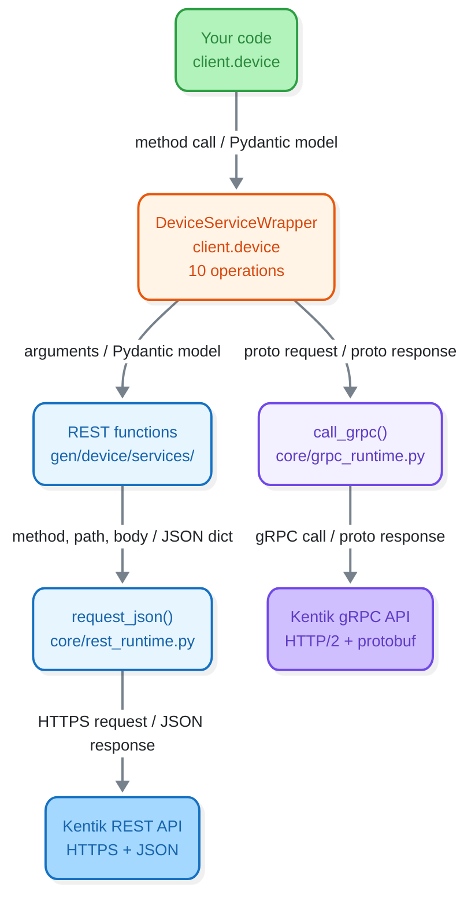

<!-- /github-only -->
<!-- markdownlint-disable MD013 -->
<!-- sphinx-only
```{raw} html
<div class="kx">
<div class="chips" role="group" aria-label="Show one path" data-paths-for="overview-svg"></div>
<figure>
<div class="diagram explorer"><svg id="overview-svg" viewBox="0 0 1100 680" role="img" aria-label="Call path of client.device: your code calls the wrapper, which sends the call over REST or gRPC." xmlns="http://www.w3.org/2000/svg"><defs><marker id="ov-ah" viewBox="0 0 10 10" refX="8.5" refY="5" markerWidth="7" markerHeight="7" orient="auto-start-reverse"><path d="M0,0 L10,5 L0,10 z" class="ah"/></marker><marker id="ov-ah-hi" viewBox="0 0 10 10" refX="8.5" refY="5" markerWidth="7" markerHeight="7" orient="auto-start-reverse"><path d="M0,0 L10,5 L0,10 z" class="ah-hi"/></marker></defs><g class="edge call" data-seg="code_call" data-links="code>wrap"><path d="M520,102 V170" data-route="M520,102 V170" class="wire arrow" marker-end="url(#ov-ah)"/><text x="512" y="140" class="elabel" text-anchor="end">method call</text></g><g class="edge data" data-seg="wrap_answer" data-links="wrap>code"><path d="M580,170 V102" data-route="M580,170 V102" class="wire arrow" marker-end="url(#ov-ah)"/><text x="588" y="140" class="elabel" text-anchor="start">Pydantic model</text></g><g class="edge call" data-seg="rest_call" data-links="wrap>rest"><path d="M450,196 L240,196 Q230,196 230,206 L230,310" data-route="M450,196 H230 V310" class="wire arrow" marker-end="url(#ov-ah)"/><text x="340" y="188" class="elabel" text-anchor="middle">arguments</text></g><g class="edge data" data-seg="rest_answer" data-links="rest>wrap"><path d="M290,310 L290,236 Q290,226 300,226 L450,226" data-route="M290,310 V226 H450" class="wire arrow" marker-end="url(#ov-ah)"/><text x="298" y="275" class="elabel" text-anchor="start">Pydantic model</text></g><g class="edge call" data-seg="rj_call" data-links="rest>rj"><path d="M230,382 V450" data-route="M230,382 V450" class="wire arrow" marker-end="url(#ov-ah)"/><text x="222" y="420" class="elabel" text-anchor="end">method, path, body</text></g><g class="edge data" data-seg="rj_answer" data-links="rj>rest"><path d="M290,450 V382" data-route="M290,450 V382" class="wire arrow" marker-end="url(#ov-ah)"/><text x="298" y="420" class="elabel" text-anchor="start">JSON dict</text></g><g class="edge call" data-seg="api_call" data-links="rj>restapi"><path d="M230,522 V590" data-route="M230,522 V590" class="wire arrow" marker-end="url(#ov-ah)"/><text x="222" y="560" class="elabel" text-anchor="end">HTTPS request</text></g><g class="edge data" data-seg="api_answer" data-links="restapi>rj"><path d="M290,590 V522" data-route="M290,590 V522" class="wire arrow" marker-end="url(#ov-ah)"/><text x="298" y="560" class="elabel" text-anchor="start">JSON response</text></g><g class="edge call" data-seg="cg_call" data-links="wrap>cg"><path d="M650,196 L860,196 Q870,196 870,206 L870,310" data-route="M650,196 H870 V310" class="wire arrow" marker-end="url(#ov-ah)"/><text x="760" y="188" class="elabel" text-anchor="middle">proto request</text></g><g class="edge data" data-seg="cg_answer" data-links="cg>wrap"><path d="M810,310 L810,236 Q810,226 800,226 L650,226" data-route="M810,310 V226 H650" class="wire arrow" marker-end="url(#ov-ah)"/><text x="802" y="275" class="elabel" text-anchor="end">proto response</text></g><g class="edge call" data-seg="grpc_call" data-links="cg>grpcapi"><path d="M810,382 V590" data-route="M810,382 V590" class="wire arrow" marker-end="url(#ov-ah)"/><text x="802" y="490" class="elabel" text-anchor="end">gRPC call</text></g><g class="edge data" data-seg="grpc_answer" data-links="grpcapi>cg"><path d="M870,590 V382" data-route="M870,590 V382" class="wire arrow" marker-end="url(#ov-ah)"/><text x="878" y="490" class="elabel" text-anchor="start">proto response</text></g><g class="node fam-green src " data-id="code" tabindex="0" role="button" aria-label="Select Your code"><rect x="450" y="30" width="200" height="72" rx="14"/><text x="550.0" y="62.5" class="nm">Your code</text><text x="550.0" y="79.5" class="ft">client.device</text></g><g class="node fam-orange proc " data-id="wrap" tabindex="0" role="button" aria-label="Select DeviceServiceWrapper"><rect x="450" y="170" width="200" height="72" rx="14"/><text x="550.0" y="194.0" class="nm">DeviceServiceWrapper</text><text x="550.0" y="211.0" class="ft">client.device</text><text x="550.0" y="228.0" class="ft">10 operations</text></g><g class="node fam-blue proc " data-id="rest" tabindex="0" role="button" aria-label="Select REST functions"><rect x="160" y="310" width="200" height="72" rx="14"/><text x="260.0" y="342.5" class="nm">REST functions</text><text x="260.0" y="359.5" class="ft">gen/device/services/</text></g><g class="node fam-blue proc " data-id="rj" tabindex="0" role="button" aria-label="Select request_json()"><rect x="160" y="450" width="200" height="72" rx="14"/><text x="260.0" y="482.5" class="nm">request_json()</text><text x="260.0" y="499.5" class="ft">core/rest_runtime.py</text></g><g class="node fam-blue src " data-id="restapi" tabindex="0" role="button" aria-label="Select Kentik REST API"><rect x="160" y="590" width="200" height="72" rx="14"/><text x="260.0" y="622.5" class="nm">Kentik REST API</text><text x="260.0" y="639.5" class="ft">HTTPS + JSON</text></g><g class="node fam-violet proc " data-id="cg" tabindex="0" role="button" aria-label="Select call_grpc()"><rect x="740" y="310" width="200" height="72" rx="14"/><text x="840.0" y="342.5" class="nm">call_grpc()</text><text x="840.0" y="359.5" class="ft">core/grpc_runtime.py</text></g><g class="node fam-violet src " data-id="grpcapi" tabindex="0" role="button" aria-label="Select Kentik gRPC API"><rect x="740" y="590" width="200" height="72" rx="14"/><text x="840.0" y="622.5" class="nm">Kentik gRPC API</text><text x="840.0" y="639.5" class="ft">HTTP/2 + protobuf</text></g></svg></div>
<figcaption>Select a part. Each hop is a call going down and its answer coming back up.</figcaption>
</figure>
<div class="legend" aria-hidden="true"><span><svg viewBox="0 0 34 10"><line x1="2" y1="5" x2="32" y2="5" stroke="var(--wire-hi)" stroke-linecap="round" stroke-width="3"/></svg>what the selected part needs</span><span><svg viewBox="0 0 34 10"><line x1="2" y1="5" x2="32" y2="5" stroke="var(--wire-hi)" stroke-linecap="round" stroke-width="3" stroke-dasharray="9 7"/></svg>where its data goes</span></div>
<div class="detail" data-detail-for="overview-svg" aria-live="polite"></div>
<script type="application/json" id="diagram-data">{"overview-svg": {"select": "wrap", "parts": {"code": {"title": "Your code", "role": "Calls a method on the service wrapper.", "facts": ["client.device.<method>(...)"], "stops": "Nothing in the SDK runs."}, "wrap": {"title": "DeviceServiceWrapper", "role": "Sends each call to the REST function or to call_grpc(), for the transport that the client uses.", "facts": ["Source: gen/device/services/device.py", "Returns models from gen/device/models/"], "stops": "Expected: no operation of this service can be called."}, "rest": {"title": "REST functions", "role": "One function per operation. Each one calls request_json() with its own error class.", "facts": ["Error classes: gen/device/error/"], "stops": "Expected: calls on a REST transport fail. A gRPC client keeps working."}, "rj": {"title": "request_json()", "role": "The one function that sends REST traffic: auth headers, quota, and errors.", "facts": ["Raises AuthenticationError on 401", "Raises the operation's error class on other errors"], "stops": "Expected: every REST call of every service fails."}, "restapi": {"title": "Kentik REST API", "role": "The REST endpoints of the service.", "facts": ["Reports the quota in response headers"], "stops": "Expected: REST calls raise TransportError. A gRPC client keeps working."}, "cg": {"title": "call_grpc()", "role": "The one function that sends gRPC traffic: deadline, quota, and errors.", "facts": ["Parses each answer into the same models as REST"], "stops": "Expected: every gRPC call fails. A REST client keeps working."}, "grpcapi": {"title": "Kentik gRPC API", "role": "The gRPC methods of the service.", "facts": ["Reports the quota in response metadata"], "stops": "Expected: gRPC calls raise TransportError. A REST client keeps working."}}, "paths": {"rest": {"label": "REST call", "family": "blue", "title": "A call on a REST transport", "text": "The wrapper calls the REST function, which sends the request with request_json().", "links": ["code>wrap", "wrap>rest", "rest>rj", "rj>restapi", "restapi>rj", "rj>rest", "rest>wrap", "wrap>code"]}, "grpc": {"label": "gRPC call", "family": "violet", "title": "A call on a gRPC transport", "text": "The wrapper builds the proto request and sends it with call_grpc().", "links": ["code>wrap", "wrap>cg", "cg>grpcapi", "grpcapi>cg", "cg>wrap", "wrap>code"]}}}}</script>
</div>
```
-->
<!-- markdownlint-enable MD013 -->

On an error status or a failed call, the SDK raises an error class from `gen/device/error/`, or a shared type from `kentik_api.errors`.

## Endpoints

### `GET` `/device/v202504beta2/device`

List all devices.

Returns list of configured devices. Use the 'view' parameter to control response detail: FULL (default), BASIC (id, name, status), or ID_ONLY (id only). See [About Devices](https://kb.kentik.com/v4/Cb01.htm).

#### REST call flow

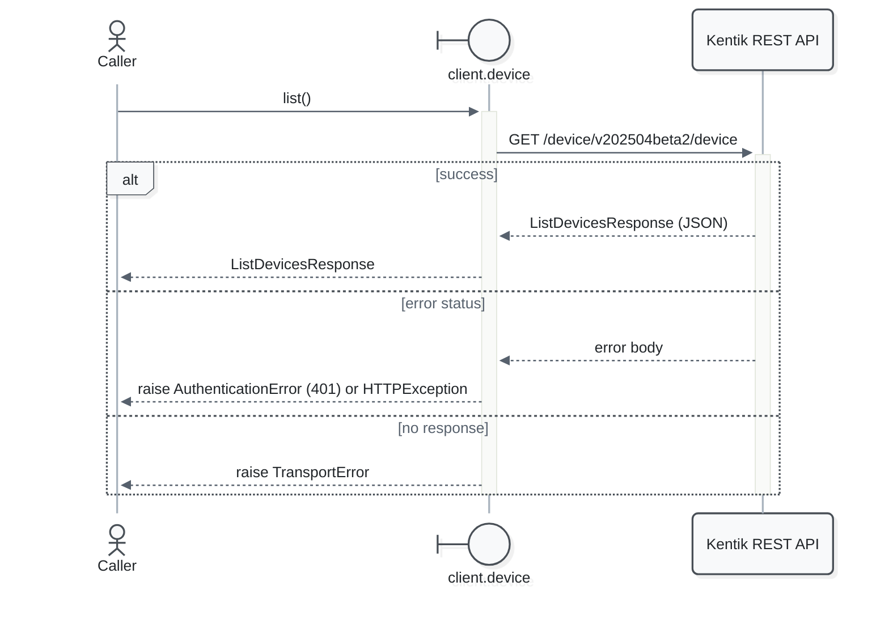

#### gRPC call flow

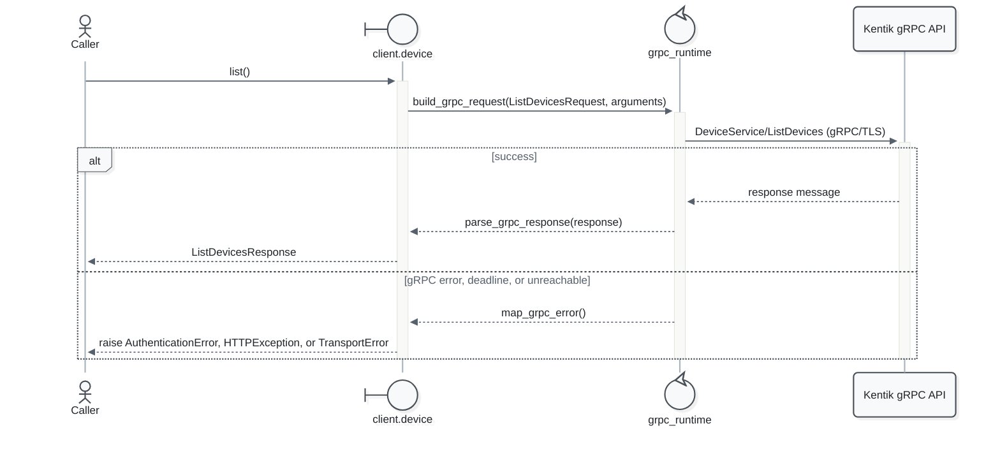

#### Parameters

| Name | In | Type | Required |
| --- | --- | --- | --- |
| `querynoCustomColumns` | query | `boolean` | No |
| `view` | query | `string` | No |

#### Responses

| Status | Description | Model |
| --- | --- | --- |
| 200 | A successful response. | `ListDevicesResponse` |
| default | An unexpected error response. | `rpcStatus` |

#### Example

```python
from kentik_api.client import KentikAPI

# Both transports work: protocol="rest" (default) or protocol="grpc".
client = KentikAPI(protocol="rest")  # loads KENTIK_EMAIL/KENTIK_API_TOKEN from .env
response = client.device.list()
```

---

### `POST` `/device/v202504beta2/device`

Configure a new device.

Create configuration for a new device. Returns the newly created configuration (see [About Devices](https://kb.kentik.com/v4/Cb01.htm)).

#### REST call flow

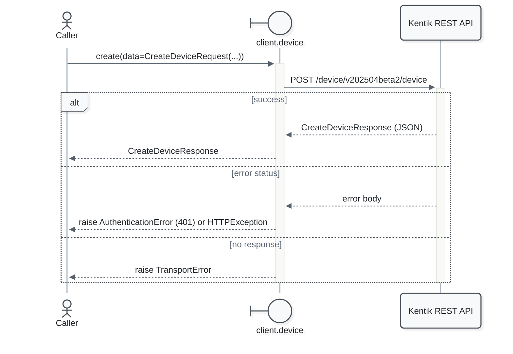

#### gRPC call flow

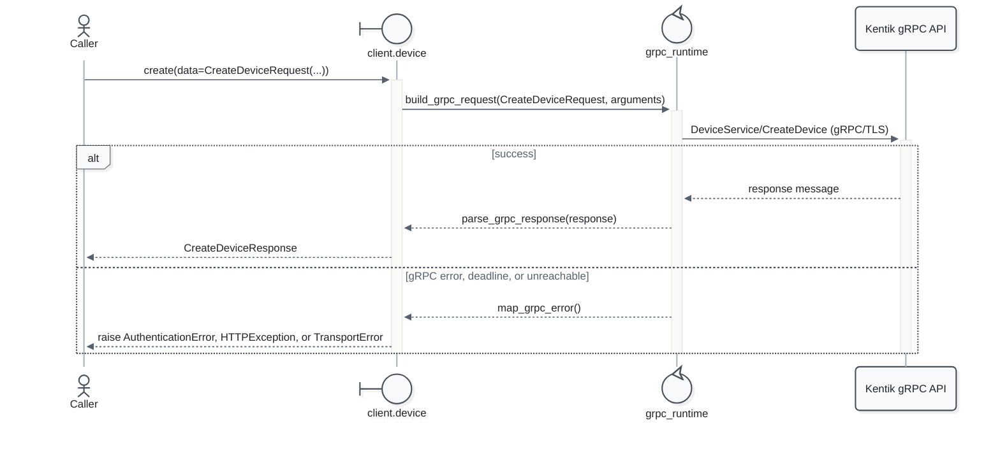

#### Parameters

| Name | In | Type | Required |
| --- | --- | --- | --- |
| `data` | body | `CreateDeviceRequest` | Yes |

#### Responses

| Status | Description | Model |
| --- | --- | --- |
| 200 | A successful response. | `CreateDeviceResponse` |
| default | An unexpected error response. | `rpcStatus` |

#### Example

```python
from kentik_api.client import KentikAPI
from kentik_api.gen.device.models import CreateDeviceRequest

# Both transports work: protocol="rest" (default) or protocol="grpc".
client = KentikAPI(protocol="rest")  # loads KENTIK_EMAIL/KENTIK_API_TOKEN from .env
response = client.device.create(
    data=CreateDeviceRequest(...),
)
```

---

### `POST` `/device/v202504beta2/device/batch_create`

Configure multiple devices (max 100).

Create configuration for multiple devices. Returns the newly created configurations (see [About Devices](https://kb.kentik.com/v4/Cb01.htm)).

#### REST call flow


#### gRPC call flow

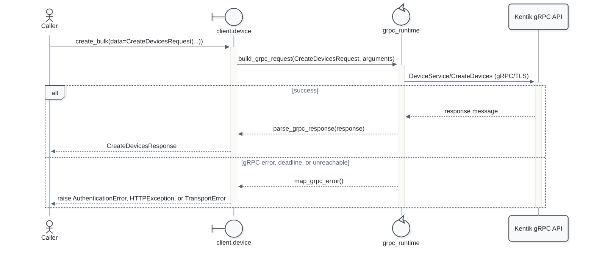

#### Parameters

| Name | In | Type | Required |
| --- | --- | --- | --- |
| `data` | body | `CreateDevicesRequest` | Yes |

#### Responses

| Status | Description | Model |
| --- | --- | --- |
| 200 | A successful response. | `CreateDevicesResponse` |
| default | An unexpected error response. | `rpcStatus` |

#### Example

```python
from kentik_api.client import KentikAPI
from kentik_api.gen.device.models import CreateDevicesRequest

# Both transports work: protocol="rest" (default) or protocol="grpc".
client = KentikAPI(protocol="rest")  # loads KENTIK_EMAIL/KENTIK_API_TOKEN from .env
response = client.device.create_bulk(
    data=CreateDevicesRequest(...),
)
```

---

### `POST` `/device/v202504beta2/device/batch_delete`

Delete configuration of multiple devices.

Deletes configuration of multiple devices with specific IDs (see [About Devices](https://kb.kentik.com/v4/Cb01.htm)).

#### REST call flow

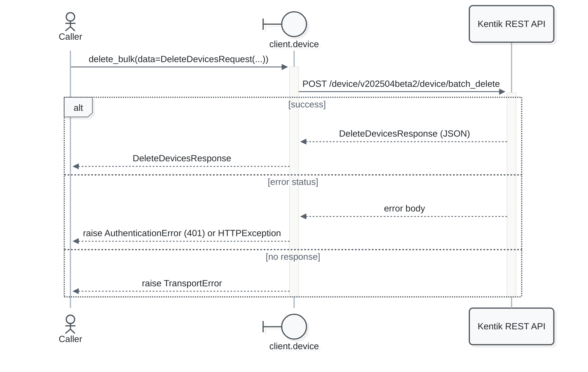

#### gRPC call flow


#### Parameters

| Name | In | Type | Required |
| --- | --- | --- | --- |
| `data` | body | `DeleteDevicesRequest` | Yes |

#### Responses

| Status | Description | Model |
| --- | --- | --- |
| 200 | A successful response. | `DeleteDevicesResponse` |
| default | An unexpected error response. | `rpcStatus` |

#### Example

```python
from kentik_api.client import KentikAPI
from kentik_api.gen.device.models import DeleteDevicesRequest

# Both transports work: protocol="rest" (default) or protocol="grpc".
client = KentikAPI(protocol="rest")  # loads KENTIK_EMAIL/KENTIK_API_TOKEN from .env
response = client.device.delete_bulk(
    data=DeleteDevicesRequest(...),
)
```

---

### `PUT` `/device/v202504beta2/device/batch_update`

Updates configuration of multiple devices (max 100).

Replaces configuration of multiple devices with attributes in the request. Returns the updated configurations (see [About Devices](https://kb.kentik.com/v4/Cb01.htm)).

#### REST call flow

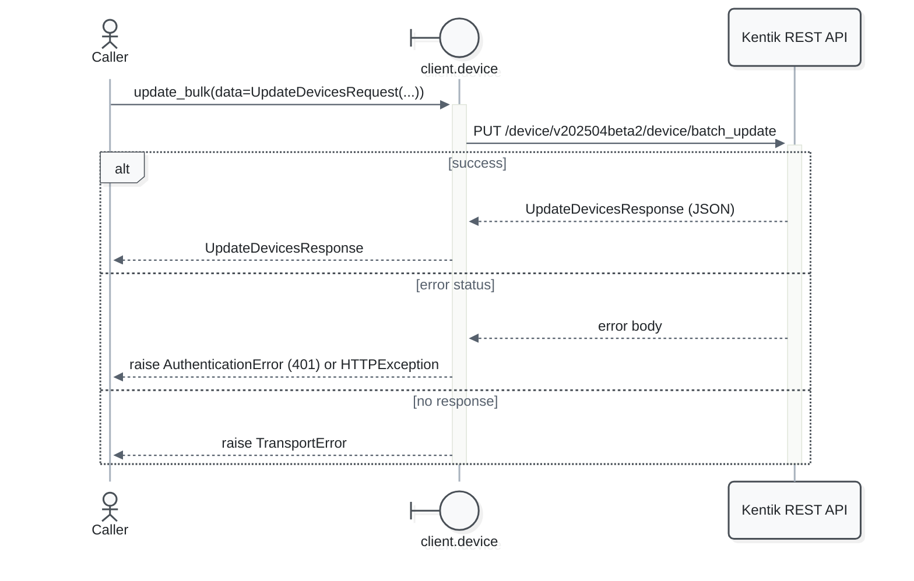

#### gRPC call flow

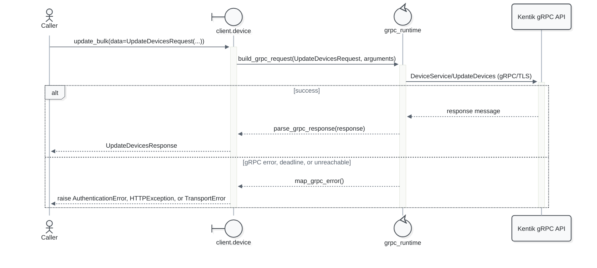

#### Parameters

| Name | In | Type | Required |
| --- | --- | --- | --- |
| `data` | body | `UpdateDevicesRequest` | Yes |

#### Responses

| Status | Description | Model |
| --- | --- | --- |
| 200 | A successful response. | `UpdateDevicesResponse` |
| default | An unexpected error response. | `rpcStatus` |

#### Example

```python
from kentik_api.client import KentikAPI
from kentik_api.gen.device.models import UpdateDevicesRequest

# Both transports work: protocol="rest" (default) or protocol="grpc".
client = KentikAPI(protocol="rest")  # loads KENTIK_EMAIL/KENTIK_API_TOKEN from .env
response = client.device.update_bulk(
    data=UpdateDevicesRequest(...),
)
```

---

### `GET` `/device/v202504beta2/device/name/{deviceName}`

Retrieve configuration of a device by name.

Returns configuration of a device specified by name (see [About Devices](https://kb.kentik.com/v4/Cb01.htm)).

#### REST call flow

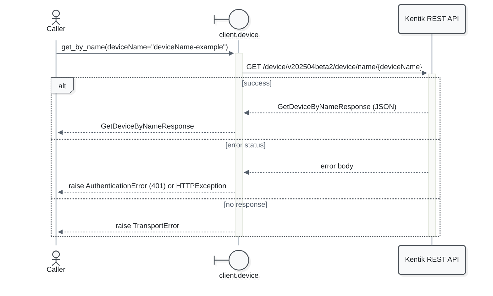

#### gRPC call flow

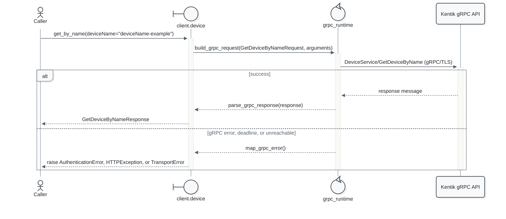

#### Parameters

| Name | In | Type | Required |
| --- | --- | --- | --- |
| `deviceName` | path | `string` | Yes |
| `querynoCustomColumns` | query | `boolean` | No |

#### Responses

| Status | Description | Model |
| --- | --- | --- |
| 200 | A successful response. | `GetDeviceByNameResponse` |
| default | An unexpected error response. | `rpcStatus` |

#### Example

```python
from kentik_api.client import KentikAPI

# Both transports work: protocol="rest" (default) or protocol="grpc".
client = KentikAPI(protocol="rest")  # loads KENTIK_EMAIL/KENTIK_API_TOKEN from .env
response = client.device.get_by_name(
    deviceName="deviceName-example",
)
```

---

### `GET` `/device/v202504beta2/device/{device.id}`

Retrieve configuration of a device.

Returns configuration of a device specified by ID (see [About Devices](https://kb.kentik.com/v4/Cb01.htm)).

#### REST call flow

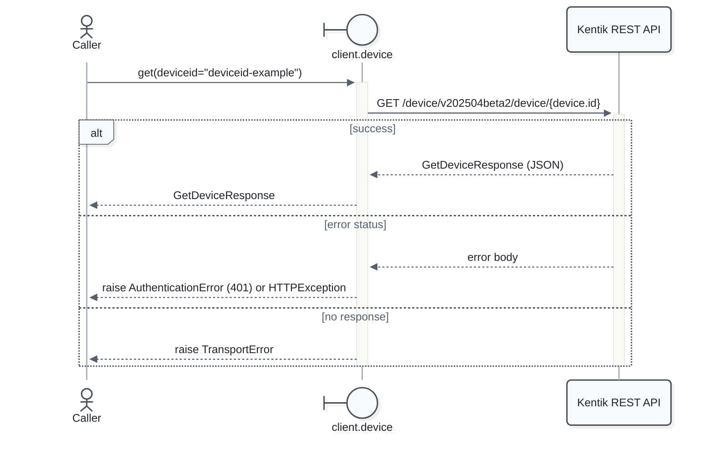

#### gRPC call flow

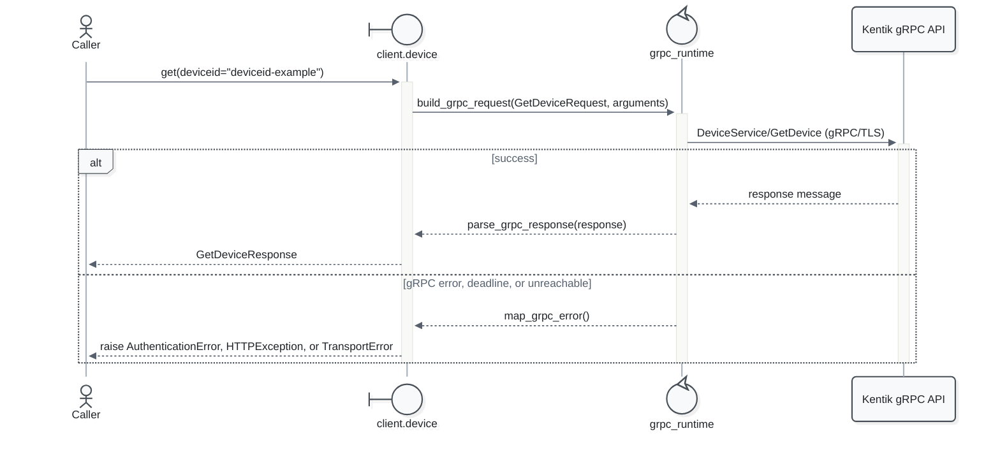

#### Parameters

| Name | In | Type | Required |
| --- | --- | --- | --- |
| `deviceid` | path | `string` | Yes |
| `querynoCustomColumns` | query | `boolean` | No |

#### Responses

| Status | Description | Model |
| --- | --- | --- |
| 200 | A successful response. | `GetDeviceResponse` |
| default | An unexpected error response. | `rpcStatus` |

#### Example

```python
from kentik_api.client import KentikAPI

# Both transports work: protocol="rest" (default) or protocol="grpc".
client = KentikAPI(protocol="rest")  # loads KENTIK_EMAIL/KENTIK_API_TOKEN from .env
response = client.device.get(
    deviceid="deviceid-example",
)
```

---

### `PUT` `/device/v202504beta2/device/{device.id}`

Updates configuration of a device.

Replaces configuration of a device with attributes in the request. Returns the updated configuration (see [About Devices](https://kb.kentik.com/v4/Cb01.htm)).

#### REST call flow

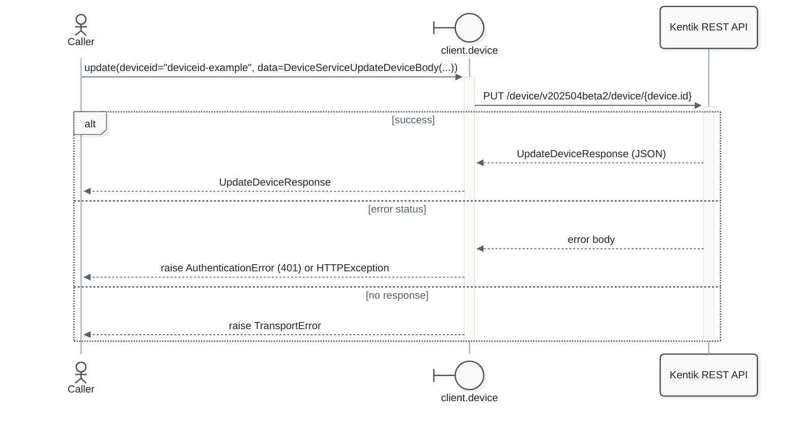

#### gRPC call flow

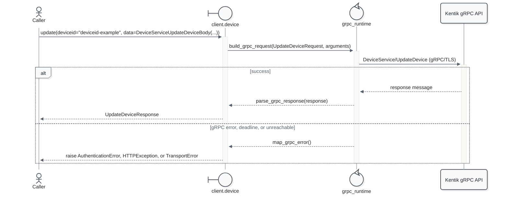

#### Parameters

| Name | In | Type | Required |
| --- | --- | --- | --- |
| `deviceid` | path | `string` | Yes |
| `data` | body | `DeviceServiceUpdateDeviceBody` | Yes |

#### Responses

| Status | Description | Model |
| --- | --- | --- |
| 200 | A successful response. | `UpdateDeviceResponse` |
| default | An unexpected error response. | `rpcStatus` |

#### Example

```python
from kentik_api.client import KentikAPI
from kentik_api.gen.device.models import DeviceServiceUpdateDeviceBody

# Both transports work: protocol="rest" (default) or protocol="grpc".
client = KentikAPI(protocol="rest")  # loads KENTIK_EMAIL/KENTIK_API_TOKEN from .env
response = client.device.update(
    deviceid="deviceid-example",
    data=DeviceServiceUpdateDeviceBody(...),
)
```

---

### `DELETE` `/device/v202504beta2/device/{device.id}`

Delete configuration of a device.

Deletes configuration of a device with specific ID (see [About Devices](https://kb.kentik.com/v4/Cb01.htm)).

#### REST call flow

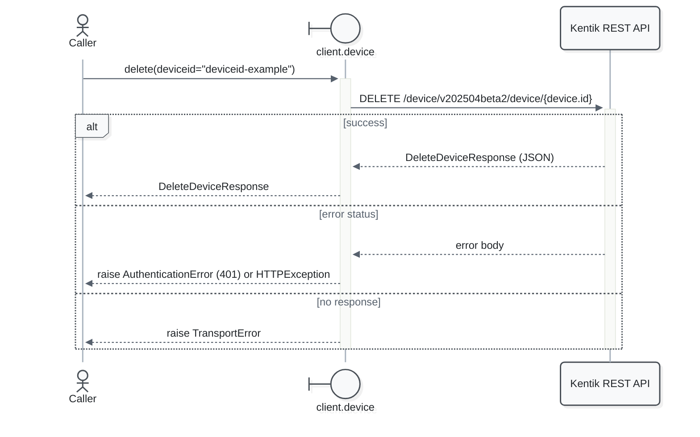

#### gRPC call flow

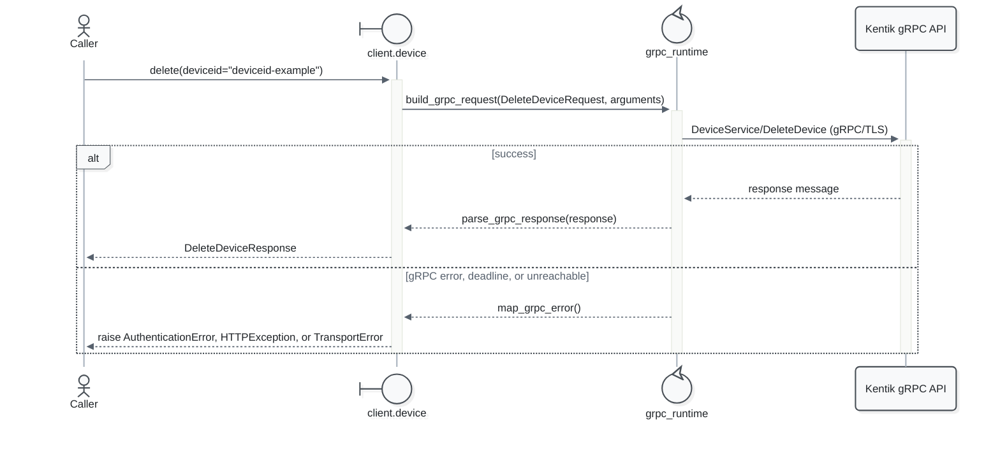

#### Parameters

| Name | In | Type | Required |
| --- | --- | --- | --- |
| `deviceid` | path | `string` | Yes |

#### Responses

| Status | Description | Model |
| --- | --- | --- |
| 200 | A successful response. | `DeleteDeviceResponse` |
| default | An unexpected error response. | `rpcStatus` |

#### Example

```python
from kentik_api.client import KentikAPI

# Both transports work: protocol="rest" (default) or protocol="grpc".
client = KentikAPI(protocol="rest")  # loads KENTIK_EMAIL/KENTIK_API_TOKEN from .env
response = client.device.delete(
    deviceid="deviceid-example",
)
```

---

### `PUT` `/device/v202504beta2/device/{id}/labels`

Updates labels of a device.

Removes all existing labels from the device and applies the device labels (see [About Device Labels](https://kb.kentik.com/v4/Cb16.htm)) specified by id. Returns the updated configuration.

#### REST call flow


#### gRPC call flow

```mermaid
%%{init: {"theme": "redux", "look": "neo", "layout": "elk", "fontFamily": "ui-monospace, SFMono-Regular, Menlo, monospace", "themeVariables": {"fontFamily": "ui-monospace, SFMono-Regular, Menlo, monospace", "primaryColor": "#f8f9fa", "primaryBorderColor": "#495057", "primaryTextColor": "#212529", "textColor": "#212529", "lineColor": "#77818c", "edgeLabelBackground": "#ffffff", "actorBkg": "#f8f9fa", "actorBorder": "#495057", "actorTextColor": "#212529", "actorLineColor": "#a9b3be", "signalColor": "#57616d", "signalTextColor": "#212529", "labelBoxBkgColor": "#f8f9fa", "labelBoxBorderColor": "#495057", "labelTextColor": "#212529", "loopTextColor": "#57616d", "noteBkgColor": "#fff9db", "noteBorderColor": "#f08c00", "noteTextColor": "#a35a00"}, "sequence": {"activationWidth": 16}, "flowchart": {"curve": "basis", "nodeSpacing": 30, "rankSpacing": 70, "wrappingWidth": 400}}}%%
sequenceDiagram
    actor C as Caller
    participant W@{ "type": "boundary" } as client.device
    participant R@{ "type": "control" } as grpc_runtime
    participant API as Kentik gRPC API

    C->>+W: update_labels(id="id-example", data=DeviceServiceUpdateDeviceLabelsBody(...))
    W->>+R: build_grpc_request(UpdateDeviceLabelsRequest, arguments)
    R->>+API: DeviceService/UpdateDeviceLabels (gRPC/TLS)
    alt success
        API-->>R: response message
        R-->>W: parse_grpc_response(response)
        W-->>C: UpdateDeviceLabelsResponse
    else gRPC error, deadline, or unreachable
        R-->>W: map_grpc_error()
        W-->>C: raise AuthenticationError, HTTPException, or TransportError
    end
    deactivate API
    deactivate R
    deactivate W
```

#### Parameters

| Name | In | Type | Required |
| --- | --- | --- | --- |
| `id` | path | `string` | Yes |
| `data` | body | `DeviceServiceUpdateDeviceLabelsBody` | Yes |

#### Responses

| Status | Description | Model |
| --- | --- | --- |
| 200 | A successful response. | `UpdateDeviceLabelsResponse` |
| default | An unexpected error response. | `rpcStatus` |

#### Example

```python
from kentik_api.client import KentikAPI
from kentik_api.gen.device.models import DeviceServiceUpdateDeviceLabelsBody

# Both transports work: protocol="rest" (default) or protocol="grpc".
client = KentikAPI(protocol="rest")  # loads KENTIK_EMAIL/KENTIK_API_TOKEN from .env
response = client.device.update_labels(
    id="id-example",
    data=DeviceServiceUpdateDeviceLabelsBody(...),
)
```

## Data Models

<details>
<summary>Model relationships (21 of 33 models)</summary>

Each arrow points from a model to a model that one of its fields holds. The label names the field.

```mermaid
%%{init: {"theme": "redux", "look": "neo", "layout": "elk", "fontFamily": "ui-monospace, SFMono-Regular, Menlo, monospace", "themeVariables": {"fontFamily": "ui-monospace, SFMono-Regular, Menlo, monospace", "primaryColor": "#f8f9fa", "primaryBorderColor": "#495057", "primaryTextColor": "#212529", "textColor": "#212529", "lineColor": "#77818c", "edgeLabelBackground": "#ffffff", "actorBkg": "#f8f9fa", "actorBorder": "#495057", "actorTextColor": "#212529", "actorLineColor": "#a9b3be", "signalColor": "#57616d", "signalTextColor": "#212529", "labelBoxBkgColor": "#f8f9fa", "labelBoxBorderColor": "#495057", "labelTextColor": "#212529", "loopTextColor": "#57616d", "noteBkgColor": "#fff9db", "noteBorderColor": "#f08c00", "noteTextColor": "#a35a00"}, "sequence": {"activationWidth": 16}, "flowchart": {"curve": "basis", "nodeSpacing": 30, "rankSpacing": 70, "wrappingWidth": 400}}}%%
classDiagram
    class CreateDeviceRequest
    class CreateDeviceResponse
    class CreateDevicesRequest
    class CreateDevicesResponse
    class DeleteDeviceResponse
    class DeleteDevicesRequest
    class DeleteDevicesResponse
    class DeviceConcise
    class DeviceDetailed
    class DeviceServiceUpdateDeviceBody
    class DeviceServiceUpdateDeviceLabelsBody
    class GetDeviceByNameResponse
    class GetDeviceResponse
    class LabelConcise
    class ListDevicesResponse
    class UpdateDeviceLabelsResponse
    class UpdateDeviceResponse
    class UpdateDevicesRequest
    class UpdateDevicesResponse
    class protobufAny
    class rpcStatus
    CreateDeviceRequest --> DeviceConcise : device
    CreateDeviceResponse --> DeviceDetailed : device
    CreateDevicesRequest --> DeviceConcise : devices
    CreateDevicesResponse --> DeviceDetailed : devices
    DeviceServiceUpdateDeviceLabelsBody --> LabelConcise : labels
    GetDeviceByNameResponse --> DeviceDetailed : device
    GetDeviceResponse --> DeviceDetailed : device
    ListDevicesResponse --> DeviceDetailed : devices
    UpdateDeviceLabelsResponse --> DeviceDetailed : device
    UpdateDeviceResponse --> DeviceDetailed : device
    UpdateDevicesRequest --> DeviceConcise : devices
    UpdateDevicesResponse --> DeviceDetailed : devices
    rpcStatus --> protobufAny : details
```

</details>

```{eval-rst}
.. autopydantic_model:: kentik_api.gen.device.models.CreateDeviceRequest
```

```{eval-rst}
.. autopydantic_model:: kentik_api.gen.device.models.CreateDeviceResponse
```

```{eval-rst}
.. autopydantic_model:: kentik_api.gen.device.models.CreateDevicesRequest
```

```{eval-rst}
.. autopydantic_model:: kentik_api.gen.device.models.CreateDevicesResponse
```

```{eval-rst}
.. autopydantic_model:: kentik_api.gen.device.models.CustomColumnData
```

```{eval-rst}
.. autopydantic_model:: kentik_api.gen.device.models.DeleteDeviceResponse
```

```{eval-rst}
.. autopydantic_model:: kentik_api.gen.device.models.DeleteDevicesRequest
```

```{eval-rst}
.. autopydantic_model:: kentik_api.gen.device.models.DeleteDevicesResponse
```

```{eval-rst}
.. autopydantic_model:: kentik_api.gen.device.models.DeviceConcise
```

```{eval-rst}
.. autopydantic_model:: kentik_api.gen.device.models.DeviceDetailed
```

```{eval-rst}
.. autopydantic_model:: kentik_api.gen.device.models.DeviceNmsConfig
```

```{eval-rst}
.. autopydantic_model:: kentik_api.gen.device.models.DeviceNmsSnmpConfig
```

```{eval-rst}
.. autopydantic_model:: kentik_api.gen.device.models.DeviceNmsStConfig
```

```{eval-rst}
.. autopydantic_model:: kentik_api.gen.device.models.DeviceQuery
```

```{eval-rst}
.. autopydantic_model:: kentik_api.gen.device.models.DeviceServiceUpdateDeviceBody
```

```{eval-rst}
.. autopydantic_model:: kentik_api.gen.device.models.DeviceServiceUpdateDeviceLabelsBody
```

```{eval-rst}
.. autopydantic_model:: kentik_api.gen.device.models.DeviceSnmpV3Conf
```

```{eval-rst}
.. autoclass:: kentik_api.gen.device.models.DeviceView
   :members:
```

```{eval-rst}
.. autopydantic_model:: kentik_api.gen.device.models.GetDeviceByNameResponse
```

```{eval-rst}
.. autopydantic_model:: kentik_api.gen.device.models.GetDeviceResponse
```

```{eval-rst}
.. autopydantic_model:: kentik_api.gen.device.models.GnmiV1Conf
```

```{eval-rst}
.. autopydantic_model:: kentik_api.gen.device.models.Interface
```

```{eval-rst}
.. autopydantic_model:: kentik_api.gen.device.models.Label
```

```{eval-rst}
.. autopydantic_model:: kentik_api.gen.device.models.LabelConcise
```

```{eval-rst}
.. autopydantic_model:: kentik_api.gen.device.models.ListDevicesResponse
```

```{eval-rst}
.. autopydantic_model:: kentik_api.gen.device.models.Plan
```

```{eval-rst}
.. autopydantic_model:: kentik_api.gen.device.models.Site
```

```{eval-rst}
.. autopydantic_model:: kentik_api.gen.device.models.UpdateDeviceLabelsResponse
```

```{eval-rst}
.. autopydantic_model:: kentik_api.gen.device.models.UpdateDeviceResponse
```

```{eval-rst}
.. autopydantic_model:: kentik_api.gen.device.models.UpdateDevicesRequest
```

```{eval-rst}
.. autopydantic_model:: kentik_api.gen.device.models.UpdateDevicesResponse
```

```{eval-rst}
.. autopydantic_model:: kentik_api.gen.device.models.protobufAny
```

```{eval-rst}
.. autopydantic_model:: kentik_api.gen.device.models.rpcStatus
```
