<!-- AUTO-GENERATED: scripts/generation/endpoint_docs.py, render_endpoint_docs() -->
<!-- Rebuilt on every `uv run poe generate`. Do not edit by hand. -->

# Synthetics Service

## Overview

<!-- github-only -->

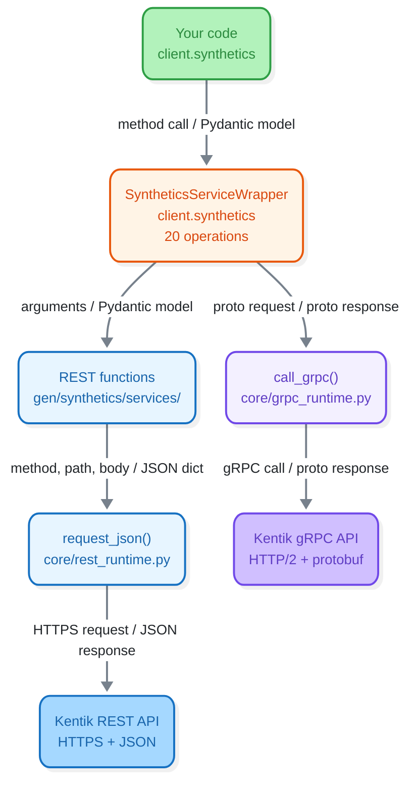

<!-- /github-only -->
<!-- markdownlint-disable MD013 -->
<!-- sphinx-only
```{raw} html
<div class="kx">
<div class="chips" role="group" aria-label="Show one path" data-paths-for="overview-svg"></div>
<figure>
<div class="diagram explorer"><svg id="overview-svg" viewBox="0 0 1100 680" role="img" aria-label="Call path of client.synthetics: your code calls the wrapper, which sends the call over REST or gRPC." xmlns="http://www.w3.org/2000/svg"><defs><marker id="ov-ah" viewBox="0 0 10 10" refX="8.5" refY="5" markerWidth="7" markerHeight="7" orient="auto-start-reverse"><path d="M0,0 L10,5 L0,10 z" class="ah"/></marker><marker id="ov-ah-hi" viewBox="0 0 10 10" refX="8.5" refY="5" markerWidth="7" markerHeight="7" orient="auto-start-reverse"><path d="M0,0 L10,5 L0,10 z" class="ah-hi"/></marker></defs><g class="edge call" data-seg="code_call" data-links="code>wrap"><path d="M520,102 V170" data-route="M520,102 V170" class="wire arrow" marker-end="url(#ov-ah)"/><text x="512" y="140" class="elabel" text-anchor="end">method call</text></g><g class="edge data" data-seg="wrap_answer" data-links="wrap>code"><path d="M580,170 V102" data-route="M580,170 V102" class="wire arrow" marker-end="url(#ov-ah)"/><text x="588" y="140" class="elabel" text-anchor="start">Pydantic model</text></g><g class="edge call" data-seg="rest_call" data-links="wrap>rest"><path d="M450,196 L240,196 Q230,196 230,206 L230,310" data-route="M450,196 H230 V310" class="wire arrow" marker-end="url(#ov-ah)"/><text x="340" y="188" class="elabel" text-anchor="middle">arguments</text></g><g class="edge data" data-seg="rest_answer" data-links="rest>wrap"><path d="M290,310 L290,236 Q290,226 300,226 L450,226" data-route="M290,310 V226 H450" class="wire arrow" marker-end="url(#ov-ah)"/><text x="298" y="275" class="elabel" text-anchor="start">Pydantic model</text></g><g class="edge call" data-seg="rj_call" data-links="rest>rj"><path d="M230,382 V450" data-route="M230,382 V450" class="wire arrow" marker-end="url(#ov-ah)"/><text x="222" y="420" class="elabel" text-anchor="end">method, path, body</text></g><g class="edge data" data-seg="rj_answer" data-links="rj>rest"><path d="M290,450 V382" data-route="M290,450 V382" class="wire arrow" marker-end="url(#ov-ah)"/><text x="298" y="420" class="elabel" text-anchor="start">JSON dict</text></g><g class="edge call" data-seg="api_call" data-links="rj>restapi"><path d="M230,522 V590" data-route="M230,522 V590" class="wire arrow" marker-end="url(#ov-ah)"/><text x="222" y="560" class="elabel" text-anchor="end">HTTPS request</text></g><g class="edge data" data-seg="api_answer" data-links="restapi>rj"><path d="M290,590 V522" data-route="M290,590 V522" class="wire arrow" marker-end="url(#ov-ah)"/><text x="298" y="560" class="elabel" text-anchor="start">JSON response</text></g><g class="edge call" data-seg="cg_call" data-links="wrap>cg"><path d="M650,196 L860,196 Q870,196 870,206 L870,310" data-route="M650,196 H870 V310" class="wire arrow" marker-end="url(#ov-ah)"/><text x="760" y="188" class="elabel" text-anchor="middle">proto request</text></g><g class="edge data" data-seg="cg_answer" data-links="cg>wrap"><path d="M810,310 L810,236 Q810,226 800,226 L650,226" data-route="M810,310 V226 H650" class="wire arrow" marker-end="url(#ov-ah)"/><text x="802" y="275" class="elabel" text-anchor="end">proto response</text></g><g class="edge call" data-seg="grpc_call" data-links="cg>grpcapi"><path d="M810,382 V590" data-route="M810,382 V590" class="wire arrow" marker-end="url(#ov-ah)"/><text x="802" y="490" class="elabel" text-anchor="end">gRPC call</text></g><g class="edge data" data-seg="grpc_answer" data-links="grpcapi>cg"><path d="M870,590 V382" data-route="M870,590 V382" class="wire arrow" marker-end="url(#ov-ah)"/><text x="878" y="490" class="elabel" text-anchor="start">proto response</text></g><g class="node fam-green src " data-id="code" tabindex="0" role="button" aria-label="Select Your code"><rect x="450" y="30" width="200" height="72" rx="14"/><text x="550.0" y="62.5" class="nm">Your code</text><text x="550.0" y="79.5" class="ft">client.synthetics</text></g><g class="node fam-orange proc " data-id="wrap" tabindex="0" role="button" aria-label="Select SyntheticsServiceWrapper"><rect x="450" y="170" width="200" height="72" rx="14"/><text x="550.0" y="194.0" class="nm">SyntheticsServiceWrapper</text><text x="550.0" y="211.0" class="ft">client.synthetics</text><text x="550.0" y="228.0" class="ft">20 operations</text></g><g class="node fam-blue proc " data-id="rest" tabindex="0" role="button" aria-label="Select REST functions"><rect x="160" y="310" width="200" height="72" rx="14"/><text x="260.0" y="342.5" class="nm">REST functions</text><text x="260.0" y="359.5" class="ft">gen/synthetics/services/</text></g><g class="node fam-blue proc " data-id="rj" tabindex="0" role="button" aria-label="Select request_json()"><rect x="160" y="450" width="200" height="72" rx="14"/><text x="260.0" y="482.5" class="nm">request_json()</text><text x="260.0" y="499.5" class="ft">core/rest_runtime.py</text></g><g class="node fam-blue src " data-id="restapi" tabindex="0" role="button" aria-label="Select Kentik REST API"><rect x="160" y="590" width="200" height="72" rx="14"/><text x="260.0" y="622.5" class="nm">Kentik REST API</text><text x="260.0" y="639.5" class="ft">HTTPS + JSON</text></g><g class="node fam-violet proc " data-id="cg" tabindex="0" role="button" aria-label="Select call_grpc()"><rect x="740" y="310" width="200" height="72" rx="14"/><text x="840.0" y="342.5" class="nm">call_grpc()</text><text x="840.0" y="359.5" class="ft">core/grpc_runtime.py</text></g><g class="node fam-violet src " data-id="grpcapi" tabindex="0" role="button" aria-label="Select Kentik gRPC API"><rect x="740" y="590" width="200" height="72" rx="14"/><text x="840.0" y="622.5" class="nm">Kentik gRPC API</text><text x="840.0" y="639.5" class="ft">HTTP/2 + protobuf</text></g></svg></div>
<figcaption>Select a part. Each hop is a call going down and its answer coming back up.</figcaption>
</figure>
<div class="legend" aria-hidden="true"><span><svg viewBox="0 0 34 10"><line x1="2" y1="5" x2="32" y2="5" stroke="var(--wire-hi)" stroke-linecap="round" stroke-width="3"/></svg>what the selected part needs</span><span><svg viewBox="0 0 34 10"><line x1="2" y1="5" x2="32" y2="5" stroke="var(--wire-hi)" stroke-linecap="round" stroke-width="3" stroke-dasharray="9 7"/></svg>where its data goes</span></div>
<div class="detail" data-detail-for="overview-svg" aria-live="polite"></div>
<script type="application/json" id="diagram-data">{"overview-svg": {"select": "wrap", "parts": {"code": {"title": "Your code", "role": "Calls a method on the service wrapper.", "facts": ["client.synthetics.<method>(...)"], "stops": "Nothing in the SDK runs."}, "wrap": {"title": "SyntheticsServiceWrapper", "role": "Sends each call to the REST function or to call_grpc(), for the transport that the client uses.", "facts": ["Source: gen/synthetics/services/synthetics.py", "Returns models from gen/synthetics/models/"], "stops": "Expected: no operation of this service can be called."}, "rest": {"title": "REST functions", "role": "One function per operation. Each one calls request_json() with its own error class.", "facts": ["Error classes: gen/synthetics/error/"], "stops": "Expected: calls on a REST transport fail. A gRPC client keeps working."}, "rj": {"title": "request_json()", "role": "The one function that sends REST traffic: auth headers, quota, and errors.", "facts": ["Raises AuthenticationError on 401", "Raises the operation's error class on other errors"], "stops": "Expected: every REST call of every service fails."}, "restapi": {"title": "Kentik REST API", "role": "The REST endpoints of the service.", "facts": ["Reports the quota in response headers"], "stops": "Expected: REST calls raise TransportError. A gRPC client keeps working."}, "cg": {"title": "call_grpc()", "role": "The one function that sends gRPC traffic: deadline, quota, and errors.", "facts": ["Parses each answer into the same models as REST"], "stops": "Expected: every gRPC call fails. A REST client keeps working."}, "grpcapi": {"title": "Kentik gRPC API", "role": "The gRPC methods of the service.", "facts": ["Reports the quota in response metadata"], "stops": "Expected: gRPC calls raise TransportError. A REST client keeps working."}}, "paths": {"rest": {"label": "REST call", "family": "blue", "title": "A call on a REST transport", "text": "The wrapper calls the REST function, which sends the request with request_json().", "links": ["code>wrap", "wrap>rest", "rest>rj", "rj>restapi", "restapi>rj", "rj>rest", "rest>wrap", "wrap>code"]}, "grpc": {"label": "gRPC call", "family": "violet", "title": "A call on a gRPC transport", "text": "The wrapper builds the proto request and sends it with call_grpc().", "links": ["code>wrap", "wrap>cg", "cg>grpcapi", "grpcapi>cg", "cg>wrap", "wrap>code"]}}}}</script>
</div>
```
-->
<!-- markdownlint-enable MD013 -->

On an error status or a failed call, the SDK raises an error class from `gen/synthetics/error/`, or a shared type from `kentik_api.errors`.

## Endpoints

### SyntheticsBulkActionService

#### `POST` `/synthetics/v20261005alpha1/tests/bulk_update`

Update multiple synthetic tests

Applies the same attribute changes to up to 50 synthetic tests. Only some attributes can be bulk-updated, and some can be changed only on certain test types or only together with another attribute. Tests are validated first; by default, if any test fails validation no test is updated (see `allow_partial_batch`). Tests that pass are then updated asynchronously: the reply carries the initial status and, if anything was started, a `workflow_id` to pass to GetBulkUpdateTestsStatus. Fails with INVALID_ARGUMENT (HTTP 400) if the request is malformed, such as no IDs, more than 50 IDs, no attributes to update, an attribute that cannot be bulk-updated, or an attribute that does not apply to every selected test's type; RESOURCE_EXHAUSTED (HTTP 429) if the company lacks the synthetics credits for the change; and UNKNOWN (HTTP 500) if the update could not be confirmed as started. After UNKNOWN the update may still run, so check the tests before retrying.

##### Bulk-updatable attributes
Paths are relative to `test` and shown in JSON (camelCase) form. snake_case is also accepted, and error messages report paths in snake_case.

| Path | Notes |
|------|-------|
| `name` | |
| `status` | `TEST_STATUS_ACTIVE` or `TEST_STATUS_PAUSED` |
| `settings.period` | |
| `settings.agentIds` | supports ADD and REMOVE |
| `settings.healthSettings.activation.times` | |
| `settings.healthSettings.activation.timeWindow` | |
| `settings.healthSettings.activation.gracePeriod` | |
| `settings.healthSettings.latencyCritical`, `latencyWarning` | set together |
| `settings.healthSettings.latencyCriticalStddev`, `latencyWarningStddev` | set together; also sets `latencyCritical` and `latencyWarning` to 0 |
| `settings.healthSettings.jitterCritical`, `jitterWarning` | set together |
| `settings.healthSettings.jitterCriticalStddev`, `jitterWarningStddev` | set together; also sets `jitterCritical` and `jitterWarning` to 0 |
| `settings.healthSettings.packetLossCritical`, `packetLossWarning` | set together |
| `settings.ip.targets` | supports ADD and REMOVE |
| `settings.networkGrid.targets` | supports ADD and REMOVE |
| `settings.dns.servers` | supports ADD and REMOVE |
| `settings.dns.target` | |
| `settings.dnsGrid.servers` | supports ADD and REMOVE |
| `settings.dnsGrid.target` | |
| `settings.hostname.target` | |
| `settings.url.target` | |
| `settings.pageLoad.target` | |
| `settings.agent.target` | |

A threshold pair and its Stddev pair cannot be set in the same request.

##### Examples
Change the period of several tests:
```json
{"ids": ["101", "102"], "test": {"settings": {"period": 300}}}
```
Add an agent to each test, keeping the agents already assigned. In JSON, a field mask is a single comma-separated string:
```json
{"ids": ["101", "102"], "test": {"settings": {"agentIds": ["55"]}},
 "ops": [{"mask": "settings.agentIds", "op": "BULK_FIELD_OP_ADD"}]}
```
Set attributes to zero. A zero value cannot be told apart from an unset one, so `mask` must name it:
```json
{"ids": ["101"], "test": {"settings": {"healthSettings": {"jitterCritical": 0, "jitterWarning": 0}}},
 "mask": "settings.healthSettings.jitterCritical,settings.healthSettings.jitterWarning"}
```

##### REST call flow

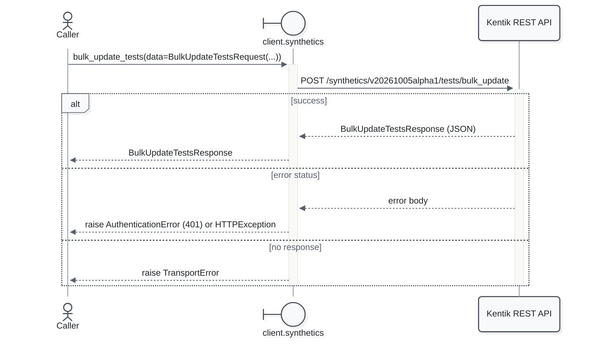

##### gRPC call flow

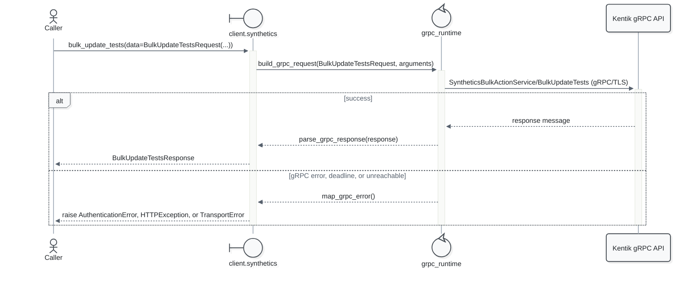

##### Parameters

| Name | In | Type | Required |
| --- | --- | --- | --- |
| `data` | body | `BulkUpdateTestsRequest` | Yes |

##### Responses

| Status | Description | Model |
| --- | --- | --- |
| 200 | A successful response. | `BulkUpdateTestsResponse` |
| default | An unexpected error response. | `rpcStatus` |

##### Example

```python
from kentik_api.client import KentikAPI
from kentik_api.gen.synthetics.models import BulkUpdateTestsRequest

# Both transports work: protocol="rest" (default) or protocol="grpc".
client = KentikAPI(protocol="rest")  # loads KENTIK_EMAIL/KENTIK_API_TOKEN from .env
response = client.synthetics.bulk_update_tests(
    data=BulkUpdateTestsRequest(...),
)
```

---

#### `GET` `/synthetics/v20261005alpha1/tests/bulk_update/{workflowId}`

Get status of a bulk test update

Returns the current state and per-test outcome of a bulk update started by BulkUpdateTests. When `end_time` is set, the bulk update has finished and its status will not change. Items skipped before the update started are reported only in the BulkUpdateTests reply. Status is kept for a limited time after a bulk update finishes, so read it soon after `end_time` is set. Fails with NOT_FOUND (HTTP 404) if the workflow ID is unknown, the bulk update was started by a different user, or its status is no longer kept.

##### REST call flow

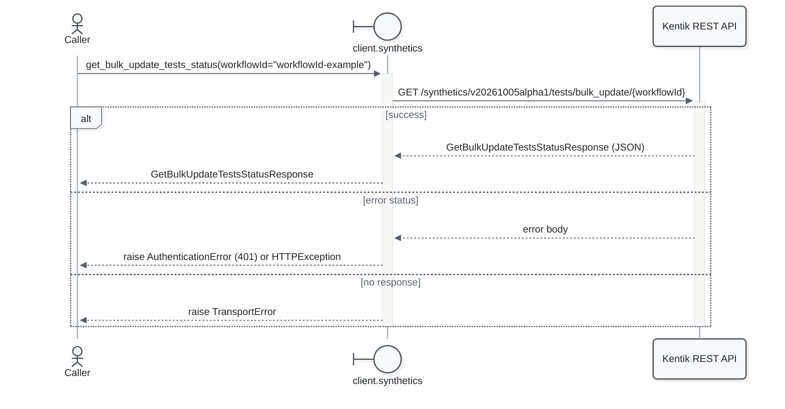

##### gRPC call flow

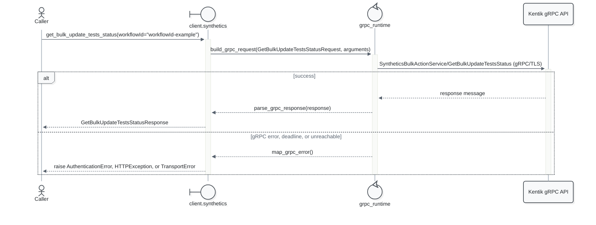

##### Parameters

| Name | In | Type | Required |
| --- | --- | --- | --- |
| `workflowId` | path | `string` | Yes |

##### Responses

| Status | Description | Model |
| --- | --- | --- |
| 200 | A successful response. | `GetBulkUpdateTestsStatusResponse` |
| default | An unexpected error response. | `rpcStatus` |

##### Example

```python
from kentik_api.client import KentikAPI

# Both transports work: protocol="rest" (default) or protocol="grpc".
client = KentikAPI(protocol="rest")  # loads KENTIK_EMAIL/KENTIK_API_TOKEN from .env
response = client.synthetics.get_bulk_update_tests_status(
    workflowId="workflowId-example",
)
```

### SyntheticsAdminService

#### `GET` `/synthetics/v202309/agentAlerts`

List agent alert configurations

Lists all agent alert configurations, optionally filtered by a list of agent ids.

##### REST call flow

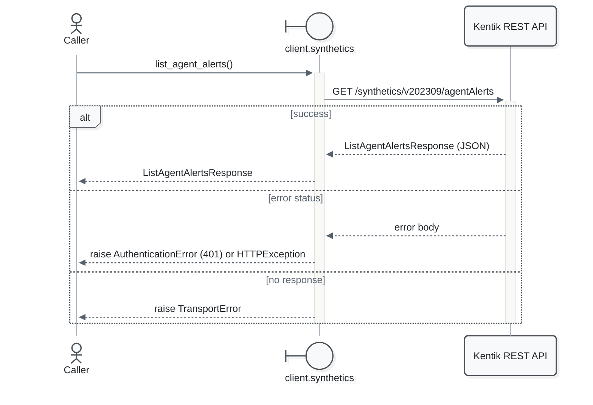

##### gRPC call flow

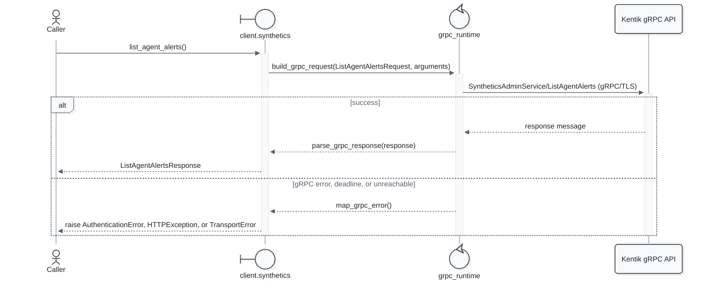

##### Parameters

| Name | In | Type | Required |
| --- | --- | --- | --- |
| `agentIds` | query | `string[]` | No |

##### Responses

| Status | Description | Model |
| --- | --- | --- |
| 200 | A successful response. | `ListAgentAlertsResponse` |
| default | An unexpected error response. | `rpcStatus` |

##### Example

```python
from kentik_api.client import KentikAPI

# Both transports work: protocol="rest" (default) or protocol="grpc".
client = KentikAPI(protocol="rest")  # loads KENTIK_EMAIL/KENTIK_API_TOKEN from .env
response = client.synthetics.list_agent_alerts()
```

---

#### `POST` `/synthetics/v202309/agentAlerts`

Create an agent alert configuration

Creates a new agent alert configuration.

##### REST call flow

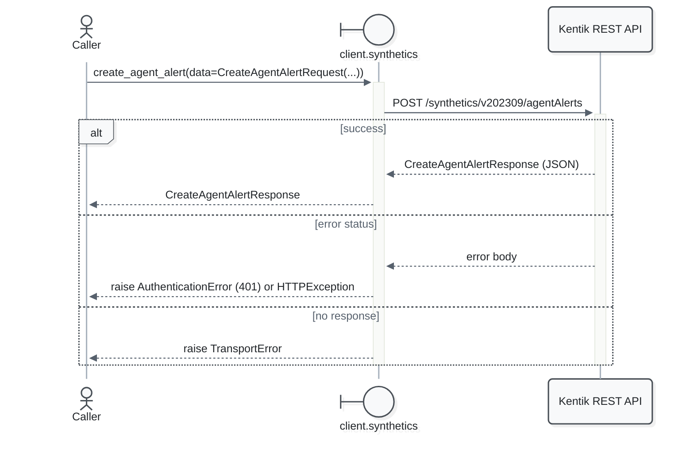

##### gRPC call flow

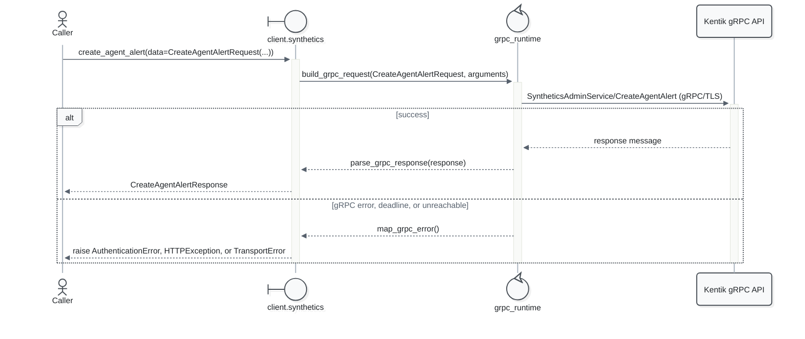

##### Parameters

| Name | In | Type | Required |
| --- | --- | --- | --- |
| `data` | body | `CreateAgentAlertRequest` | Yes |

##### Responses

| Status | Description | Model |
| --- | --- | --- |
| 200 | A successful response. | `CreateAgentAlertResponse` |
| default | An unexpected error response. | `rpcStatus` |

##### Example

```python
from kentik_api.client import KentikAPI
from kentik_api.gen.synthetics.models import CreateAgentAlertRequest

# Both transports work: protocol="rest" (default) or protocol="grpc".
client = KentikAPI(protocol="rest")  # loads KENTIK_EMAIL/KENTIK_API_TOKEN from .env
response = client.synthetics.create_agent_alert(
    data=CreateAgentAlertRequest(...),
)
```

---

#### `GET` `/synthetics/v202309/agentAlerts/{id}`

Get an agent alert configuration

Retrieves an existing agent alert configuration.

##### REST call flow

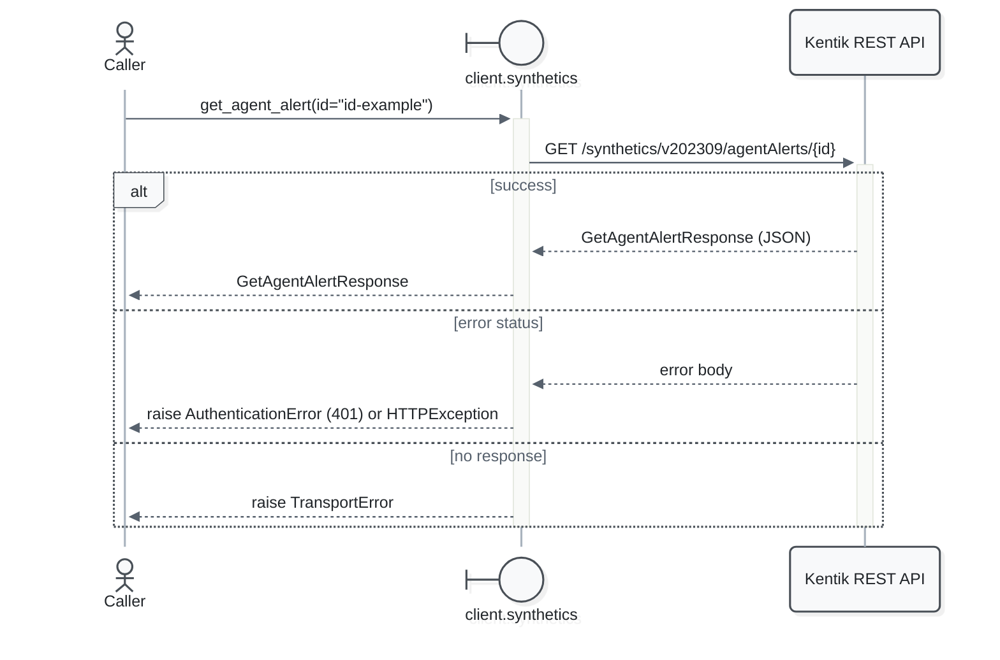

##### gRPC call flow

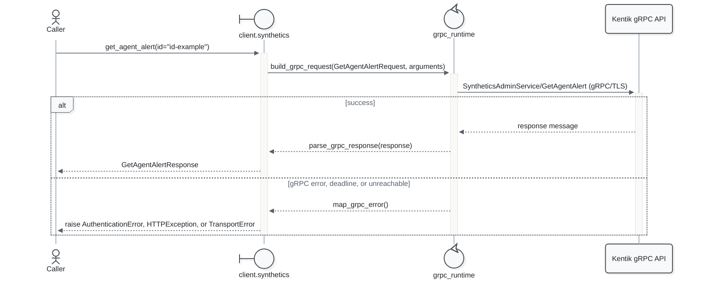

##### Parameters

| Name | In | Type | Required |
| --- | --- | --- | --- |
| `id` | path | `string` | Yes |

##### Responses

| Status | Description | Model |
| --- | --- | --- |
| 200 | A successful response. | `GetAgentAlertResponse` |
| default | An unexpected error response. | `rpcStatus` |

##### Example

```python
from kentik_api.client import KentikAPI

# Both transports work: protocol="rest" (default) or protocol="grpc".
client = KentikAPI(protocol="rest")  # loads KENTIK_EMAIL/KENTIK_API_TOKEN from .env
response = client.synthetics.get_agent_alert(
    id="id-example",
)
```

---

#### `PUT` `/synthetics/v202309/agentAlerts/{id}`

Update an agent alert configuration

Updates an existing agent alert configuration with the time threshold and notification channels provided.

##### REST call flow


##### gRPC call flow

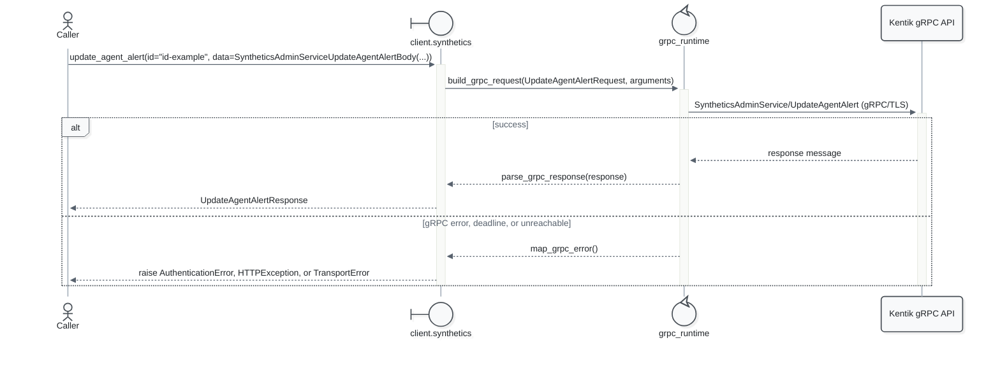

##### Parameters

| Name | In | Type | Required |
| --- | --- | --- | --- |
| `id` | path | `string` | Yes |
| `data` | body | `SyntheticsAdminServiceUpdateAgentAlertBody` | Yes |

##### Responses

| Status | Description | Model |
| --- | --- | --- |
| 200 | A successful response. | `UpdateAgentAlertResponse` |
| default | An unexpected error response. | `rpcStatus` |

##### Example

```python
from kentik_api.client import KentikAPI
from kentik_api.gen.synthetics.models import SyntheticsAdminServiceUpdateAgentAlertBody

# Both transports work: protocol="rest" (default) or protocol="grpc".
client = KentikAPI(protocol="rest")  # loads KENTIK_EMAIL/KENTIK_API_TOKEN from .env
response = client.synthetics.update_agent_alert(
    id="id-example",
    data=SyntheticsAdminServiceUpdateAgentAlertBody(...),
)
```

---

#### `DELETE` `/synthetics/v202309/agentAlerts/{id}`

Delete an agent alert configuration

Deletes an existing agent alert configuration.

##### REST call flow

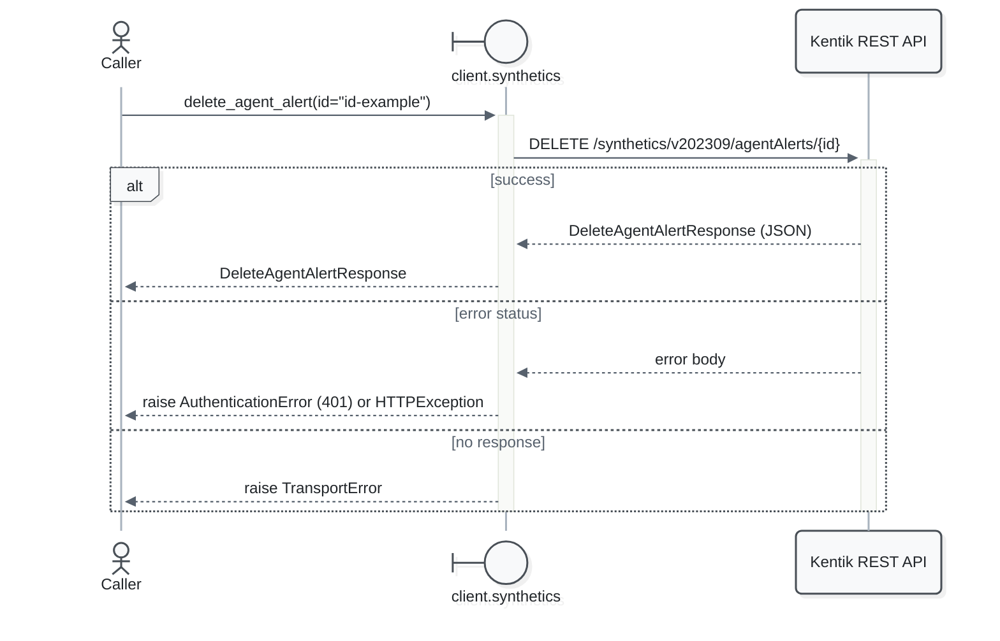

##### gRPC call flow

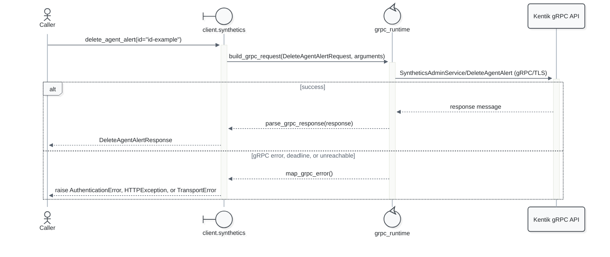

##### Parameters

| Name | In | Type | Required |
| --- | --- | --- | --- |
| `id` | path | `string` | Yes |

##### Responses

| Status | Description | Model |
| --- | --- | --- |
| 200 | A successful response. | `DeleteAgentAlertResponse` |
| default | An unexpected error response. | `rpcStatus` |

##### Example

```python
from kentik_api.client import KentikAPI

# Both transports work: protocol="rest" (default) or protocol="grpc".
client = KentikAPI(protocol="rest")  # loads KENTIK_EMAIL/KENTIK_API_TOKEN from .env
response = client.synthetics.delete_agent_alert(
    id="id-example",
)
```

---

#### `GET` `/synthetics/v202309/agents`

List available agents

Returns list of all synthetic agents available in the account.

##### REST call flow

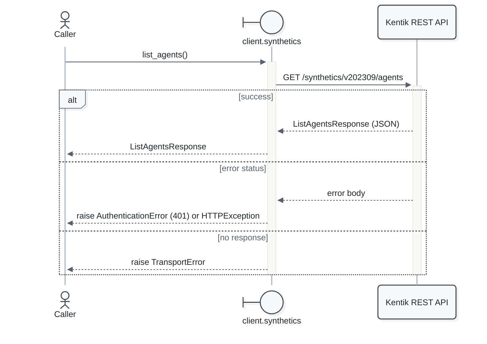

##### gRPC call flow

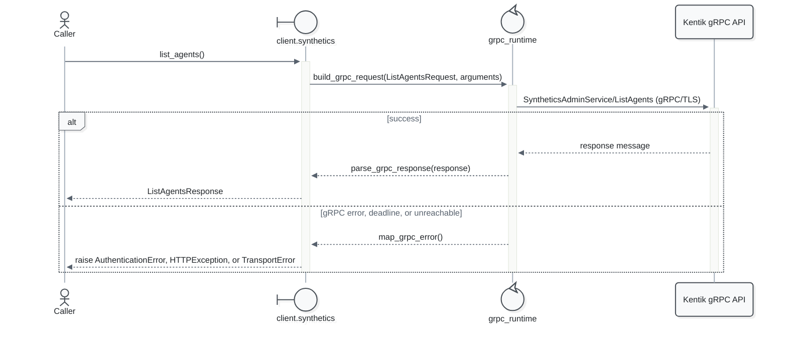

##### Responses

| Status | Description | Model |
| --- | --- | --- |
| 200 | A successful response. | `ListAgentsResponse` |
| default | An unexpected error response. | `rpcStatus` |

##### Example

```python
from kentik_api.client import KentikAPI

# Both transports work: protocol="rest" (default) or protocol="grpc".
client = KentikAPI(protocol="rest")  # loads KENTIK_EMAIL/KENTIK_API_TOKEN from .env
response = client.synthetics.list_agents()
```

---

#### `GET` `/synthetics/v202309/agents/{agent.id}`

Get information about an agent

Returns information about the requested synthetic agent.

##### REST call flow

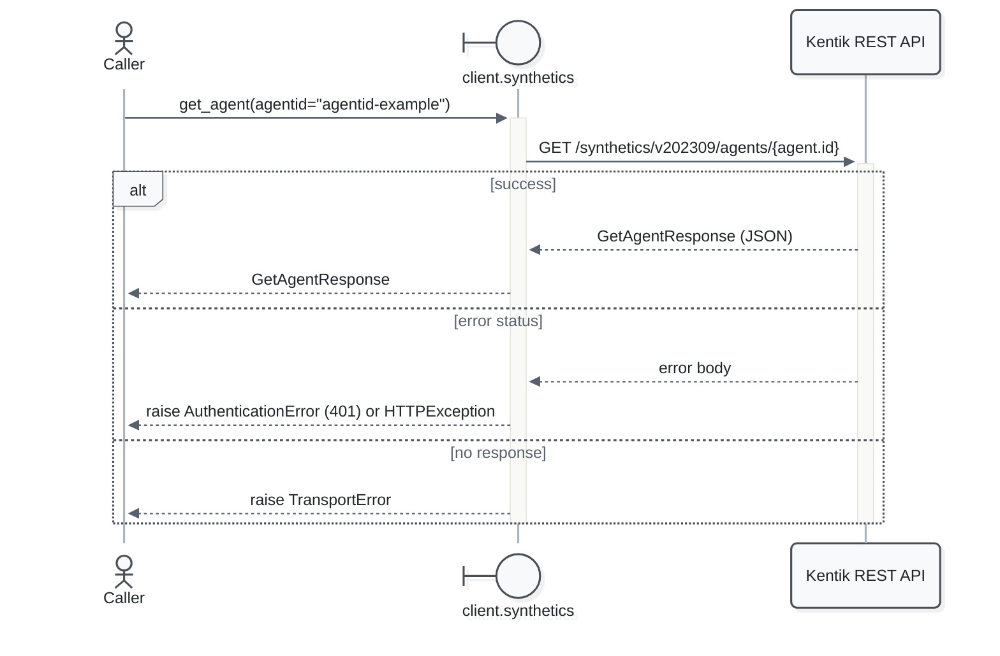

##### gRPC call flow

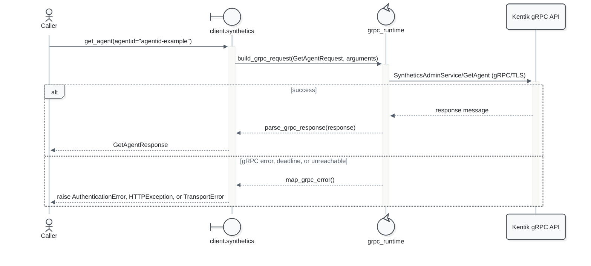

##### Parameters

| Name | In | Type | Required |
| --- | --- | --- | --- |
| `agentid` | path | `string` | Yes |

##### Responses

| Status | Description | Model |
| --- | --- | --- |
| 200 | A successful response. | `GetAgentResponse` |
| default | An unexpected error response. | `rpcStatus` |

##### Example

```python
from kentik_api.client import KentikAPI

# Both transports work: protocol="rest" (default) or protocol="grpc".
client = KentikAPI(protocol="rest")  # loads KENTIK_EMAIL/KENTIK_API_TOKEN from .env
response = client.synthetics.get_agent(
    agentid="agentid-example",
)
```

---

#### `PUT` `/synthetics/v202309/agents/{agent.id}`

Update configuration of an agent

Update configuration of a synthetic agent.

##### REST call flow

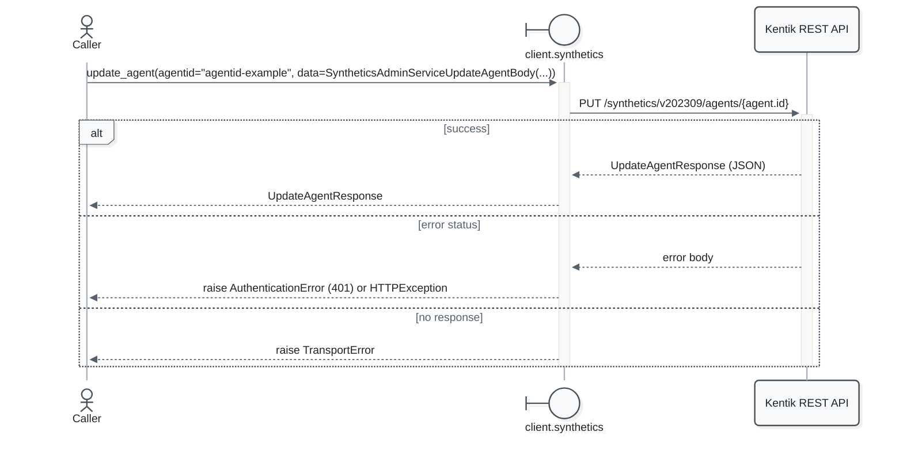

##### gRPC call flow

```mermaid
%%{init: {"theme": "redux", "look": "neo", "layout": "elk", "fontFamily": "ui-monospace, SFMono-Regular, Menlo, monospace", "themeVariables": {"fontFamily": "ui-monospace, SFMono-Regular, Menlo, monospace", "primaryColor": "#f8f9fa", "primaryBorderColor": "#495057", "primaryTextColor": "#212529", "textColor": "#212529", "lineColor": "#77818c", "edgeLabelBackground": "#ffffff", "actorBkg": "#f8f9fa", "actorBorder": "#495057", "actorTextColor": "#212529", "actorLineColor": "#a9b3be", "signalColor": "#57616d", "signalTextColor": "#212529", "labelBoxBkgColor": "#f8f9fa", "labelBoxBorderColor": "#495057", "labelTextColor": "#212529", "loopTextColor": "#57616d", "noteBkgColor": "#fff9db", "noteBorderColor": "#f08c00", "noteTextColor": "#a35a00"}, "sequence": {"activationWidth": 16}, "flowchart": {"curve": "basis", "nodeSpacing": 30, "rankSpacing": 70, "wrappingWidth": 400}}}%%
sequenceDiagram
    actor C as Caller
    participant W@{ "type": "boundary" } as client.synthetics
    participant R@{ "type": "control" } as grpc_runtime
    participant API as Kentik gRPC API

    C->>+W: update_agent(agentid="agentid-example", data=SyntheticsAdminServiceUpdateAgentBody(...))
    W->>+R: build_grpc_request(UpdateAgentRequest, arguments)
    R->>+API: SyntheticsAdminService/UpdateAgent (gRPC/TLS)
    alt success
        API-->>R: response message
        R-->>W: parse_grpc_response(response)
        W-->>C: UpdateAgentResponse
    else gRPC error, deadline, or unreachable
        R-->>W: map_grpc_error()
        W-->>C: raise AuthenticationError, HTTPException, or TransportError
    end
    deactivate API
    deactivate R
    deactivate W
```

##### Parameters

| Name | In | Type | Required |
| --- | --- | --- | --- |
| `agentid` | path | `string` | Yes |
| `data` | body | `SyntheticsAdminServiceUpdateAgentBody` | Yes |

##### Responses

| Status | Description | Model |
| --- | --- | --- |
| 200 | A successful response. | `UpdateAgentResponse` |
| default | An unexpected error response. | `rpcStatus` |

##### Example

```python
from kentik_api.client import KentikAPI
from kentik_api.gen.synthetics.models import SyntheticsAdminServiceUpdateAgentBody

# Both transports work: protocol="rest" (default) or protocol="grpc".
client = KentikAPI(protocol="rest")  # loads KENTIK_EMAIL/KENTIK_API_TOKEN from .env
response = client.synthetics.update_agent(
    agentid="agentid-example",
    data=SyntheticsAdminServiceUpdateAgentBody(...),
)
```

---

#### `DELETE` `/synthetics/v202309/agents/{agent.id}`

Delete an agent

Deletes the requested agent. The deleted agent is removed from configuration of all tests.

##### REST call flow

```mermaid
%%{init: {"theme": "redux", "look": "neo", "layout": "elk", "fontFamily": "ui-monospace, SFMono-Regular, Menlo, monospace", "themeVariables": {"fontFamily": "ui-monospace, SFMono-Regular, Menlo, monospace", "primaryColor": "#f8f9fa", "primaryBorderColor": "#495057", "primaryTextColor": "#212529", "textColor": "#212529", "lineColor": "#77818c", "edgeLabelBackground": "#ffffff", "actorBkg": "#f8f9fa", "actorBorder": "#495057", "actorTextColor": "#212529", "actorLineColor": "#a9b3be", "signalColor": "#57616d", "signalTextColor": "#212529", "labelBoxBkgColor": "#f8f9fa", "labelBoxBorderColor": "#495057", "labelTextColor": "#212529", "loopTextColor": "#57616d", "noteBkgColor": "#fff9db", "noteBorderColor": "#f08c00", "noteTextColor": "#a35a00"}, "sequence": {"activationWidth": 16}, "flowchart": {"curve": "basis", "nodeSpacing": 30, "rankSpacing": 70, "wrappingWidth": 400}}}%%
sequenceDiagram
    actor C as Caller
    participant W@{ "type": "boundary" } as client.synthetics
    participant API as Kentik REST API

    C->>+W: delete_agent(agentid="agentid-example")
    W->>+API: DELETE /synthetics/v202309/agents/{agent.id}
    alt success
        API-->>W: DeleteAgentResponse (JSON)
        W-->>C: DeleteAgentResponse
    else error status
        API-->>W: error body
        W-->>C: raise AuthenticationError (401) or HTTPException
    else no response
        W-->>C: raise TransportError
    end
    deactivate API
    deactivate W
```

##### gRPC call flow

```mermaid
%%{init: {"theme": "redux", "look": "neo", "layout": "elk", "fontFamily": "ui-monospace, SFMono-Regular, Menlo, monospace", "themeVariables": {"fontFamily": "ui-monospace, SFMono-Regular, Menlo, monospace", "primaryColor": "#f8f9fa", "primaryBorderColor": "#495057", "primaryTextColor": "#212529", "textColor": "#212529", "lineColor": "#77818c", "edgeLabelBackground": "#ffffff", "actorBkg": "#f8f9fa", "actorBorder": "#495057", "actorTextColor": "#212529", "actorLineColor": "#a9b3be", "signalColor": "#57616d", "signalTextColor": "#212529", "labelBoxBkgColor": "#f8f9fa", "labelBoxBorderColor": "#495057", "labelTextColor": "#212529", "loopTextColor": "#57616d", "noteBkgColor": "#fff9db", "noteBorderColor": "#f08c00", "noteTextColor": "#a35a00"}, "sequence": {"activationWidth": 16}, "flowchart": {"curve": "basis", "nodeSpacing": 30, "rankSpacing": 70, "wrappingWidth": 400}}}%%
sequenceDiagram
    actor C as Caller
    participant W@{ "type": "boundary" } as client.synthetics
    participant R@{ "type": "control" } as grpc_runtime
    participant API as Kentik gRPC API

    C->>+W: delete_agent(agentid="agentid-example")
    W->>+R: build_grpc_request(DeleteAgentRequest, arguments)
    R->>+API: SyntheticsAdminService/DeleteAgent (gRPC/TLS)
    alt success
        API-->>R: response message
        R-->>W: parse_grpc_response(response)
        W-->>C: DeleteAgentResponse
    else gRPC error, deadline, or unreachable
        R-->>W: map_grpc_error()
        W-->>C: raise AuthenticationError, HTTPException, or TransportError
    end
    deactivate API
    deactivate R
    deactivate W
```

##### Parameters

| Name | In | Type | Required |
| --- | --- | --- | --- |
| `agentid` | path | `string` | Yes |

##### Responses

| Status | Description | Model |
| --- | --- | --- |
| 200 | A successful response. | `DeleteAgentResponse` |
| default | An unexpected error response. | `rpcStatus` |

##### Example

```python
from kentik_api.client import KentikAPI

# Both transports work: protocol="rest" (default) or protocol="grpc".
client = KentikAPI(protocol="rest")  # loads KENTIK_EMAIL/KENTIK_API_TOKEN from .env
response = client.synthetics.delete_agent(
    agentid="agentid-example",
)
```

---

#### `GET` `/synthetics/v202309/tests`

List all tests

Returns a list of all configured active and paused synthetic tests.

##### REST call flow

```mermaid
%%{init: {"theme": "redux", "look": "neo", "layout": "elk", "fontFamily": "ui-monospace, SFMono-Regular, Menlo, monospace", "themeVariables": {"fontFamily": "ui-monospace, SFMono-Regular, Menlo, monospace", "primaryColor": "#f8f9fa", "primaryBorderColor": "#495057", "primaryTextColor": "#212529", "textColor": "#212529", "lineColor": "#77818c", "edgeLabelBackground": "#ffffff", "actorBkg": "#f8f9fa", "actorBorder": "#495057", "actorTextColor": "#212529", "actorLineColor": "#a9b3be", "signalColor": "#57616d", "signalTextColor": "#212529", "labelBoxBkgColor": "#f8f9fa", "labelBoxBorderColor": "#495057", "labelTextColor": "#212529", "loopTextColor": "#57616d", "noteBkgColor": "#fff9db", "noteBorderColor": "#f08c00", "noteTextColor": "#a35a00"}, "sequence": {"activationWidth": 16}, "flowchart": {"curve": "basis", "nodeSpacing": 30, "rankSpacing": 70, "wrappingWidth": 400}}}%%
sequenceDiagram
    actor C as Caller
    participant W@{ "type": "boundary" } as client.synthetics
    participant API as Kentik REST API

    C->>+W: list_tests()
    W->>+API: GET /synthetics/v202309/tests
    alt success
        API-->>W: ListTestsResponse (JSON)
        W-->>C: ListTestsResponse
    else error status
        API-->>W: error body
        W-->>C: raise AuthenticationError (401) or HTTPException
    else no response
        W-->>C: raise TransportError
    end
    deactivate API
    deactivate W
```

##### gRPC call flow

```mermaid
%%{init: {"theme": "redux", "look": "neo", "layout": "elk", "fontFamily": "ui-monospace, SFMono-Regular, Menlo, monospace", "themeVariables": {"fontFamily": "ui-monospace, SFMono-Regular, Menlo, monospace", "primaryColor": "#f8f9fa", "primaryBorderColor": "#495057", "primaryTextColor": "#212529", "textColor": "#212529", "lineColor": "#77818c", "edgeLabelBackground": "#ffffff", "actorBkg": "#f8f9fa", "actorBorder": "#495057", "actorTextColor": "#212529", "actorLineColor": "#a9b3be", "signalColor": "#57616d", "signalTextColor": "#212529", "labelBoxBkgColor": "#f8f9fa", "labelBoxBorderColor": "#495057", "labelTextColor": "#212529", "loopTextColor": "#57616d", "noteBkgColor": "#fff9db", "noteBorderColor": "#f08c00", "noteTextColor": "#a35a00"}, "sequence": {"activationWidth": 16}, "flowchart": {"curve": "basis", "nodeSpacing": 30, "rankSpacing": 70, "wrappingWidth": 400}}}%%
sequenceDiagram
    actor C as Caller
    participant W@{ "type": "boundary" } as client.synthetics
    participant R@{ "type": "control" } as grpc_runtime
    participant API as Kentik gRPC API

    C->>+W: list_tests()
    W->>+R: build_grpc_request(ListTestsRequest, arguments)
    R->>+API: SyntheticsAdminService/ListTests (gRPC/TLS)
    alt success
        API-->>R: response message
        R-->>W: parse_grpc_response(response)
        W-->>C: ListTestsResponse
    else gRPC error, deadline, or unreachable
        R-->>W: map_grpc_error()
        W-->>C: raise AuthenticationError, HTTPException, or TransportError
    end
    deactivate API
    deactivate R
    deactivate W
```

##### Responses

| Status | Description | Model |
| --- | --- | --- |
| 200 | A successful response. | `ListTestsResponse` |
| default | An unexpected error response. | `rpcStatus` |

##### Example

```python
from kentik_api.client import KentikAPI

# Both transports work: protocol="rest" (default) or protocol="grpc".
client = KentikAPI(protocol="rest")  # loads KENTIK_EMAIL/KENTIK_API_TOKEN from .env
response = client.synthetics.list_tests()
```

---

#### `POST` `/synthetics/v202309/tests`

Create a test

Create synthetic test based on configuration provided in the request.

##### REST call flow

```mermaid
%%{init: {"theme": "redux", "look": "neo", "layout": "elk", "fontFamily": "ui-monospace, SFMono-Regular, Menlo, monospace", "themeVariables": {"fontFamily": "ui-monospace, SFMono-Regular, Menlo, monospace", "primaryColor": "#f8f9fa", "primaryBorderColor": "#495057", "primaryTextColor": "#212529", "textColor": "#212529", "lineColor": "#77818c", "edgeLabelBackground": "#ffffff", "actorBkg": "#f8f9fa", "actorBorder": "#495057", "actorTextColor": "#212529", "actorLineColor": "#a9b3be", "signalColor": "#57616d", "signalTextColor": "#212529", "labelBoxBkgColor": "#f8f9fa", "labelBoxBorderColor": "#495057", "labelTextColor": "#212529", "loopTextColor": "#57616d", "noteBkgColor": "#fff9db", "noteBorderColor": "#f08c00", "noteTextColor": "#a35a00"}, "sequence": {"activationWidth": 16}, "flowchart": {"curve": "basis", "nodeSpacing": 30, "rankSpacing": 70, "wrappingWidth": 400}}}%%
sequenceDiagram
    actor C as Caller
    participant W@{ "type": "boundary" } as client.synthetics
    participant API as Kentik REST API

    C->>+W: create_test(data=CreateTestRequest(...))
    W->>+API: POST /synthetics/v202309/tests
    alt success
        API-->>W: CreateTestResponse (JSON)
        W-->>C: CreateTestResponse
    else error status
        API-->>W: error body
        W-->>C: raise AuthenticationError (401) or HTTPException
    else no response
        W-->>C: raise TransportError
    end
    deactivate API
    deactivate W
```

##### gRPC call flow

```mermaid
%%{init: {"theme": "redux", "look": "neo", "layout": "elk", "fontFamily": "ui-monospace, SFMono-Regular, Menlo, monospace", "themeVariables": {"fontFamily": "ui-monospace, SFMono-Regular, Menlo, monospace", "primaryColor": "#f8f9fa", "primaryBorderColor": "#495057", "primaryTextColor": "#212529", "textColor": "#212529", "lineColor": "#77818c", "edgeLabelBackground": "#ffffff", "actorBkg": "#f8f9fa", "actorBorder": "#495057", "actorTextColor": "#212529", "actorLineColor": "#a9b3be", "signalColor": "#57616d", "signalTextColor": "#212529", "labelBoxBkgColor": "#f8f9fa", "labelBoxBorderColor": "#495057", "labelTextColor": "#212529", "loopTextColor": "#57616d", "noteBkgColor": "#fff9db", "noteBorderColor": "#f08c00", "noteTextColor": "#a35a00"}, "sequence": {"activationWidth": 16}, "flowchart": {"curve": "basis", "nodeSpacing": 30, "rankSpacing": 70, "wrappingWidth": 400}}}%%
sequenceDiagram
    actor C as Caller
    participant W@{ "type": "boundary" } as client.synthetics
    participant R@{ "type": "control" } as grpc_runtime
    participant API as Kentik gRPC API

    C->>+W: create_test(data=CreateTestRequest(...))
    W->>+R: build_grpc_request(CreateTestRequest, arguments)
    R->>+API: SyntheticsAdminService/CreateTest (gRPC/TLS)
    alt success
        API-->>R: response message
        R-->>W: parse_grpc_response(response)
        W-->>C: CreateTestResponse
    else gRPC error, deadline, or unreachable
        R-->>W: map_grpc_error()
        W-->>C: raise AuthenticationError, HTTPException, or TransportError
    end
    deactivate API
    deactivate R
    deactivate W
```

##### Parameters

| Name | In | Type | Required |
| --- | --- | --- | --- |
| `data` | body | `CreateTestRequest` | Yes |

##### Responses

| Status | Description | Model |
| --- | --- | --- |
| 200 | A successful response. | `CreateTestResponse` |
| default | An unexpected error response. | `rpcStatus` |

##### Example

```python
from kentik_api.client import KentikAPI
from kentik_api.gen.synthetics.models import CreateTestRequest

# Both transports work: protocol="rest" (default) or protocol="grpc".
client = KentikAPI(protocol="rest")  # loads KENTIK_EMAIL/KENTIK_API_TOKEN from .env
response = client.synthetics.create_test(
    data=CreateTestRequest(...),
)
```

---

#### `GET` `/synthetics/v202309/tests/{id}`

Get information about a test

Returns configuration and status for the requested synthetic test.

##### REST call flow

```mermaid
%%{init: {"theme": "redux", "look": "neo", "layout": "elk", "fontFamily": "ui-monospace, SFMono-Regular, Menlo, monospace", "themeVariables": {"fontFamily": "ui-monospace, SFMono-Regular, Menlo, monospace", "primaryColor": "#f8f9fa", "primaryBorderColor": "#495057", "primaryTextColor": "#212529", "textColor": "#212529", "lineColor": "#77818c", "edgeLabelBackground": "#ffffff", "actorBkg": "#f8f9fa", "actorBorder": "#495057", "actorTextColor": "#212529", "actorLineColor": "#a9b3be", "signalColor": "#57616d", "signalTextColor": "#212529", "labelBoxBkgColor": "#f8f9fa", "labelBoxBorderColor": "#495057", "labelTextColor": "#212529", "loopTextColor": "#57616d", "noteBkgColor": "#fff9db", "noteBorderColor": "#f08c00", "noteTextColor": "#a35a00"}, "sequence": {"activationWidth": 16}, "flowchart": {"curve": "basis", "nodeSpacing": 30, "rankSpacing": 70, "wrappingWidth": 400}}}%%
sequenceDiagram
    actor C as Caller
    participant W@{ "type": "boundary" } as client.synthetics
    participant API as Kentik REST API

    C->>+W: get_test(id="id-example")
    W->>+API: GET /synthetics/v202309/tests/{id}
    alt success
        API-->>W: GetTestResponse (JSON)
        W-->>C: GetTestResponse
    else error status
        API-->>W: error body
        W-->>C: raise AuthenticationError (401) or HTTPException
    else no response
        W-->>C: raise TransportError
    end
    deactivate API
    deactivate W
```

##### gRPC call flow

```mermaid
%%{init: {"theme": "redux", "look": "neo", "layout": "elk", "fontFamily": "ui-monospace, SFMono-Regular, Menlo, monospace", "themeVariables": {"fontFamily": "ui-monospace, SFMono-Regular, Menlo, monospace", "primaryColor": "#f8f9fa", "primaryBorderColor": "#495057", "primaryTextColor": "#212529", "textColor": "#212529", "lineColor": "#77818c", "edgeLabelBackground": "#ffffff", "actorBkg": "#f8f9fa", "actorBorder": "#495057", "actorTextColor": "#212529", "actorLineColor": "#a9b3be", "signalColor": "#57616d", "signalTextColor": "#212529", "labelBoxBkgColor": "#f8f9fa", "labelBoxBorderColor": "#495057", "labelTextColor": "#212529", "loopTextColor": "#57616d", "noteBkgColor": "#fff9db", "noteBorderColor": "#f08c00", "noteTextColor": "#a35a00"}, "sequence": {"activationWidth": 16}, "flowchart": {"curve": "basis", "nodeSpacing": 30, "rankSpacing": 70, "wrappingWidth": 400}}}%%
sequenceDiagram
    actor C as Caller
    participant W@{ "type": "boundary" } as client.synthetics
    participant R@{ "type": "control" } as grpc_runtime
    participant API as Kentik gRPC API

    C->>+W: get_test(id="id-example")
    W->>+R: build_grpc_request(GetTestRequest, arguments)
    R->>+API: SyntheticsAdminService/GetTest (gRPC/TLS)
    alt success
        API-->>R: response message
        R-->>W: parse_grpc_response(response)
        W-->>C: GetTestResponse
    else gRPC error, deadline, or unreachable
        R-->>W: map_grpc_error()
        W-->>C: raise AuthenticationError, HTTPException, or TransportError
    end
    deactivate API
    deactivate R
    deactivate W
```

##### Parameters

| Name | In | Type | Required |
| --- | --- | --- | --- |
| `id` | path | `string` | Yes |

##### Responses

| Status | Description | Model |
| --- | --- | --- |
| 200 | A successful response. | `GetTestResponse` |
| default | An unexpected error response. | `rpcStatus` |

##### Example

```python
from kentik_api.client import KentikAPI

# Both transports work: protocol="rest" (default) or protocol="grpc".
client = KentikAPI(protocol="rest")  # loads KENTIK_EMAIL/KENTIK_API_TOKEN from .env
response = client.synthetics.get_test(
    id="id-example",
)
```

---

#### `PUT` `/synthetics/v202309/tests/{id}`

Update configuration of a test

Updates configuration of a synthetic test.

##### REST call flow

```mermaid
%%{init: {"theme": "redux", "look": "neo", "layout": "elk", "fontFamily": "ui-monospace, SFMono-Regular, Menlo, monospace", "themeVariables": {"fontFamily": "ui-monospace, SFMono-Regular, Menlo, monospace", "primaryColor": "#f8f9fa", "primaryBorderColor": "#495057", "primaryTextColor": "#212529", "textColor": "#212529", "lineColor": "#77818c", "edgeLabelBackground": "#ffffff", "actorBkg": "#f8f9fa", "actorBorder": "#495057", "actorTextColor": "#212529", "actorLineColor": "#a9b3be", "signalColor": "#57616d", "signalTextColor": "#212529", "labelBoxBkgColor": "#f8f9fa", "labelBoxBorderColor": "#495057", "labelTextColor": "#212529", "loopTextColor": "#57616d", "noteBkgColor": "#fff9db", "noteBorderColor": "#f08c00", "noteTextColor": "#a35a00"}, "sequence": {"activationWidth": 16}, "flowchart": {"curve": "basis", "nodeSpacing": 30, "rankSpacing": 70, "wrappingWidth": 400}}}%%
sequenceDiagram
    actor C as Caller
    participant W@{ "type": "boundary" } as client.synthetics
    participant API as Kentik REST API

    C->>+W: update_test(id="id-example", data=SyntheticsAdminServiceUpdateTestBody(...))
    W->>+API: PUT /synthetics/v202309/tests/{id}
    alt success
        API-->>W: UpdateTestResponse (JSON)
        W-->>C: UpdateTestResponse
    else error status
        API-->>W: error body
        W-->>C: raise AuthenticationError (401) or HTTPException
    else no response
        W-->>C: raise TransportError
    end
    deactivate API
    deactivate W
```

##### gRPC call flow

```mermaid
%%{init: {"theme": "redux", "look": "neo", "layout": "elk", "fontFamily": "ui-monospace, SFMono-Regular, Menlo, monospace", "themeVariables": {"fontFamily": "ui-monospace, SFMono-Regular, Menlo, monospace", "primaryColor": "#f8f9fa", "primaryBorderColor": "#495057", "primaryTextColor": "#212529", "textColor": "#212529", "lineColor": "#77818c", "edgeLabelBackground": "#ffffff", "actorBkg": "#f8f9fa", "actorBorder": "#495057", "actorTextColor": "#212529", "actorLineColor": "#a9b3be", "signalColor": "#57616d", "signalTextColor": "#212529", "labelBoxBkgColor": "#f8f9fa", "labelBoxBorderColor": "#495057", "labelTextColor": "#212529", "loopTextColor": "#57616d", "noteBkgColor": "#fff9db", "noteBorderColor": "#f08c00", "noteTextColor": "#a35a00"}, "sequence": {"activationWidth": 16}, "flowchart": {"curve": "basis", "nodeSpacing": 30, "rankSpacing": 70, "wrappingWidth": 400}}}%%
sequenceDiagram
    actor C as Caller
    participant W@{ "type": "boundary" } as client.synthetics
    participant R@{ "type": "control" } as grpc_runtime
    participant API as Kentik gRPC API

    C->>+W: update_test(id="id-example", data=SyntheticsAdminServiceUpdateTestBody(...))
    W->>+R: build_grpc_request(UpdateTestRequest, arguments)
    R->>+API: SyntheticsAdminService/UpdateTest (gRPC/TLS)
    alt success
        API-->>R: response message
        R-->>W: parse_grpc_response(response)
        W-->>C: UpdateTestResponse
    else gRPC error, deadline, or unreachable
        R-->>W: map_grpc_error()
        W-->>C: raise AuthenticationError, HTTPException, or TransportError
    end
    deactivate API
    deactivate R
    deactivate W
```

##### Parameters

| Name | In | Type | Required |
| --- | --- | --- | --- |
| `id` | path | `string` | Yes |
| `data` | body | `SyntheticsAdminServiceUpdateTestBody` | Yes |

##### Responses

| Status | Description | Model |
| --- | --- | --- |
| 200 | A successful response. | `UpdateTestResponse` |
| default | An unexpected error response. | `rpcStatus` |

##### Example

```python
from kentik_api.client import KentikAPI
from kentik_api.gen.synthetics.models import SyntheticsAdminServiceUpdateTestBody

# Both transports work: protocol="rest" (default) or protocol="grpc".
client = KentikAPI(protocol="rest")  # loads KENTIK_EMAIL/KENTIK_API_TOKEN from .env
response = client.synthetics.update_test(
    id="id-example",
    data=SyntheticsAdminServiceUpdateTestBody(...),
)
```

---

#### `DELETE` `/synthetics/v202309/tests/{id}`

Delete a synthetic test.

Deletes the synthetics test. All accumulated results for the test cease to be accessible.

##### REST call flow

```mermaid
%%{init: {"theme": "redux", "look": "neo", "layout": "elk", "fontFamily": "ui-monospace, SFMono-Regular, Menlo, monospace", "themeVariables": {"fontFamily": "ui-monospace, SFMono-Regular, Menlo, monospace", "primaryColor": "#f8f9fa", "primaryBorderColor": "#495057", "primaryTextColor": "#212529", "textColor": "#212529", "lineColor": "#77818c", "edgeLabelBackground": "#ffffff", "actorBkg": "#f8f9fa", "actorBorder": "#495057", "actorTextColor": "#212529", "actorLineColor": "#a9b3be", "signalColor": "#57616d", "signalTextColor": "#212529", "labelBoxBkgColor": "#f8f9fa", "labelBoxBorderColor": "#495057", "labelTextColor": "#212529", "loopTextColor": "#57616d", "noteBkgColor": "#fff9db", "noteBorderColor": "#f08c00", "noteTextColor": "#a35a00"}, "sequence": {"activationWidth": 16}, "flowchart": {"curve": "basis", "nodeSpacing": 30, "rankSpacing": 70, "wrappingWidth": 400}}}%%
sequenceDiagram
    actor C as Caller
    participant W@{ "type": "boundary" } as client.synthetics
    participant API as Kentik REST API

    C->>+W: delete_test(id="id-example")
    W->>+API: DELETE /synthetics/v202309/tests/{id}
    alt success
        API-->>W: DeleteTestResponse (JSON)
        W-->>C: DeleteTestResponse
    else error status
        API-->>W: error body
        W-->>C: raise AuthenticationError (401) or HTTPException
    else no response
        W-->>C: raise TransportError
    end
    deactivate API
    deactivate W
```

##### gRPC call flow

```mermaid
%%{init: {"theme": "redux", "look": "neo", "layout": "elk", "fontFamily": "ui-monospace, SFMono-Regular, Menlo, monospace", "themeVariables": {"fontFamily": "ui-monospace, SFMono-Regular, Menlo, monospace", "primaryColor": "#f8f9fa", "primaryBorderColor": "#495057", "primaryTextColor": "#212529", "textColor": "#212529", "lineColor": "#77818c", "edgeLabelBackground": "#ffffff", "actorBkg": "#f8f9fa", "actorBorder": "#495057", "actorTextColor": "#212529", "actorLineColor": "#a9b3be", "signalColor": "#57616d", "signalTextColor": "#212529", "labelBoxBkgColor": "#f8f9fa", "labelBoxBorderColor": "#495057", "labelTextColor": "#212529", "loopTextColor": "#57616d", "noteBkgColor": "#fff9db", "noteBorderColor": "#f08c00", "noteTextColor": "#a35a00"}, "sequence": {"activationWidth": 16}, "flowchart": {"curve": "basis", "nodeSpacing": 30, "rankSpacing": 70, "wrappingWidth": 400}}}%%
sequenceDiagram
    actor C as Caller
    participant W@{ "type": "boundary" } as client.synthetics
    participant R@{ "type": "control" } as grpc_runtime
    participant API as Kentik gRPC API

    C->>+W: delete_test(id="id-example")
    W->>+R: build_grpc_request(DeleteTestRequest, arguments)
    R->>+API: SyntheticsAdminService/DeleteTest (gRPC/TLS)
    alt success
        API-->>R: response message
        R-->>W: parse_grpc_response(response)
        W-->>C: DeleteTestResponse
    else gRPC error, deadline, or unreachable
        R-->>W: map_grpc_error()
        W-->>C: raise AuthenticationError, HTTPException, or TransportError
    end
    deactivate API
    deactivate R
    deactivate W
```

##### Parameters

| Name | In | Type | Required |
| --- | --- | --- | --- |
| `id` | path | `string` | Yes |

##### Responses

| Status | Description | Model |
| --- | --- | --- |
| 200 | A successful response. | `DeleteTestResponse` |
| default | An unexpected error response. | `rpcStatus` |

##### Example

```python
from kentik_api.client import KentikAPI

# Both transports work: protocol="rest" (default) or protocol="grpc".
client = KentikAPI(protocol="rest")  # loads KENTIK_EMAIL/KENTIK_API_TOKEN from .env
response = client.synthetics.delete_test(
    id="id-example",
)
```

---

#### `PUT` `/synthetics/v202309/tests/{id}/status`

Update status of a synthetic test

##### REST call flow

```mermaid
%%{init: {"theme": "redux", "look": "neo", "layout": "elk", "fontFamily": "ui-monospace, SFMono-Regular, Menlo, monospace", "themeVariables": {"fontFamily": "ui-monospace, SFMono-Regular, Menlo, monospace", "primaryColor": "#f8f9fa", "primaryBorderColor": "#495057", "primaryTextColor": "#212529", "textColor": "#212529", "lineColor": "#77818c", "edgeLabelBackground": "#ffffff", "actorBkg": "#f8f9fa", "actorBorder": "#495057", "actorTextColor": "#212529", "actorLineColor": "#a9b3be", "signalColor": "#57616d", "signalTextColor": "#212529", "labelBoxBkgColor": "#f8f9fa", "labelBoxBorderColor": "#495057", "labelTextColor": "#212529", "loopTextColor": "#57616d", "noteBkgColor": "#fff9db", "noteBorderColor": "#f08c00", "noteTextColor": "#a35a00"}, "sequence": {"activationWidth": 16}, "flowchart": {"curve": "basis", "nodeSpacing": 30, "rankSpacing": 70, "wrappingWidth": 400}}}%%
sequenceDiagram
    actor C as Caller
    participant W@{ "type": "boundary" } as client.synthetics
    participant API as Kentik REST API

    C->>+W: set_test_status(id="id-example", data=SyntheticsAdminServiceSetTestStatusBody(...))
    W->>+API: PUT /synthetics/v202309/tests/{id}/status
    alt success
        API-->>W: SetTestStatusResponse (JSON)
        W-->>C: SetTestStatusResponse
    else error status
        API-->>W: error body
        W-->>C: raise AuthenticationError (401) or HTTPException
    else no response
        W-->>C: raise TransportError
    end
    deactivate API
    deactivate W
```

##### gRPC call flow

```mermaid
%%{init: {"theme": "redux", "look": "neo", "layout": "elk", "fontFamily": "ui-monospace, SFMono-Regular, Menlo, monospace", "themeVariables": {"fontFamily": "ui-monospace, SFMono-Regular, Menlo, monospace", "primaryColor": "#f8f9fa", "primaryBorderColor": "#495057", "primaryTextColor": "#212529", "textColor": "#212529", "lineColor": "#77818c", "edgeLabelBackground": "#ffffff", "actorBkg": "#f8f9fa", "actorBorder": "#495057", "actorTextColor": "#212529", "actorLineColor": "#a9b3be", "signalColor": "#57616d", "signalTextColor": "#212529", "labelBoxBkgColor": "#f8f9fa", "labelBoxBorderColor": "#495057", "labelTextColor": "#212529", "loopTextColor": "#57616d", "noteBkgColor": "#fff9db", "noteBorderColor": "#f08c00", "noteTextColor": "#a35a00"}, "sequence": {"activationWidth": 16}, "flowchart": {"curve": "basis", "nodeSpacing": 30, "rankSpacing": 70, "wrappingWidth": 400}}}%%
sequenceDiagram
    actor C as Caller
    participant W@{ "type": "boundary" } as client.synthetics
    participant R@{ "type": "control" } as grpc_runtime
    participant API as Kentik gRPC API

    C->>+W: set_test_status(id="id-example", data=SyntheticsAdminServiceSetTestStatusBody(...))
    W->>+R: build_grpc_request(SetTestStatusRequest, arguments)
    R->>+API: SyntheticsAdminService/SetTestStatus (gRPC/TLS)
    alt success
        API-->>R: response message
        R-->>W: parse_grpc_response(response)
        W-->>C: SetTestStatusResponse
    else gRPC error, deadline, or unreachable
        R-->>W: map_grpc_error()
        W-->>C: raise AuthenticationError, HTTPException, or TransportError
    end
    deactivate API
    deactivate R
    deactivate W
```

##### Parameters

| Name | In | Type | Required |
| --- | --- | --- | --- |
| `id` | path | `string` | Yes |
| `data` | body | `SyntheticsAdminServiceSetTestStatusBody` | Yes |

##### Responses

| Status | Description | Model |
| --- | --- | --- |
| 200 | A successful response. | `SetTestStatusResponse` |
| default | An unexpected error response. | `rpcStatus` |

##### Example

```python
from kentik_api.client import KentikAPI
from kentik_api.gen.synthetics.models import SyntheticsAdminServiceSetTestStatusBody

# Both transports work: protocol="rest" (default) or protocol="grpc".
client = KentikAPI(protocol="rest")  # loads KENTIK_EMAIL/KENTIK_API_TOKEN from .env
response = client.synthetics.set_test_status(
    id="id-example",
    data=SyntheticsAdminServiceSetTestStatusBody(...),
)
```

### SyntheticsDataService

#### `POST` `/synthetics/v202309/results`

Get results for tests

Returns probe results for a set of tests for specified period of time.

##### REST call flow

```mermaid
%%{init: {"theme": "redux", "look": "neo", "layout": "elk", "fontFamily": "ui-monospace, SFMono-Regular, Menlo, monospace", "themeVariables": {"fontFamily": "ui-monospace, SFMono-Regular, Menlo, monospace", "primaryColor": "#f8f9fa", "primaryBorderColor": "#495057", "primaryTextColor": "#212529", "textColor": "#212529", "lineColor": "#77818c", "edgeLabelBackground": "#ffffff", "actorBkg": "#f8f9fa", "actorBorder": "#495057", "actorTextColor": "#212529", "actorLineColor": "#a9b3be", "signalColor": "#57616d", "signalTextColor": "#212529", "labelBoxBkgColor": "#f8f9fa", "labelBoxBorderColor": "#495057", "labelTextColor": "#212529", "loopTextColor": "#57616d", "noteBkgColor": "#fff9db", "noteBorderColor": "#f08c00", "noteTextColor": "#a35a00"}, "sequence": {"activationWidth": 16}, "flowchart": {"curve": "basis", "nodeSpacing": 30, "rankSpacing": 70, "wrappingWidth": 400}}}%%
sequenceDiagram
    actor C as Caller
    participant W@{ "type": "boundary" } as client.synthetics
    participant API as Kentik REST API

    C->>+W: get_results_for_tests(data=GetResultsForTestsRequest(...))
    W->>+API: POST /synthetics/v202309/results
    alt success
        API-->>W: GetResultsForTestsResponse (JSON)
        W-->>C: GetResultsForTestsResponse
    else error status
        API-->>W: error body
        W-->>C: raise AuthenticationError (401) or HTTPException
    else no response
        W-->>C: raise TransportError
    end
    deactivate API
    deactivate W
```

##### gRPC call flow

```mermaid
%%{init: {"theme": "redux", "look": "neo", "layout": "elk", "fontFamily": "ui-monospace, SFMono-Regular, Menlo, monospace", "themeVariables": {"fontFamily": "ui-monospace, SFMono-Regular, Menlo, monospace", "primaryColor": "#f8f9fa", "primaryBorderColor": "#495057", "primaryTextColor": "#212529", "textColor": "#212529", "lineColor": "#77818c", "edgeLabelBackground": "#ffffff", "actorBkg": "#f8f9fa", "actorBorder": "#495057", "actorTextColor": "#212529", "actorLineColor": "#a9b3be", "signalColor": "#57616d", "signalTextColor": "#212529", "labelBoxBkgColor": "#f8f9fa", "labelBoxBorderColor": "#495057", "labelTextColor": "#212529", "loopTextColor": "#57616d", "noteBkgColor": "#fff9db", "noteBorderColor": "#f08c00", "noteTextColor": "#a35a00"}, "sequence": {"activationWidth": 16}, "flowchart": {"curve": "basis", "nodeSpacing": 30, "rankSpacing": 70, "wrappingWidth": 400}}}%%
sequenceDiagram
    actor C as Caller
    participant W@{ "type": "boundary" } as client.synthetics
    participant R@{ "type": "control" } as grpc_runtime
    participant API as Kentik gRPC API

    C->>+W: get_results_for_tests(data=GetResultsForTestsRequest(...))
    W->>+R: build_grpc_request(GetResultsForTestsRequest, arguments)
    R->>+API: SyntheticsDataService/GetResultsForTests (gRPC/TLS)
    alt success
        API-->>R: response message
        R-->>W: parse_grpc_response(response)
        W-->>C: GetResultsForTestsResponse
    else gRPC error, deadline, or unreachable
        R-->>W: map_grpc_error()
        W-->>C: raise AuthenticationError, HTTPException, or TransportError
    end
    deactivate API
    deactivate R
    deactivate W
```

##### Parameters

| Name | In | Type | Required |
| --- | --- | --- | --- |
| `data` | body | `GetResultsForTestsRequest` | Yes |

##### Responses

| Status | Description | Model |
| --- | --- | --- |
| 200 | A successful response. | `GetResultsForTestsResponse` |
| default | An unexpected error response. | `rpcStatus` |

##### Example

```python
from kentik_api.client import KentikAPI
from kentik_api.gen.synthetics.models import GetResultsForTestsRequest

# Both transports work: protocol="rest" (default) or protocol="grpc".
client = KentikAPI(protocol="rest")  # loads KENTIK_EMAIL/KENTIK_API_TOKEN from .env
response = client.synthetics.get_results_for_tests(
    data=GetResultsForTestsRequest(...),
)
```

---

#### `POST` `/synthetics/v202309/results/csv`

Get test results in CSV format

Returns probe results for tests in CSV format.

##### REST call flow

```mermaid
%%{init: {"theme": "redux", "look": "neo", "layout": "elk", "fontFamily": "ui-monospace, SFMono-Regular, Menlo, monospace", "themeVariables": {"fontFamily": "ui-monospace, SFMono-Regular, Menlo, monospace", "primaryColor": "#f8f9fa", "primaryBorderColor": "#495057", "primaryTextColor": "#212529", "textColor": "#212529", "lineColor": "#77818c", "edgeLabelBackground": "#ffffff", "actorBkg": "#f8f9fa", "actorBorder": "#495057", "actorTextColor": "#212529", "actorLineColor": "#a9b3be", "signalColor": "#57616d", "signalTextColor": "#212529", "labelBoxBkgColor": "#f8f9fa", "labelBoxBorderColor": "#495057", "labelTextColor": "#212529", "loopTextColor": "#57616d", "noteBkgColor": "#fff9db", "noteBorderColor": "#f08c00", "noteTextColor": "#a35a00"}, "sequence": {"activationWidth": 16}, "flowchart": {"curve": "basis", "nodeSpacing": 30, "rankSpacing": 70, "wrappingWidth": 400}}}%%
sequenceDiagram
    actor C as Caller
    participant W@{ "type": "boundary" } as client.synthetics
    participant API as Kentik REST API

    C->>+W: get_results_for_tests_csv(data=GetResultsForTestsCsvRequest(...))
    W->>+API: POST /synthetics/v202309/results/csv
    alt success
        API-->>W: GetResultsForTestsCsvResponse (JSON)
        W-->>C: GetResultsForTestsCsvResponse
    else error status
        API-->>W: error body
        W-->>C: raise AuthenticationError (401) or HTTPException
    else no response
        W-->>C: raise TransportError
    end
    deactivate API
    deactivate W
```

##### gRPC call flow

```mermaid
%%{init: {"theme": "redux", "look": "neo", "layout": "elk", "fontFamily": "ui-monospace, SFMono-Regular, Menlo, monospace", "themeVariables": {"fontFamily": "ui-monospace, SFMono-Regular, Menlo, monospace", "primaryColor": "#f8f9fa", "primaryBorderColor": "#495057", "primaryTextColor": "#212529", "textColor": "#212529", "lineColor": "#77818c", "edgeLabelBackground": "#ffffff", "actorBkg": "#f8f9fa", "actorBorder": "#495057", "actorTextColor": "#212529", "actorLineColor": "#a9b3be", "signalColor": "#57616d", "signalTextColor": "#212529", "labelBoxBkgColor": "#f8f9fa", "labelBoxBorderColor": "#495057", "labelTextColor": "#212529", "loopTextColor": "#57616d", "noteBkgColor": "#fff9db", "noteBorderColor": "#f08c00", "noteTextColor": "#a35a00"}, "sequence": {"activationWidth": 16}, "flowchart": {"curve": "basis", "nodeSpacing": 30, "rankSpacing": 70, "wrappingWidth": 400}}}%%
sequenceDiagram
    actor C as Caller
    participant W@{ "type": "boundary" } as client.synthetics
    participant R@{ "type": "control" } as grpc_runtime
    participant API as Kentik gRPC API

    C->>+W: get_results_for_tests_csv(data=GetResultsForTestsCsvRequest(...))
    W->>+R: build_grpc_request(GetResultsForTestsCsvRequest, arguments)
    R->>+API: SyntheticsDataService/GetResultsForTestsCsv (gRPC/TLS)
    alt success
        API-->>R: response message
        R-->>W: parse_grpc_response(response)
        W-->>C: GetResultsForTestsCsvResponse
    else gRPC error, deadline, or unreachable
        R-->>W: map_grpc_error()
        W-->>C: raise AuthenticationError, HTTPException, or TransportError
    end
    deactivate API
    deactivate R
    deactivate W
```

##### Parameters

| Name | In | Type | Required |
| --- | --- | --- | --- |
| `data` | body | `GetResultsForTestsCsvRequest` | Yes |

##### Responses

| Status | Description | Model |
| --- | --- | --- |
| 200 | A successful response. | `GetResultsForTestsCsvResponse` |
| default | An unexpected error response. | `rpcStatus` |

##### Example

```python
from kentik_api.client import KentikAPI
from kentik_api.gen.synthetics.models import GetResultsForTestsCsvRequest

# Both transports work: protocol="rest" (default) or protocol="grpc".
client = KentikAPI(protocol="rest")  # loads KENTIK_EMAIL/KENTIK_API_TOKEN from .env
response = client.synthetics.get_results_for_tests_csv(
    data=GetResultsForTestsCsvRequest(...),
)
```

---

#### `POST` `/synthetics/v202309/trace`

Get network trace data for a test

Get network trace data for a specific synthetic test. The test must have traceroute task configured.

##### REST call flow

```mermaid
%%{init: {"theme": "redux", "look": "neo", "layout": "elk", "fontFamily": "ui-monospace, SFMono-Regular, Menlo, monospace", "themeVariables": {"fontFamily": "ui-monospace, SFMono-Regular, Menlo, monospace", "primaryColor": "#f8f9fa", "primaryBorderColor": "#495057", "primaryTextColor": "#212529", "textColor": "#212529", "lineColor": "#77818c", "edgeLabelBackground": "#ffffff", "actorBkg": "#f8f9fa", "actorBorder": "#495057", "actorTextColor": "#212529", "actorLineColor": "#a9b3be", "signalColor": "#57616d", "signalTextColor": "#212529", "labelBoxBkgColor": "#f8f9fa", "labelBoxBorderColor": "#495057", "labelTextColor": "#212529", "loopTextColor": "#57616d", "noteBkgColor": "#fff9db", "noteBorderColor": "#f08c00", "noteTextColor": "#a35a00"}, "sequence": {"activationWidth": 16}, "flowchart": {"curve": "basis", "nodeSpacing": 30, "rankSpacing": 70, "wrappingWidth": 400}}}%%
sequenceDiagram
    actor C as Caller
    participant W@{ "type": "boundary" } as client.synthetics
    participant API as Kentik REST API

    C->>+W: get_trace_for_test(data=GetTraceForTestRequest(...))
    W->>+API: POST /synthetics/v202309/trace
    alt success
        API-->>W: GetTraceForTestResponse (JSON)
        W-->>C: GetTraceForTestResponse
    else error status
        API-->>W: error body
        W-->>C: raise AuthenticationError (401) or HTTPException
    else no response
        W-->>C: raise TransportError
    end
    deactivate API
    deactivate W
```

##### gRPC call flow

```mermaid
%%{init: {"theme": "redux", "look": "neo", "layout": "elk", "fontFamily": "ui-monospace, SFMono-Regular, Menlo, monospace", "themeVariables": {"fontFamily": "ui-monospace, SFMono-Regular, Menlo, monospace", "primaryColor": "#f8f9fa", "primaryBorderColor": "#495057", "primaryTextColor": "#212529", "textColor": "#212529", "lineColor": "#77818c", "edgeLabelBackground": "#ffffff", "actorBkg": "#f8f9fa", "actorBorder": "#495057", "actorTextColor": "#212529", "actorLineColor": "#a9b3be", "signalColor": "#57616d", "signalTextColor": "#212529", "labelBoxBkgColor": "#f8f9fa", "labelBoxBorderColor": "#495057", "labelTextColor": "#212529", "loopTextColor": "#57616d", "noteBkgColor": "#fff9db", "noteBorderColor": "#f08c00", "noteTextColor": "#a35a00"}, "sequence": {"activationWidth": 16}, "flowchart": {"curve": "basis", "nodeSpacing": 30, "rankSpacing": 70, "wrappingWidth": 400}}}%%
sequenceDiagram
    actor C as Caller
    participant W@{ "type": "boundary" } as client.synthetics
    participant R@{ "type": "control" } as grpc_runtime
    participant API as Kentik gRPC API

    C->>+W: get_trace_for_test(data=GetTraceForTestRequest(...))
    W->>+R: build_grpc_request(GetTraceForTestRequest, arguments)
    R->>+API: SyntheticsDataService/GetTraceForTest (gRPC/TLS)
    alt success
        API-->>R: response message
        R-->>W: parse_grpc_response(response)
        W-->>C: GetTraceForTestResponse
    else gRPC error, deadline, or unreachable
        R-->>W: map_grpc_error()
        W-->>C: raise AuthenticationError, HTTPException, or TransportError
    end
    deactivate API
    deactivate R
    deactivate W
```

##### Parameters

| Name | In | Type | Required |
| --- | --- | --- | --- |
| `data` | body | `GetTraceForTestRequest` | Yes |

##### Responses

| Status | Description | Model |
| --- | --- | --- |
| 200 | A successful response. | `GetTraceForTestResponse` |
| default | An unexpected error response. | `rpcStatus` |

##### Example

```python
from kentik_api.client import KentikAPI
from kentik_api.gen.synthetics.models import GetTraceForTestRequest

# Both transports work: protocol="rest" (default) or protocol="grpc".
client = KentikAPI(protocol="rest")  # loads KENTIK_EMAIL/KENTIK_API_TOKEN from .env
response = client.synthetics.get_trace_for_test(
    data=GetTraceForTestRequest(...),
)
```

## Data Models

<details>
<summary>Model relationships (30 of 111 models)</summary>

Each arrow points from a model to a model that one of its fields holds. The label names the field.

```mermaid
%%{init: {"theme": "redux", "look": "neo", "layout": "elk", "fontFamily": "ui-monospace, SFMono-Regular, Menlo, monospace", "themeVariables": {"fontFamily": "ui-monospace, SFMono-Regular, Menlo, monospace", "primaryColor": "#f8f9fa", "primaryBorderColor": "#495057", "primaryTextColor": "#212529", "textColor": "#212529", "lineColor": "#77818c", "edgeLabelBackground": "#ffffff", "actorBkg": "#f8f9fa", "actorBorder": "#495057", "actorTextColor": "#212529", "actorLineColor": "#a9b3be", "signalColor": "#57616d", "signalTextColor": "#212529", "labelBoxBkgColor": "#f8f9fa", "labelBoxBorderColor": "#495057", "labelTextColor": "#212529", "loopTextColor": "#57616d", "noteBkgColor": "#fff9db", "noteBorderColor": "#f08c00", "noteTextColor": "#a35a00"}, "sequence": {"activationWidth": 16}, "flowchart": {"curve": "basis", "nodeSpacing": 30, "rankSpacing": 70, "wrappingWidth": 400}}}%%
classDiagram
    class Agent
    class AgentAlert
    class BulkActionStatus
    class BulkFieldOpRule
    class BulkUpdateTestsRequest
    class BulkUpdateTestsResponse
    class CreateAgentAlertRequest
    class CreateAgentAlertResponse
    class CreateTestRequest
    class CreateTestResponse
    class DeleteAgentAlertResponse
    class DeleteAgentResponse
    class DeleteTestResponse
    class GetAgentAlertResponse
    class GetAgentResponse
    class GetBulkUpdateTestsStatusResponse
    class GetResultsForTestsCsvRequest
    class GetResultsForTestsCsvResponse
    class GetResultsForTestsRequest
    class GetResultsForTestsResponse
    class GetTestResponse
    class GetTraceForTestRequest
    class GetTraceForTestResponse
    class ListAgentAlertsResponse
    class ListAgentsResponse
    class ListTestsResponse
    class Path
    class SetTestStatusResponse
    class SyntheticsAdminServiceSetTestStatusBody
    class SyntheticsAdminServiceUpdateAgentAlertBody
    BulkUpdateTestsRequest --> BulkFieldOpRule : ops
    BulkUpdateTestsResponse --> BulkActionStatus : status
    CreateAgentAlertResponse --> AgentAlert : agentAlert
    GetAgentAlertResponse --> AgentAlert : agentAlert
    GetAgentResponse --> Agent : agent
    GetBulkUpdateTestsStatusResponse --> BulkActionStatus : status
    GetTraceForTestResponse --> Path : paths
    ListAgentAlertsResponse --> AgentAlert : agentAlerts
    ListAgentsResponse --> Agent : agents
```

</details>

```{eval-rst}
.. autopydantic_model:: kentik_api.gen.synthetics.models.ActivationSettings
```

```{eval-rst}
.. autopydantic_model:: kentik_api.gen.synthetics.models.Agent
```

```{eval-rst}
.. autopydantic_model:: kentik_api.gen.synthetics.models.AgentAlert
```

```{eval-rst}
.. autopydantic_model:: kentik_api.gen.synthetics.models.AgentMetadata
```

```{eval-rst}
.. autopydantic_model:: kentik_api.gen.synthetics.models.AgentMetadataIpValue
```

```{eval-rst}
.. autopydantic_model:: kentik_api.gen.synthetics.models.AgentResults
```

```{eval-rst}
.. autoclass:: kentik_api.gen.synthetics.models.AgentStatus
   :members:
```

```{eval-rst}
.. autopydantic_model:: kentik_api.gen.synthetics.models.AgentTest
```

```{eval-rst}
.. autopydantic_model:: kentik_api.gen.synthetics.models.AlertingSettings
```

```{eval-rst}
.. autoclass:: kentik_api.gen.synthetics.models.AlertingType
   :members:
```

```{eval-rst}
.. autoclass:: kentik_api.gen.synthetics.models.BulkActionItemState
   :members:
```

```{eval-rst}
.. autopydantic_model:: kentik_api.gen.synthetics.models.BulkActionItemStatus
```

```{eval-rst}
.. autoclass:: kentik_api.gen.synthetics.models.BulkActionState
   :members:
```

```{eval-rst}
.. autopydantic_model:: kentik_api.gen.synthetics.models.BulkActionStatus
```

```{eval-rst}
.. autoclass:: kentik_api.gen.synthetics.models.BulkFieldOp
   :members:
```

```{eval-rst}
.. autopydantic_model:: kentik_api.gen.synthetics.models.BulkFieldOpRule
```

```{eval-rst}
.. autopydantic_model:: kentik_api.gen.synthetics.models.BulkUpdateTestsRequest
```

```{eval-rst}
.. autopydantic_model:: kentik_api.gen.synthetics.models.BulkUpdateTestsResponse
```

```{eval-rst}
.. autopydantic_model:: kentik_api.gen.synthetics.models.CreateAgentAlertRequest
```

```{eval-rst}
.. autopydantic_model:: kentik_api.gen.synthetics.models.CreateAgentAlertResponse
```

```{eval-rst}
.. autopydantic_model:: kentik_api.gen.synthetics.models.CreateTestRequest
```

```{eval-rst}
.. autopydantic_model:: kentik_api.gen.synthetics.models.CreateTestResponse
```

```{eval-rst}
.. autoclass:: kentik_api.gen.synthetics.models.DNSRecord
   :members:
```

```{eval-rst}
.. autopydantic_model:: kentik_api.gen.synthetics.models.DNSResponseData
```

```{eval-rst}
.. autopydantic_model:: kentik_api.gen.synthetics.models.DNSResults
```

```{eval-rst}
.. autopydantic_model:: kentik_api.gen.synthetics.models.DeleteAgentAlertResponse
```

```{eval-rst}
.. autopydantic_model:: kentik_api.gen.synthetics.models.DeleteAgentResponse
```

```{eval-rst}
.. autopydantic_model:: kentik_api.gen.synthetics.models.DeleteTestResponse
```

```{eval-rst}
.. autopydantic_model:: kentik_api.gen.synthetics.models.DisabledMetrics
```

```{eval-rst}
.. autopydantic_model:: kentik_api.gen.synthetics.models.DnsTest
```

```{eval-rst}
.. autopydantic_model:: kentik_api.gen.synthetics.models.FlowTest
```

```{eval-rst}
.. autopydantic_model:: kentik_api.gen.synthetics.models.GetAgentAlertResponse
```

```{eval-rst}
.. autopydantic_model:: kentik_api.gen.synthetics.models.GetAgentResponse
```

```{eval-rst}
.. autopydantic_model:: kentik_api.gen.synthetics.models.GetBulkUpdateTestsStatusResponse
```

```{eval-rst}
.. autopydantic_model:: kentik_api.gen.synthetics.models.GetResultsForTestsCsvRequest
```

```{eval-rst}
.. autopydantic_model:: kentik_api.gen.synthetics.models.GetResultsForTestsCsvResponse
```

```{eval-rst}
.. autopydantic_model:: kentik_api.gen.synthetics.models.GetResultsForTestsRequest
```

```{eval-rst}
.. autopydantic_model:: kentik_api.gen.synthetics.models.GetResultsForTestsResponse
```

```{eval-rst}
.. autopydantic_model:: kentik_api.gen.synthetics.models.GetTestResponse
```

```{eval-rst}
.. autopydantic_model:: kentik_api.gen.synthetics.models.GetTraceForTestRequest
```

```{eval-rst}
.. autopydantic_model:: kentik_api.gen.synthetics.models.GetTraceForTestResponse
```

```{eval-rst}
.. autopydantic_model:: kentik_api.gen.synthetics.models.GroupedAlertSetting
```

```{eval-rst}
.. autopydantic_model:: kentik_api.gen.synthetics.models.GroupedAlertSettings
```

```{eval-rst}
.. autopydantic_model:: kentik_api.gen.synthetics.models.HTTPResponseData
```

```{eval-rst}
.. autopydantic_model:: kentik_api.gen.synthetics.models.HTTPResults
```

```{eval-rst}
.. autopydantic_model:: kentik_api.gen.synthetics.models.HealthSettings
```

```{eval-rst}
.. autopydantic_model:: kentik_api.gen.synthetics.models.HostnameTest
```

```{eval-rst}
.. autoclass:: kentik_api.gen.synthetics.models.IPFamily
   :members:
```

```{eval-rst}
.. autoclass:: kentik_api.gen.synthetics.models.ImplementType
   :members:
```

```{eval-rst}
.. autopydantic_model:: kentik_api.gen.synthetics.models.IpTest
```

```{eval-rst}
.. autopydantic_model:: kentik_api.gen.synthetics.models.ListAgentAlertsResponse
```

```{eval-rst}
.. autopydantic_model:: kentik_api.gen.synthetics.models.ListAgentsResponse
```

```{eval-rst}
.. autopydantic_model:: kentik_api.gen.synthetics.models.ListTestsResponse
```

```{eval-rst}
.. autopydantic_model:: kentik_api.gen.synthetics.models.Location
```

```{eval-rst}
.. autopydantic_model:: kentik_api.gen.synthetics.models.MetricData
```

```{eval-rst}
.. autopydantic_model:: kentik_api.gen.synthetics.models.NetNode
```

```{eval-rst}
.. autopydantic_model:: kentik_api.gen.synthetics.models.NetworkMeshTest
```

```{eval-rst}
.. autopydantic_model:: kentik_api.gen.synthetics.models.PacketLossData
```

```{eval-rst}
.. autopydantic_model:: kentik_api.gen.synthetics.models.PageLoadTest
```

```{eval-rst}
.. autopydantic_model:: kentik_api.gen.synthetics.models.Path
```

```{eval-rst}
.. autopydantic_model:: kentik_api.gen.synthetics.models.PathTrace
```

```{eval-rst}
.. autopydantic_model:: kentik_api.gen.synthetics.models.PingResults
```

```{eval-rst}
.. autopydantic_model:: kentik_api.gen.synthetics.models.ScheduleSettings
```

```{eval-rst}
.. autopydantic_model:: kentik_api.gen.synthetics.models.SetTestStatusResponse
```

```{eval-rst}
.. autoclass:: kentik_api.gen.synthetics.models.SrcGroupBy
   :members:
```

```{eval-rst}
.. autopydantic_model:: kentik_api.gen.synthetics.models.Stats
```

```{eval-rst}
.. autopydantic_model:: kentik_api.gen.synthetics.models.SyntheticsAdminServiceSetTestStatusBody
```

```{eval-rst}
.. autopydantic_model:: kentik_api.gen.synthetics.models.SyntheticsAdminServiceUpdateAgentAlertBody
```

```{eval-rst}
.. autopydantic_model:: kentik_api.gen.synthetics.models.SyntheticsAdminServiceUpdateAgentBody
```

```{eval-rst}
.. autopydantic_model:: kentik_api.gen.synthetics.models.SyntheticsAdminServiceUpdateTestBody
```

```{eval-rst}
.. autopydantic_model:: kentik_api.gen.synthetics.models.TaskResults
```

```{eval-rst}
.. autopydantic_model:: kentik_api.gen.synthetics.models.Test
```

```{eval-rst}
.. autopydantic_model:: kentik_api.gen.synthetics.models.TestPingSettings
```

```{eval-rst}
.. autopydantic_model:: kentik_api.gen.synthetics.models.TestResults
```

```{eval-rst}
.. autopydantic_model:: kentik_api.gen.synthetics.models.TestSettings
```

```{eval-rst}
.. autoclass:: kentik_api.gen.synthetics.models.TestStatus
   :members:
```

```{eval-rst}
.. autopydantic_model:: kentik_api.gen.synthetics.models.TestThroughputSettings
```

```{eval-rst}
.. autopydantic_model:: kentik_api.gen.synthetics.models.TestTraceSettings
```

```{eval-rst}
.. autopydantic_model:: kentik_api.gen.synthetics.models.TraceHop
```

```{eval-rst}
.. autopydantic_model:: kentik_api.gen.synthetics.models.UpdateAgentAlertResponse
```

```{eval-rst}
.. autopydantic_model:: kentik_api.gen.synthetics.models.UpdateAgentResponse
```

```{eval-rst}
.. autopydantic_model:: kentik_api.gen.synthetics.models.UpdateTestResponse
```

```{eval-rst}
.. autopydantic_model:: kentik_api.gen.synthetics.models.UrlTest
```

```{eval-rst}
.. autopydantic_model:: kentik_api.gen.synthetics.models.UserInfo
```

```{eval-rst}
.. autopydantic_model:: kentik_api.gen.synthetics.models.protobufAny
```

```{eval-rst}
.. autopydantic_model:: kentik_api.gen.synthetics.models.rpcStatus
```

```{eval-rst}
.. autopydantic_model:: kentik_api.gen.synthetics.models.v202309ActivationSettings
```

```{eval-rst}
.. autopydantic_model:: kentik_api.gen.synthetics.models.v202309AgentTest
```

```{eval-rst}
.. autopydantic_model:: kentik_api.gen.synthetics.models.v202309AlertingSettings
```

```{eval-rst}
.. autoclass:: kentik_api.gen.synthetics.models.v202309AlertingType
   :members:
```

```{eval-rst}
.. autoclass:: kentik_api.gen.synthetics.models.v202309DNSRecord
   :members:
```

```{eval-rst}
.. autopydantic_model:: kentik_api.gen.synthetics.models.v202309DisabledMetrics
```

```{eval-rst}
.. autopydantic_model:: kentik_api.gen.synthetics.models.v202309DnsTest
```

```{eval-rst}
.. autopydantic_model:: kentik_api.gen.synthetics.models.v202309FlowTest
```

```{eval-rst}
.. autopydantic_model:: kentik_api.gen.synthetics.models.v202309GroupedAlertSetting
```

```{eval-rst}
.. autopydantic_model:: kentik_api.gen.synthetics.models.v202309GroupedAlertSettings
```

```{eval-rst}
.. autopydantic_model:: kentik_api.gen.synthetics.models.v202309HealthSettings
```

```{eval-rst}
.. autopydantic_model:: kentik_api.gen.synthetics.models.v202309HostnameTest
```

```{eval-rst}
.. autoclass:: kentik_api.gen.synthetics.models.v202309IPFamily
   :members:
```

```{eval-rst}
.. autopydantic_model:: kentik_api.gen.synthetics.models.v202309IpTest
```

```{eval-rst}
.. autopydantic_model:: kentik_api.gen.synthetics.models.v202309NetworkMeshTest
```

```{eval-rst}
.. autopydantic_model:: kentik_api.gen.synthetics.models.v202309PageLoadTest
```

```{eval-rst}
.. autopydantic_model:: kentik_api.gen.synthetics.models.v202309ScheduleSettings
```

```{eval-rst}
.. autoclass:: kentik_api.gen.synthetics.models.v202309SrcGroupBy
   :members:
```

```{eval-rst}
.. autopydantic_model:: kentik_api.gen.synthetics.models.v202309Test
```

```{eval-rst}
.. autopydantic_model:: kentik_api.gen.synthetics.models.v202309TestPingSettings
```

```{eval-rst}
.. autopydantic_model:: kentik_api.gen.synthetics.models.v202309TestSettings
```

```{eval-rst}
.. autoclass:: kentik_api.gen.synthetics.models.v202309TestStatus
   :members:
```

```{eval-rst}
.. autopydantic_model:: kentik_api.gen.synthetics.models.v202309TestThroughputSettings
```

```{eval-rst}
.. autopydantic_model:: kentik_api.gen.synthetics.models.v202309TestTraceSettings
```

```{eval-rst}
.. autopydantic_model:: kentik_api.gen.synthetics.models.v202309UrlTest
```
