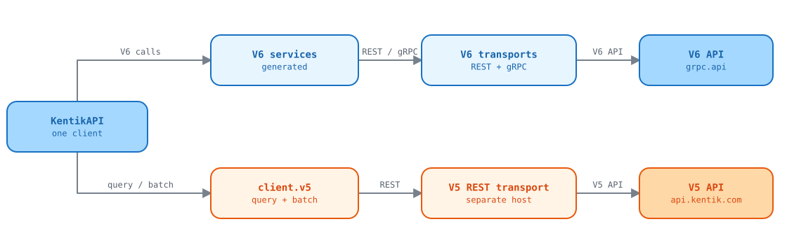

# V5 (1.x) features compared with V6 (2.x)

This report lists what the V5 SDK on `origin/main` (last release `v1.0.7`)
gave users, and what the V6 SDK on `feat/v6-sdk` keeps, changes, or drops. It
was written on 2026-10-16 from `git show origin/main:<path>` and the
`feat/v6-sdk` working tree. [The migration guide](../../docs/sphinx/guides/migrating-from-1x.md)
already records some of these gaps for users.

Status values:

- Kept: V6 has the same capability, maybe under a new name.
- Partial: V6 has part of it, or needs a workaround.
- Missing: V6 has nothing for it.

## Summary of losses, by user impact

| Rank | Loss | Why it matters | Can the SDK restore it? |
| --- | --- | --- | --- |
| 1 | Query API (`query.sql`, `query.data`, `query.chart`, `query.url`) and the `analytics` package | It was the only way to pull flow and traffic data into scripts and pandas | Done in feature 005: `client.v5.top_x_data`, `top_x_chart` (not verified), `query_url`, and the `analytics` extra. `sql` is retired |
| 2 | Batch API for flow tags and populators | Bulk sync from a CMDB or IPAM becomes many single calls, which is slower and uses more quota | Done in feature 005: `client.v5.batch_tags`, `batch_populators`, `batch_status`, and the batch helpers in `v5_tools` |
| 3 | Automatic retry on 429, 502, 503, and 504 | Batch scripts recovered from rate limits without code. Now they fail | Yes, but retrying a write is unsafe. A caller-side retry on 429 is the safer design |
| 4 | Tolerance of unknown enum values (V5 ADR 0003) | A new enum value from the API now fails the whole call with a 502 until the SDK is regenerated | No. V6 keeps strict enum parsing. |
| 5 | Alert list and alert history semantics | Every alert-polling integration needs a rewrite | Yes. `alerting.alert_list` with `states` and `startedAt` returns cleared alerts (verified live) |
| 6 | Credential profiles and `KTAPI_*` variables | Existing environments and `~/.kentik/<profile>` files stop working | Yes, with a small helper |
| 7 | `DeviceCache` | Scripts that map device or interface names to objects or speeds must build their own lookup | Done in feature 005: `kentik_api.devices.DeviceLookup`, saved as JSON |
| 8 | User-Agent header and debug logging | Kentik loses SDK usage data, and users lose request traces | Yes, a few lines in the runtime |
| 9 | `proxy=` argument, SOCKS proxies, and custom hosts | Private or staging Kentik hosts and SOCKS users have no client option | Yes, small changes to `KentikAPI` and `APIConfig` |
| 10 | Mutating examples and examples for 7 services | No copy-paste recipes for create, update, or delete | Yes, examples only |

## Current request routing

V6 and V5 calls use separate transport paths. The V5 path supports the query
and batch endpoints that have no V6 equivalent.

<picture>
  <source media="(prefers-color-scheme: dark)" srcset="../assets/v5-routing-dark.svg">
  <source media="(prefers-color-scheme: light)" srcset="../assets/v5-routing-light.svg">
  
</picture>

Open the [interactive V5/V6 routing explorer](v5-feature-parity-audit.html) to
select a transport path and inspect its role and evidence.

## Analytics support (`kentik_api.analytics`)

V5 path: `kentik_api/analytics/` with `mapped_query.py`, `flatness.py`,
`data_frame_cache.py`, and a README. It shipped with the optional extra
`kentik-api[analytics]`, which installed pandas, PyYAML, and fastparquet.

What it provided:

- Saved query definitions. `SQLQueryDefinition` and `DataQueryDefinition`
  hold a query and a column mapping, written in Python or in a YAML file, with
  `{start}` and `{end}` placeholders.
- Results as pandas DataFrames. `get_data(api, start=..., end=...)` runs the
  query and returns a DataFrame. A top-X query returns one DataFrame for each
  bucket, and it can unpack the time series of each row.
- A local cache. `DFCache` stores DataFrames as parquet files by time range,
  fetches only the missing time steps, and removes duplicate rows.
- Flat-traffic detection. `flatness_analysis` uses `DeviceCache` to get
  interface speeds, converts traffic to percent of link use, and reports time
  windows where outbound traffic on a link stayed flat. On a perimeter link,
  flat traffic suggests a bandwidth limit in a peer network.

Who used it: data scientists and network engineers who analyze flow data in
notebooks or scheduled jobs.

What users lose: there is no way to get flow or traffic data through the SDK,
as DataFrames or in any other form. The two analytics examples cannot be
ported.

Why V6 does not have it: the analytics package called `POST /api/v5/query/sql`
and `POST /api/v5/query/topXdata`. The V6 schema publishes no query, SQL, or
top-X service. `journeys.get_nlq` converts a plain-English question to a query
object but does not run it.

What can be restored:

- The pandas-only parts (`DFCache`, `dedup_data_frame`, the flatness
  statistics) do not call the API. They work on DataFrames from any source.
- The query parts need a query endpoint. That needs either upstream schema
  work or a hand-written V5 query client outside the generator.
- If the YAML mapping is ported, remove the `@fixup:` mapping type. It runs
  `eval()` on text from the YAML file, which allows code injection.

The [rate limiting guide](../../docs/sphinx/guides/rate_limiting.md) still quotes
a separate Query API limit from the Kentik Knowledge Base.

## Live check of the V5 API (2026-10-16)

[`scripts/v5/live_probe.py`](../scripts/v5/live_probe.py) sent read-only calls to
`https://api.kentik.com` with the project credentials. It prints status codes,
response shapes, and quota headers only. The
[Admin APIs](https://kb.kentik.com/docs/admin-apis) and
[Query API](https://kb.kentik.com/docs/query-api) pages of the Kentik
Knowledge Base mark V5 as deprecated, but list these endpoints.

| V5 endpoint | Result | V6 equivalent |
| --- | --- | --- |
| `GET /users`, `/devices`, `/deviceLabels`, `/plans`, `/sites`, `/tags`, `/customdimensions`, `/saved-filters/custom` | 200 | Yes: `user`, `device`, `label`, `plan`, `site`, `flow_tag`, `custom_dimension`, `saved_filter` |
| `GET /customApplications` | 404 | Yes: `custom_application` |
| `GET /mykentik/tenants` | 404 | Yes: `mkp` |
| `GET /alerts-active/alarms`, `/alerts-active/alerts-history` | 200 | Yes: `alerting.alert_list`. A live call with `states=[ALERT_STATE_CLEAR]` and a 30-day `startedAt` returned 138 cleared alerts |
| `POST /alerts/manual-mitigate` | Not called (writes) | Yes: `alerting.mitigations_create` |
| `POST /query/topXdata` and `/api/next/v5/query/topXdata` | 200, with `results[].bucket` and `results[].data` rows | None |
| `POST /query/url` | 200, a JSON string with a portal link | None |
| `POST /query/topXchart` | No response in 180 s, for SVG and PNG. A manual retest with the Knowledge Base example body also timed out, while `topXdata` answered the same body in 1.4 s | None |
| `POST /query/sql` | 403 `Access Denied`. The Knowledge Base says Kentik retired it on 2025-05-01 | None |
| `GET /batch/<guid>/status` | 404 `Could not find this batch` for an unknown ID, so the endpoint answers | None |
| `POST /batch/tags`, `/batch/customdimensions/<name>/populators` | Not called (writes) | None. V6 `device` has bulk calls, but only for devices |

Other findings:

- V5 sends no `X-RateLimit-*` headers. V6 sends `x-ratelimit-limit`,
  `x-ratelimit-remaining`, and `x-ratelimit-reset`. So the SDK cannot report
  quota for a V5 call.
- A query needs `device_name` even when `all_selected` is true. Without it, the
  API returns 400 `The device_name is required`.
- V5 uses its own hosts: `https://api.kentik.com/api/v5` (US) and
  `https://api.kentik.eu/api/v5` (EU). V6 REST uses `grpc.api.kentik.com`.
- A V6 `alert_list` call with `states=[ALERT_STATE_ACTIVE]` and a `startedAt`
  range returned 400 `backend request error`. Investigate before you document
  active-alert polling with a time filter.

Result: only the query (`topXdata`, `url`, and maybe `topXchart`) and batch
endpoints have no V6 equivalent. Every other V5 endpoint has one, so the SDK
maps those in the migration guide instead of adding them again.

## API resources

Even where a row says Kept, the method names and the models changed. V5
hand-written classes became generated Pydantic models.

| V5 operation | V6 equivalent | Status |
| --- | --- | --- |
| `sites.get_all`, `get`, `create`, `update`, `delete` | `site.list_sites`, `get_site`, `create_site`, `update_site`, `delete_site` | Kept. Fields renamed (`site_name` to `title`, `latitude` to `lat`) |
| `devices.get_all`, `get`, `create`, `update`, `delete` | `device.list_devices`, `get_device`, `create_device`, `update_device`, `delete_device` | Kept. V6 adds bulk calls and `get_device_by_name` |
| `devices.apply_labels` | `device.update_labels` | Kept |
| `devices.interfaces.get_all(device_id)` | `interface.list_interface` with `filters.deviceIds` | Partial. Interfaces are not nested under a device |
| `devices.interfaces.get`, `create`, `update`, `delete` | `interface.interface_get`, `interface_create`, `interface_update`, `interface_delete` | Kept |
| `device_labels.get_all`, `create`, `update`, `delete` | `label.list_labels`, `create_label`, `update_label`, `delete_label` | Kept |
| `device_labels.get` | None | Partial. List the labels and filter |
| `users.*` | `user.list_users`, `get_user`, `create_user`, `update_user`, `delete_user` | Kept. V6 adds token and session reset |
| `tags.get_all` | `flow_tag.search_flow_tag` | Partial. Page through the search |
| `tags.get`, `create`, `update`, `delete` | `flow_tag.get_flow_tag`, `create_flow_tag`, `update_flow_tag`, `delete_flow_tag` | Kept |
| `saved_filters.*` | `saved_filter.*` | Kept |
| `custom_dimensions.*` and `populators.*` | `custom_dimension.*` (get is `get_info`) | Kept. V6 adds `get_populator` |
| `custom_applications.*` | `custom_application.*` | Kept. V6 adds a get call |
| `plans.get_all` | `plan.list_plans` | Kept |
| `my_kentik_portal.get_all`, `get`, `create_tenant_user`, `delete_tenant_user` | `mkp.tenant_list`, `tenant_get`, `tenant_user_create`, `tenant_user_delete` | Kept. V6 adds tenant and package management |
| `alerting.create_manual_mitigation` | `alerting.mitigations_create` | Kept, with a new model that uses platform and method IDs |
| `alerting.get_active_alerts` | `alerting.alert_list` | Partial. Filters move into a request body with different semantics |
| `alerting.get_alerts_history` | `alerting.alert_list` with `states` and `startedAt` filters | Kept. Verified live on 2026-10-16 |
| `batch.batch_operation_on_flow_tags`, `batch_operation_on_populators`, `get_status` | `v5.batch_tags`, `batch_populators`, `batch_status` | Kept (feature 005), REST only |
| `query.data`, `query.chart`, `query.url` | `v5.top_x_data`, `top_x_chart`, `query_url` | Kept (feature 005), REST only. `top_x_chart` not verified |
| `query.sql` | None | Missing. Kentik retired the endpoint on 2025-05-01 |
| `synthetics` agents, tests, results, traces | `synthetics.*` (v202309) | Kept. `private_only` filtering moves to the caller |
| `cloud_export.get_all`, `get`, `create`, `update`, `delete` | `cloud_export.*` (v202506) | Kept |
| `cloud_export.patch` (field mask) | None | Partial. Read, change, and write back the whole object |

V6 also adds 22 services that V5 never had, for example `audit`,
`bgp_monitoring`, `capacity_plan`, `cost`, `credential`, `journeys`, `kmi`,
`notification_channel`, and `rbux`.

## Utilities (`kentik_api.utils`)

| V5 helper | What it provided | V6 status |
| --- | --- | --- |
| `get_credentials`, `get_url`, `get_proxy` | Named JSON profiles in `$KTAPI_CFG_FILE`, `$KTAPI_HOME/.kentik/<profile>`, or `~/.kentik/<profile>`, then the `KTAPI_AUTH_EMAIL`, `KTAPI_AUTH_TOKEN`, `KTAPI_URL`, and `KTAPI_PROXY` variables | Partial. V6 reads arguments, then `KENTIK_EMAIL` and `KENTIK_API_TOKEN`, then a `.env` file. No profiles and no `KTAPI_*` names |
| `DeviceCache` | Loads all devices once, looks them up by ID or name, builds `device:interface` link names, returns link speeds, and saves to a pickle file | Kept as `kentik_api.devices.DeviceLookup` (feature 005). Saves JSON, not pickle |
| `time_seq` | Yields datetimes in fixed steps for the analytics cache | Missing. Only useful with analytics |

If `DeviceCache` is restored, save to JSON, not pickle. Loading a pickle file
from an untrusted source runs code.

## Connection behavior

| Behavior | V5 | V6 | Status |
| --- | --- | --- | --- |
| Auth headers | `X-CH-Auth-Email`, `X-CH-Auth-API-Token` | Same headers, also on gRPC | Kept |
| Retries | 3 retries with backoff on 429, 502, 503, 504, for every method. Replaceable with `retry_strategy=` | 2 retries of a failed connection only. No retry after a response | Partial, by design: V6 never sends a write twice |
| Rate limits | `RateLimitExceededError`, usually absorbed by the retries | `HTTPException` with `status_code == 429` and a `rate_limit` attribute. Quota recorded per endpoint | Changed. More information, no automatic backoff |
| Timeouts | Connect 10 s, read 60 s, REST only | `timeout`, `rest_timeout`, `grpc_deadline`, and `with_timeout()` per call | Kept and improved |
| Proxy | `proxy=` argument or `KTAPI_PROXY`. SOCKS supported | Standard proxy variables only. No SOCKS | Partial |
| Host | Any host through `api_host=` | `region="us"` or `"eu"`. A custom REST host only per call | Partial |
| Logging | Debug log of each request | None | Missing |
| User-Agent | `kentik_community_sdk_python/<version>` | Library default | Missing |
| Unknown enum values | Accepted (ADR 0003) | Rejected. The call raises `HTTPException(502)` | Changed. Reliability risk |

## Errors

| V5 | V6 |
| --- | --- |
| `KentikAPIError` | `KentikError` |
| `AuthError` (401 and 403) | `AuthenticationError` (401). A 403 is an `HTTPException` |
| `TimedOutError`, `UnavailabilityError`, `IntermittentError` | `TransportError` |
| `BadRequestError`, `NotFoundError`, `RateLimitExceededError`, `ProtocolError` | `HTTPException` with `status_code`, and a generated class for each operation |
| `DataFormatError`, `DeserializationError`, `IncompleteObjectError` | Pydantic validation, or `HTTPException(502)` for an unusable response |

V6 has no "safe to retry" base class like `IntermittentError`. Callers check
`status_code` instead.

## Packaging, imports, and tooling

| Item | V5 | V6 | Status |
| --- | --- | --- | --- |
| Package name | `kentik-api` | `kentik-api` | Kept. Users who do not pin `<2` get the breaking upgrade |
| Python | 3.8 and later | 3.12 and later | Changed. Users on 3.8 to 3.11 cannot install 2.x |
| Extra `[analytics]` | pandas, PyYAML, fastparquet | pandas, pyarrow, PyYAML | Kept (feature 005) |
| `py.typed` | No | Yes | Added |
| `from kentik_api import KentikAPI` | Works | Works, new keyword arguments | Kept |
| `kentik_api.public.*`, `kentik_api.utils`, `kentik_api.analytics`, `kentik_api.api_calls` | Public modules | `ModuleNotFoundError` | Missing. Models are in `kentik_api.gen.<service>.models` |
| Model and error imports from `kentik_api` | `Device`, `Site`, `AuthError`, and others | `ImportError`. Top level exports `KentikAPI`, `RateLimit`, `rate_limit_of` | Changed |
| `__version__` | Yes | No | Missing |
| CI | Format, mypy, and unit tests; one wheel per Python version; twine upload | Tests on 3.12 to 3.14, type check, lint, changelog gate, drift check, docs build, clean-venv wheel test, trusted publishing, weekly schema sync | Kept and expanded |
| Tests | About 254 functions, including real create and delete for synthetics and cloud export | About 3,470 mocked cases and 470 opt-in read-only e2e cases | Kept and expanded. The e2e layer no longer creates or deletes anything |
| ADRs (`docs/adr/`) | Three Nygard-style records | None. Decisions live in CLAUDE.md, CONTEXT.md, and `specs/` | Replaced. ADR 0002 (one `ID` type) and ADR 0003 (permissive enums) are reversed |

## Examples

V5 examples ran full create, update, and delete cycles. V6 examples only list
resources, on REST and gRPC.

| V5 example | V6 status |
| --- | --- |
| `sites_example.py`, `devices_example.py`, `labels_example.py`, `users_example.py`, `synthetics_example.py`, `alerting_example.py` | Partial. A list-only version exists in `examples/<service>/` |
| `error_handling_example.py` | Kept as `examples/common/error_handling.py` |
| `applications_example.py`, `dimensions_example.py`, `tags_example.py`, `saved_filters_example.py`, `plans_example.py`, `my_kentik_portal_example.py`, `cloud_export_example.py` | Missing. The services exist, but no example |
| `bulk_user_create.py` (users from a YAML file) | Missing |
| `batch_example.py`, `queries_example.py`, `analytics_example_topx.py` | Kept as `examples/v5/` (feature 005) |
| `analytics_example_sql.py`, `demos/queries_visualisation_demo.ipynb` | Missing. The SQL endpoint is retired, and the notebook is out of scope |

## Recommended follow-up

1. Done: Kentik confirmed that the V5 query and batch endpoints still answer
   and that a V6 query service is planned. The live check above confirms it,
   except for `query/sql` (retired) and `query/topXchart` (no response).
   Feature 005 (`specs/005-v5-query-batch/`) covers the rest.
2. Accept unknown enum values in response models, as V5 did, so that a new
   value from the API does not fail calls.
3. Add a User-Agent header and debug logging to `request_json()` and
   `call_grpc()`.
4. Add a documented caller-side retry recipe for 429 to the rate limiting
   guide, using `exc.rate_limit`.
5. Decide whether to add small helpers: credential profiles, `DeviceCache`
   (JSON, not pickle), a `proxy=` argument, and a custom host.
6. Add create, update, and delete examples, and examples for the 7 services
   that have none.
